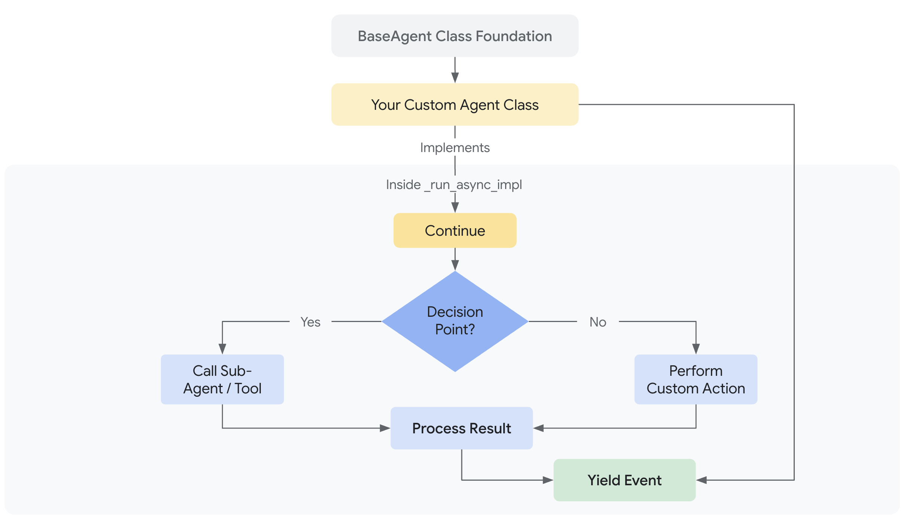

# カスタムエージェント

<div class="language-support-tag">
  <span class="lst-supported">ADKでサポート</span><span class="lst-python">Python v0.1.0</span><span class="lst-typescript">Typescript v0.2.0</span><span class="lst-go">Go v0.1.0</span><span class="lst-java">Java v0.1.0</span><span class="lst-kotlin">Kotlin v0.1.0</span>
</div>

カスタムエージェントは、`BaseAgent`を直接継承し、独自の制御フローを実装することで**任意のオーケストレーションロジック**を定義でき、ADKにおいて究極の柔軟性を提供します。これは、`SequentialAgent`、`LoopAgent`、`ParallelAgent`といった事前定義されたパターンを超え、非常に特殊で複雑なエージェントワークフローを構築することを可能にします。

!!! warning "代替手段: グラフベースのワークフロー"

    ADK 2.0 以降、`BaseAgent` を使用するエージェントベースのワークフローは、[グラフベースのワークフロー](/ja/graphs/) や [動的ワークフロー](/ja/graphs/dynamic/) を含む、より柔軟なワークフロー構造に置き換えられました。対象のワークフロー用にカスタムエージェントを構築する***前に***、これらのワークフローメカニズムの機能を評価することをお勧めします。

!!! warning "高度な概念"

    `_run_async_impl`（または他の言語での同等のメソッド）を直接実装してカスタムエージェントを構築することは、強力な制御を提供しますが、事前定義された`LlmAgent`や標準の`WorkflowAgent`タイプを使用するよりも複雑です。カスタムオーケストレーションロジックに取り組む前に、これらの基本的なエージェントタイプをまず理解することをお勧めします。

## はじめに：事前定義されたワークフローを超えて

### カスタムエージェントとは？

カスタムエージェントとは、本質的に`google.adk.agents.BaseAgent`を継承し、その中核となる実行ロジックを`_run_async_impl`非同期メソッド内に実装して作成する任意のクラスです。このメソッドが他のエージェント（サブエージェント）をどのように呼び出し、状態を管理し、イベントを処理するかを完全に制御できます。

!!! Note
    エージェントの中核となる非同期ロジックを実装するための特定のメソッド名は、SDKの言語によって若干異なる場合があります（例：Javaでは`runAsyncImpl`、Pythonでは`_run_async_impl`）。詳細は、各言語のAPIドキュメントを参照してください。

### なぜ使用するのか？

標準の[ワークフローエージェント](workflow-agents/index.md)（`SequentialAgent`、`LoopAgent`、`ParallelAgent`）は一般的なオーケストレーションパターンをカバーしていますが、要件に以下が含まれる場合はカスタムエージェントが必要になります。

*   **条件付きロジック:** 実行時の条件や前のステップの結果に基づいて、異なるサブエージェントを実行したり、異なるパスをたどる場合。
*   **複雑な状態管理:** 単純な逐次的な受け渡しを超えて、ワークフロー全体で状態を維持・更新するための複雑なロジックを実装する場合。
*   **外部との統合:** オーケストレーションのフロー制御内で、外部API、データベース、またはカスタムライブラリへの呼び出しを直接組み込む場合。
*   **動的なエージェント選択:** 状況や入力の動的な評価に基づいて、次に実行するサブエージェントを選択する場合。
*   **独自のワークフローパターン:** 標準的なシーケンシャル、パラレル、またはループ構造に適合しないオーケストレーションロジックを実装する場合。



## カスタムロジックの実装：

すべてのカスタムエージェントの中核は、その独自の非同期動作を定義するメソッドです。このメソッドにより、サブエージェントをオーケストレーションし、実行の流れを管理できます。

=== "Python"

      すべてのカスタムエージェントの中心は`_run_async_impl`メソッドです。ここで独自の動作を定義します。
      
      *   **シグネチャ:** `async def _run_async_impl(self, ctx: InvocationContext) -> AsyncGenerator[Event, None]:`
      *   **非同期ジェネレーター:** `async def`関数であり、`AsyncGenerator`を返す必要があります。これにより、サブエージェントや自身のロジックによって生成されたイベントを`yield`でランナーに返すことができます。
      *   **`ctx` (InvocationContext):** 重要な実行時情報、特に`ctx.session.state`へのアクセスを提供します。これは、カスタムエージェントがオーケストレーションするステップ間でデータを共有する主要な方法です。
      *   **ライブ音声および動画の実行:** `_run_async_impl`メソッドは非ライブ実行（`run_async()`）のみを対象としています。`run_live()`をサポートするには、同じシグネチャを持つ`_run_live_impl`もオーバーライドしてください。このオーバーライドがない場合、ライブ実行は`NotImplementedError`を送出します。

=== "Go"

    Goでは、`agent.Config` 内の `Run` 関数を `agent.New` に渡すことでカスタムエージェントを作成します。`agent.Agent` インターフェースには非公開（unexported）のメソッドが含まれているため、直接実装することはできません。実際のロジックは通常、カスタムエージェント構造体のメソッドとなり、それを `Run` として渡します。

    *   **シグネチャ:** `Run(ctx agent.InvocationContext) iter.Seq2[*session.Event, error]`
    *   **イテレータ:** `Run`メソッドは、イベントとエラーを生成するイテレータ（`iter.Seq2`）を返します。これは、エージェントの実行からストリーミング結果を処理する標準的な方法です。
    *   **`ctx` (InvocationContext):** `agent.InvocationContext`は、状態を含むセッションやその他の重要な実行時情報へのアクセスを提供します。
    *   **セッション状態:** `ctx.Session().State()`を介してセッション状態にアクセスできます。

=== "Java"

    すべてのカスタムエージェントの中心は、`BaseAgent`からオーバーライドする`runAsyncImpl`メソッドです。

    *   **シグネチャ:** `protected Flowable<Event> runAsyncImpl(InvocationContext ctx)`
    *   **リアクティブストリーム (`Flowable`):** `io.reactivex.rxjava3.core.Flowable<Event>`を返す必要があります。この`Flowable`は、カスタムエージェントのロジックによって生成されるイベントのストリームを表し、しばしば複数のサブエージェントからの`Flowable`を組み合わせたり変換したりして作成されます。
    *   **`ctx` (InvocationContext):** 重要な実行時情報、特に`java.util.concurrent.ConcurrentMap<String, Object>`である`ctx.session().state()`へのアクセスを提供します。これは、カスタムエージェントがオーケストレーションするステップ間でデータを共有する主要な方法です。

**中核となる非同期メソッド内の主要な機能：**

=== "Python"

    1. **サブエージェントの呼び出し:** `run_async`メソッドを使用して（通常は`self.my_llm_agent`などのインスタンス属性として格納されている）サブエージェントを呼び出し、そのイベントをyieldします。

          ```python
          async for event in self.some_sub_agent.run_async(ctx):
              # オプションでイベントを検査またはログ記録
              yield event # イベントを上位に渡す
          ```

    2. **状態管理:** セッション状態辞書（`ctx.session.state`）の読み書きを行い、サブエージェントの呼び出し間でデータを渡したり、意思決定を行ったりします。
          ```python
          # 前のエージェントが設定したデータを読み込む
          previous_result = ctx.session.state.get("some_key")
      
          # 状態に基づいて意思決定
          if previous_result == "some_value":
              # ... 特定のサブエージェントを呼び出す ...
          else:
              # ... 別のサブエージェントを呼び出す ...
      
          # 後のステップのために結果を保存する（サブエージェントのoutput_keyを介して行われることが多い）
          # ctx.session.state["my_custom_result"] = "calculated_value"
          ```

    3. **制御フローの実装:** 標準のPython構文（`if`/`elif`/`else`、`for`/`while`ループ、`try`/`except`）を使用して、サブエージェントを含む洗練された、条件付きまたは反復的なワークフローを作成します。

=== "Go"

    1. **サブエージェントの呼び出し:** `Run`メソッドを呼び出してサブエージェントを起動します。

          ```go
          // 例：サブエージェントを1つ実行し、そのイベントをyieldする
          for event, err := range someSubAgent.Run(ctx) {
              if err != nil {
                  // エラーを処理または伝播する
                  return
              }
              // イベントを呼び出し元にyieldする
              if !yield(event, nil) {
                return
              }
          }
          ```

    2. **状態管理:** セッション状態の読み書きを行い、サブエージェントの呼び出し間でデータを渡したり、意思決定を行ったりします。
          ```go
          // `ctx`（`agent.InvocationContext`）はエージェントの`Run`関数に直接渡される
          // 前のエージェントが設定したデータを読み込む
          previousResult, err := ctx.Session().State().Get("some_key")
          if err != nil {
              // キーがまだ存在しない可能性のあるケースを処理
          }

          // 状態に基づいて意思決定
          if val, ok := previousResult.(string); ok && val == "some_value" {
              // ... 特定のサブエージェントを呼び出す ...
          } else {
              // ... 別のサブエージェントを呼び出す ...
          }

          // 後のステップのために結果を保存する
          if err := ctx.Session().State().Set("my_custom_result", "calculated_value"); err != nil {
              // エラー処理
          }
          ```

    3. **制御フローの実装:** 標準のGo構文（`if`/`else`、`for`/`switch`ループ、ゴルーチン、チャネル）を使用して、サブエージェントを含む洗練された、条件付きまたは反復的なワークフローを作成します。

=== "Java"

    1. **サブエージェントの呼び出し:** 非同期実行メソッドを使用して（通常はインスタンス属性やオブジェクトとして格納されている）サブエージェントを呼び出し、そのイベントストリームを返します。

           通常、`concatWith`、`flatMapPublisher`、`concatArray`などのRxJava演算子を使用して、サブエージェントからの`Flowable`を連鎖させます。

           ```java
           // 例：サブエージェントを1つ実行
           // return someSubAgent.runAsync(ctx);
      
           // 例：サブエージェントを順次実行
           Flowable<Event> firstAgentEvents = someSubAgent1.runAsync(ctx)
               .doOnNext(event -> System.out.println("エージェント1からのイベント: " + event.id()));
      
           Flowable<Event> secondAgentEvents = Flowable.defer(() ->
               someSubAgent2.runAsync(ctx)
                   .doOnNext(event -> System.out.println("エージェント2からのイベント: " + event.id()))
           );
      
           return firstAgentEvents.concatWith(secondAgentEvents);
           ```
           `Flowable.defer()`は、後続ステージの実行が前のステージの完了や状態に依存する場合によく使用されます。

    2. **状態管理:** セッション状態の読み書きを行い、サブエージェントの呼び出し間でデータを渡したり、意思決定を行ったりします。セッション状態は`ctx.session().state()`を介して取得される`java.util.concurrent.ConcurrentMap<String, Object>`です。
        
        ```java
        // 前のエージェントが設定したデータを読み込む
        Object previousResult = ctx.session().state().get("some_key");

        // 状態に基づいて意思決定
        if ("some_value".equals(previousResult)) {
            // ... 特定のサブエージェントのFlowableを含めるロジック ...
        } else {
            // ... 別のサブエージェントのFlowableを含めるロジック ...
        }

        // 後のステップのために結果を保存する（サブエージェントのoutput_keyを介して行われることが多い）
        // ctx.session().state().put("my_custom_result", "calculated_value");
        ```

    3. **制御フローの実装:** 標準の言語構文（`if`/`else`、ループ、`try`/`catch`）とリアクティブ演算子（RxJava）を組み合わせて、洗練されたワークフローを作成します。

          *   **条件付き:** 条件に基づいてどの`Flowable`を購読するかを選択するための`Flowable.defer()`、またはストリーム内でイベントをフィルタリングする場合は`filter()`。
          *   **反復:** `repeat()`、`retry()`などの演算子、または条件に基づいて`Flowable`チェーンの一部を再帰的に呼び出すように構造化する（`flatMapPublisher`や`concatMap`で管理されることが多い）。

## サブエージェントと状態の管理

通常、カスタムエージェントは他のエージェント（`LlmAgent`、`LoopAgent`など）をオーケストレーションします。

*   **初期化:** 通常、これらのサブエージェントのインスタンスをカスタムエージェントのコンストラクタに渡し、インスタンスフィールド/属性として格納します（例: `this.story_generator = story_generator_instance` または `self.story_generator = story_generator_instance`）。これにより、カスタムエージェントの中核となる非同期実行ロジック（`_run_async_impl`メソッドなど）内からアクセス可能になります。Pythonでは、`BaseAgent`は`extra='forbid'`で構成されたPydanticモデルであるため、保持する各サブエージェントを`story_generator: LlmAgent`のような型注釈付きのクラスレベルフィールドとして宣言し、`super().__init__(...)`に渡す必要があります。`__init__`で未宣言の属性を代入すると`ValueError`が発生します。
*   **サブエージェントリスト:** `super()`コンストラクタを使用して`BaseAgent`を初期化する際に、`sub agents`リストを渡すべきです。このリストは、このカスタムエージェントの直接の階層に属するエージェントをADKフレームワークに伝えます。これは、中核となる実行ロジック（`_run_async_impl`）が`self.xxx_agent`を介してエージェントを直接呼び出す場合でも、ライフサイクル管理、イントロスペクション、そして将来のルーティング機能などのフレームワーク機能にとって重要です。カスタムロジックがトップレベルで直接呼び出すエージェントを含めてください。
*   **状態:** 前述の通り、`ctx.session.state`は、サブエージェント（特に`output key`を使用する`LlmAgent`）が結果をオーケストレーターに返し、オーケストレーターが必要な入力を渡すための標準的な方法です。

## エージェントベースのワークフロープリミティブ

以下のセクションでは、これらのマルチエージェントシステムを効果的に構築および管理できるようにする、エージェント階層、ワークフローエージェント、インタラクションメカニズムといったADKのコアプリミティブについて詳しく説明します。ADKは、マルチエージェントシステム内のインタラクションを構造化し管理することを可能にする、コアとなる構成要素（プリミティブ）を提供します。

!!! Note

    プリミティブの特定のパラメータ名やメソッド名は、SDKの言語によって若干異なる場合があります（例：Pythonの`sub_agents`、Javaの`subAgents`）。詳細については、各言語のAPIドキュメントを参照してください。

### エージェント階層：親エージェントとサブエージェント

マルチエージェントシステムの構成の基礎は、`BaseAgent`で定義された親子関係です。

* **階層の確立:** 親エージェントの初期化時に`sub_agents`引数にエージェントインスタンスのリストを渡すことで、ツリー構造を作成します。ADKは初期化中に各子エージェントに`parent_agent`属性を自動的に設定します。
* **単一の親ルール:** エージェントインスタンスは、サブエージェントとして一度しか追加できません。2番目の親を割り当てようとすると`ValueError`が発生します。
* **重要性:** この階層は[ワークフローエージェント](#workflow-agents-as-orchestrators)のスコープを定義し、LLM駆動の委任の潜在的なターゲットに影響を与えます。`agent.parent_agent`を使用して階層をナビゲートしたり、`agent.find_agent(name)`を使用して子孫エージェントを見つけたりできます。

=== "Python"

    ```python
    # 概念例：階層の定義
    from typing import AsyncGenerator

    from google.adk.agents import LlmAgent, BaseAgent
    from google.adk.agents.invocation_context import InvocationContext
    from google.adk.events import Event


    # カスタムの非LLMエージェントは _run_async_impl を実装する必要があります。
    # BaseAgent を直接インスタンス化すると、実行時に NotImplementedError が送出されます。
    class TaskExecutor(BaseAgent):
        async def _run_async_impl(
            self, ctx: InvocationContext
        ) -> AsyncGenerator[Event, None]:
            yield Event(author=self.name)


    # 個々のエージェントを定義
    greeter = LlmAgent(name="Greeter", model="gemini-flash-latest")
    task_doer = TaskExecutor(name="TaskExecutor") # カスタムの非LLMエージェント


    # 親エージェントを作成し、sub_agents経由で子を割り当て
    coordinator = LlmAgent(
        name="Coordinator",
        model="gemini-flash-latest",
        description="挨拶とタスクを調整します。",
        sub_agents=[ # ここでsub_agentsを割り当て
            greeter,
            task_doer
        ]
    )


    # フレームワークが自動的に設定：
    # assert greeter.parent_agent == coordinator
    # assert task_doer.parent_agent == coordinator
    ```

=== "TypeScript"

    ```typescript
    // 概念例：階層の定義
    import { LlmAgent, BaseAgent, InvocationContext } from '@google/adk';
    import type { Event, createEventActions } from '@google/adk';

    class TaskExecutorAgent extends BaseAgent {
      async *runAsyncImpl(context: InvocationContext): AsyncGenerator<Event, void, void> {
        yield {
          id: 'event-1',
          invocationId: context.invocationId,
          author: this.name,
          content: { parts: [{ text: 'Task completed!' }] },
          actions: createEventActions(),
          timestamp: Date.now(),
        };
      }
      async *runLiveImpl(context: InvocationContext): AsyncGenerator<Event, void, void> {
        this.runAsyncImpl(context);
      }
    }

    // 個々のエージェントを定義
    const greeter = new LlmAgent({name: 'Greeter', model: 'gemini-flash-latest'});
    const taskDoer = new TaskExecutorAgent({name: 'TaskExecutor'}); // カスタムの非LLMエージェント

    // 親エージェントを作成し、subAgents経由で子を割り当て
    const coordinator = new LlmAgent({
        name: 'Coordinator',
        model: 'gemini-flash-latest',
        description: '挨拶とタスクを調整します。',
        subAgents: [ // ここでsubAgentsを割り当て
            greeter,
            taskDoer
        ],
    });

    // フレームワークが自動的に設定：
    // console.assert(greeter.parentAgent === coordinator);
    // console.assert(taskDoer.parentAgent === coordinator);
    ```

=== "Go"

    ```go
    import (
        "google.golang.org/adk/v2/agent"
        "google.golang.org/adk/v2/agent/llmagent"
    )

    --8<-- "examples/go/snippets/agents/multi-agent/main.go:hierarchy"
    ```

=== "Java"

    ```java
    // 概念例：階層の定義
    import com.google.adk.agents.SequentialAgent;
    import com.google.adk.agents.LlmAgent;


    // 個々のエージェントを定義
    LlmAgent greeter = LlmAgent.builder().name("Greeter").model("gemini-flash-latest").build();
    SequentialAgent taskDoer = SequentialAgent.builder().name("TaskExecutor").subAgents(...).build(); // シーケンシャルエージェント


    // 親エージェントを作成し、sub_agentsを割り当て
    LlmAgent coordinator = LlmAgent.builder()
        .name("Coordinator")
        .model("gemini-flash-latest")
        .description("挨拶とタスクを調整します")
        .subAgents(greeter, taskDoer) // ここでsub_agentsを割り当て
        .build();


    // フレームワークが自動的に設定：
    // assert greeter.parentAgent().equals(coordinator);
    // assert taskDoer.parentAgent().equals(coordinator);
    ```

=== "Kotlin"

    ```kotlin
    --8<-- "examples/kotlin/snippets/agents/multi-agent/MultiAgentExample.kt:custom_agent"
    --8<-- "examples/kotlin/snippets/agents/multi-agent/MultiAgentExample.kt:hierarchy"
    ```

### オーケストレーターとしてのワークフローエージェント {#workflow-agents-as-orchestrators}

ADKには、自身でタスクを実行するのではなく、`sub_agents`の実行フローを調整（オーケストレート）する`BaseAgent`から派生した特殊なエージェントが含まれています。

!!! note "Python および TypeScript では非推奨"

    Python および TypeScript では、`SequentialAgent`、`ParallelAgent`、および
    `LoopAgent` は `Workflow` に置き換えられ、非推奨（deprecated）となっています。これらを構築すると
    非推奨の警告が出力され、今後のリリースでクラスが削除される予定です。
    `Workflow` は `LlmAgent` のサブエージェントとして使用できません。

* **[`SequentialAgent`](workflow-agents/sequential-agents.md):** `sub_agents`をリストされた順に一つずつ実行します。
    * **コンテキスト:** *同じ*[`InvocationContext`](../runtime/index.md)を順次渡すことで、エージェントが共有ステートを介して結果を簡単に渡せるようにします。

=== "Python"

    ```python
    # 概念例：シーケンシャルパイプライン
    from google.adk.agents import SequentialAgent, LlmAgent

    step1 = LlmAgent(name="Step1_Fetch", output_key="data") # 出力をstate['data']に保存
    step2 = LlmAgent(name="Step2_Process", instruction="{data}からのデータを処理します。")

    pipeline = SequentialAgent(name="MyPipeline", sub_agents=[step1, step2])
    # pipelineが実行されると、Step2はStep1が設定したstate['data']にアクセスできます。
    ```

=== "TypeScript"

    ```typescript
    // 概念例：シーケンシャルパイプライン
    import { SequentialAgent, LlmAgent } from '@google/adk';

    const step1 = new LlmAgent({name: 'Step1_Fetch', outputKey: 'data'}); // 出力をstate['data']に保存
    const step2 = new LlmAgent({name: 'Step2_Process', instruction: 'Process data from {data}.'});

    const pipeline = new SequentialAgent({name: 'MyPipeline', subAgents: [step1, step2]});
    // pipelineが実行されると、Step2はStep1が設定したstate['data']にアクセスできます。
    ```

=== "Go"

    ```go
    import (
        "google.golang.org/adk/v2/agent"
        "google.golang.org/adk/v2/agent/llmagent"
        "google.golang.org/adk/v2/agent/workflowagents/sequentialagent"
    )

    --8<-- "examples/go/snippets/agents/multi-agent/main.go:sequential-pipeline"
    ```

=== "Java"

    ```java
    // 概念例：シーケンシャルパイプライン
    import com.google.adk.agents.SequentialAgent;
    import com.google.adk.agents.LlmAgent;

    LlmAgent step1 = LlmAgent.builder().name("Step1_Fetch").outputKey("data").build(); // 出力をstate.get("data")に保存
    LlmAgent step2 = LlmAgent.builder().name("Step2_Process").instruction("Process data from {data}.").build();

    SequentialAgent pipeline = SequentialAgent.builder().name("MyPipeline").subAgents(step1, step2).build();
    // pipelineが実行されると、Step2はStep1が設定したstate.get("data")にアクセスできます。
    ```

=== "Kotlin"

    ```kotlin
    --8<-- "examples/kotlin/snippets/agents/multi-agent/MultiAgentExample.kt:sequential_pipeline"
    ```

* **[`ParallelAgent`](workflow-agents/parallel-agents.md):** `sub_agents`を並列で実行します。サブエージェントからのイベントはインターリーブされる可能性があります。
    * **コンテキスト:** 各子エージェントの`InvocationContext.branch`を変更し（例：`ParentBranch.ChildName`）、別個のコンテキストパスを提供します。これは一部のメモリー実装で履歴を分離するのに役立ちます。
    * **ステート:** ブランチが異なっていても、すべての並列の子は*同じ共有*`session.state`にアクセスし、初期ステートの読み取りと結果の書き込みができます（競合状態を避けるために別個のキーを使用）。

=== "Python"

    ```python
    # 概念例：並列実行
    from google.adk.agents import ParallelAgent, LlmAgent

    fetch_weather = LlmAgent(name="WeatherFetcher", output_key="weather")
    fetch_news = LlmAgent(name="NewsFetcher", output_key="news")

    gatherer = ParallelAgent(name="InfoGatherer", sub_agents=[fetch_weather, fetch_news])
    # gathererが実行されると、WeatherFetcherとNewsFetcherが同時に実行されます。
    # 後続のエージェントはstate['weather']とstate['news']を読み取ることができます。
    ```

=== "TypeScript"

    ```typescript
    // 概念例：並列実行
    import { ParallelAgent, LlmAgent } from '@google/adk';

    const fetchWeather = new LlmAgent({name: 'WeatherFetcher', outputKey: 'weather'});
    const fetchNews = new LlmAgent({name: 'NewsFetcher', outputKey: 'news'});

    const gatherer = new ParallelAgent({name: 'InfoGatherer', subAgents: [fetchWeather, fetchNews]});
    // gathererが実行されると、WeatherFetcherとNewsFetcherが同時に実行されます。
    // 後続のエージェントはstate['weather']とstate['news']を読み取ることができます。
    ```

=== "Go"

    ```go
    import (
        "google.golang.org/adk/v2/agent"
        "google.golang.org/adk/v2/agent/llmagent"
        "google.golang.org/adk/v2/agent/workflowagents/parallelagent"
    )

    --8<-- "examples/go/snippets/agents/multi-agent/main.go:parallel-execution"
    ```

=== "Java"

    ```java
    // 概念例：並列実行
    import com.google.adk.agents.LlmAgent;
    import com.google.adk.agents.ParallelAgent;


    LlmAgent fetchWeather = LlmAgent.builder()
        .name("WeatherFetcher")
        .outputKey("weather")
        .build();


    LlmAgent fetchNews = LlmAgent.builder()
        .name("NewsFetcher")
        .instruction("news")
        .build();


    ParallelAgent gatherer = ParallelAgent.builder()
        .name("InfoGatherer")
        .subAgents(fetchWeather, fetchNews)
        .build();


    // gathererが実行されると、WeatherFetcherとNewsFetcherが同時に実行されます。
    // 後続のエージェントはstate['weather']とstate['news']を読み取ることができます。
    ```

=== "Kotlin"

    ```kotlin
    --8<-- "examples/kotlin/snippets/agents/multi-agent/MultiAgentExample.kt:parallel_execution"
    ```

  * **[`LoopAgent`](workflow-agents/loop-agents.md):** `sub_agents`をループ内で順次実行します。
      * **終了:** オプションの`max_iterations`に達した場合、またはいずれかのサブエージェントが`Event Actions`に`escalate=True`を含む[`Event`](../events/index.md)を返した場合にループは停止します。
      * **コンテキストとステート:** 各イテレーションで*同じ*`InvocationContext`を渡すことで、ステートの変更（カウンター、フラグなど）がループ間で持続するようにします。

=== "Python"

      ```python
      # 概念例：条件付きループ
      from google.adk.agents import LoopAgent, LlmAgent, BaseAgent
      from google.adk.events import Event, EventActions
      from google.adk.agents.invocation_context import InvocationContext
      from typing import AsyncGenerator

      class CheckCondition(BaseAgent): # ステートを確認するカスタムエージェント
          async def _run_async_impl(self, ctx: InvocationContext) -> AsyncGenerator[Event, None]:
              status = ctx.session.state.get("status", "pending")
              is_done = (status == "completed")
              yield Event(author=self.name, actions=EventActions(escalate=is_done)) # 完了したらエスカレート

      process_step = LlmAgent(name="ProcessingStep") # state['status']を更新する可能性のあるエージェント

      poller = LoopAgent(
          name="StatusPoller",
          max_iterations=10,
          sub_agents=[process_step, CheckCondition(name="Checker")]
      )
      # pollerが実行されると、Checkerがエスカレートするまで（state['status'] == 'completed'）、
      # または10回のイテレーションが経過するまで、process_stepとCheckerを繰り返し実行します。
      ```

=== "TypeScript"

    ```typescript
    // 概念例：条件付きループ
    import { LoopAgent, LlmAgent, BaseAgent, InvocationContext } from '@google/adk';
    import type { Event, createEventActions, EventActions } from '@google/adk';

    class CheckConditionAgent extends BaseAgent { // ステートを確認するカスタムエージェント
        async *runAsyncImpl(ctx: InvocationContext): AsyncGenerator<Event> {
            const status = ctx.session.state['status'] || 'pending';
            const isDone = status === 'completed';
            yield createEvent({ author: 'check_condition', actions: createEventActions({ escalate: isDone }) });
        }

        async *runLiveImpl(ctx: InvocationContext): AsyncGenerator<Event> {
            // 未実装
        }
    };

    const processStep = new LlmAgent({name: 'ProcessingStep'}); // state['status']を更新する可能性のあるエージェント

    const poller = new LoopAgent({
        name: 'StatusPoller',
        maxIterations: 10,
        // sub_agentsをループ内で順次実行
        subAgents: [processStep, new CheckConditionAgent ({name: 'Checker'})]
    });
    // pollerが実行されると、Checkerがエスカレートするまで（state['status'] === 'completed'）、
    // または10回のイテレーションが経過するまで、processStepとCheckerを繰り返し実行します。
    ```

=== "Go"

    ```go
    import (
        "iter"
        "google.golang.org/adk/v2/agent"
        "google.golang.org/adk/v2/agent/llmagent"
        "google.golang.org/adk/v2/agent/workflowagents/loopagent"
        "google.golang.org/adk/v2/session"
    )

    --8<-- "examples/go/snippets/agents/multi-agent/main.go:loop-with-condition"
    ```

=== "Java"

    ```java
    // 概念例：条件付きループ
    // ステートを確認し、エスカレートする可能性のあるカスタムエージェント
    public static class CheckConditionAgent extends BaseAgent {
      public CheckConditionAgent(String name, String description) {
        super(name, description, List.of(), null, null);
      }

      @Override
      protected Flowable<Event> runAsyncImpl(InvocationContext ctx) {
        String status = (String) ctx.session().state().getOrDefault("status", "pending");
        boolean isDone = "completed".equalsIgnoreCase(status);

        // 条件が満たされた場合、エスカレート（ループを抜ける）を知らせるイベントを発行します。
        // 未完了の場合、escalateフラグはfalseまたは存在せず、ループは継続します。
        Event checkEvent = Event.builder()
                .author(name())
                .id(Event.generateEventId()) // イベントに一意のIDを付与することが重要
                .actions(EventActions.builder().escalate(isDone).build()) // 完了したらエスカレート
                .build();
        return Flowable.just(checkEvent);
      }
    }

    // state.put("status")を更新する可能性のあるエージェント
    LlmAgent processingStepAgent = LlmAgent.builder().name("ProcessingStep").build();
    // 条件をチェックするためのカスタムエージェントインスタンス
    CheckConditionAgent conditionCheckerAgent = new CheckConditionAgent(
        "ConditionChecker",
        "ステータスが'completed'かどうかをチェックします。"
    );
    LoopAgent poller = LoopAgent.builder().name("StatusPoller").maxIterations(10).subAgents(processingStepAgent, conditionCheckerAgent).build();
    // pollerが実行されると、Checkerがエスカレートするまで（state.get("status") == "completed"）、
    // または10回のイテレーションが経過するまで、processingStepAgentとconditionCheckerAgentを繰り返し実行します。
    ```

=== "Kotlin"

    ```kotlin
    --8<-- "examples/kotlin/snippets/agents/multi-agent/MultiAgentExample.kt:check_condition_agent"
    --8<-- "examples/kotlin/snippets/agents/multi-agent/MultiAgentExample.kt:loop_with_condition"
    ```

### インタラクションと通信メカニズム

システム内のエージェントは、しばしば互いにデータを交換したり、アクションをトリガーしたりする必要があります。ADKはこれを以下の方法で容易にします。

#### 共有セッションステート

同じ呼び出し内で動作し、`InvocationContext`を介して同じ[`Session`](/ja/sessions/session/)オブジェクトを共有するエージェントが、受動的に通信するための最も基本的な方法です。

* **メカニズム:** あるエージェント（またはそのツール/コールバック）が値を書き込み（`context.state['data_key'] = processed_data`）、後続のエージェントがそれを読み取ります（`data = context.state.get('data_key')`）。Pythonでは、[`CallbackContext`](../callbacks/index.md)と`ToolContext`は同じデルタ認識（delta-aware）コンテキストクラスであり、`context.state`へのすべての書き込みはエージェントが送出するイベント上の`state_delta`として記録されます。
* **利便性:** [`LlmAgent`](llm-agents.md)の`output_key`プロパティは、エージェントの最終的な応答テキスト（または構造化出力）を指定されたステートキーに自動的に保存します。
* **性質:** 非同期で受動的な通信。`SequentialAgent`によって調整されるパイプラインや、`LoopAgent`のイテレーション間でデータを渡すのに理想的です。
* **参照:** [ステート管理](../sessions/state.md)

!!! note "呼び出しコンテキストと`temp:`ステート"
    親エージェントがサブエージェントを呼び出すとき、同じ`InvocationContext`を渡します。これは、それらが同じ一時的な（`temp:`）ステートを共有することを意味し、現在のターンにのみ関連するデータを渡すのに理想的です。

=== "Python"

    ```python
    # 概念例：output_keyの使用とステートの読み取り
    from google.adk.agents import LlmAgent, SequentialAgent


    agent_A = LlmAgent(name="AgentA", instruction="フランスの首都を見つけてください。", output_key="capital_city")
    agent_B = LlmAgent(name="AgentB", instruction="{capital_city}に保存されている都市について教えてください。")


    pipeline = SequentialAgent(name="CityInfo", sub_agents=[agent_A, agent_B])
    # AgentAが実行され、「Paris」をstate['capital_city']に保存します。
    # AgentBが実行され、そのinstructionプロセッサがstate['capital_city']を読み取って「Paris」を取得します。
    ```

=== "TypeScript"

    ```typescript
    // 概念例：outputKeyの使用とステートの読み取り
    import { LlmAgent, SequentialAgent } from '@google/adk';

    const agentA = new LlmAgent({name: 'AgentA', instruction: 'Find the capital of France.', outputKey: 'capital_city'});
    const agentB = new LlmAgent({name: 'AgentB', instruction: 'Tell me about the city stored in {capital_city}.'});

    const pipeline = new SequentialAgent({name: 'CityInfo', subAgents: [agentA, agentB]});
    // AgentAが実行され、「Paris」をstate['capital_city']に保存します。
    // AgentBが実行され、そのinstructionプロセッサがstate['capital_city']を読み取って「Paris」を取得します。
    ```

=== "Go"

    ```go
    import (
        "google.golang.org/adk/v2/agent"
        "google.golang.org/adk/v2/agent/llmagent"
        "google.golang.org/adk/v2/agent/workflowagents/sequentialagent"
    )

    --8<-- "examples/go/snippets/agents/multi-agent/main.go:output-key-state"
    ```

=== "Java"

    ```java
    // 概念例：outputKeyの使用とステートの読み取り
    import com.google.adk.agents.LlmAgent;
    import com.google.adk.agents.SequentialAgent;


    LlmAgent agentA = LlmAgent.builder()
        .name("AgentA")
        .instruction("Find the capital of France.")
        .outputKey("capital_city")
        .build();


    LlmAgent agentB = LlmAgent.builder()
        .name("AgentB")
        .instruction("Tell me about the city stored in {capital_city}.")
        .outputKey("capital_city")
        .build();


    SequentialAgent pipeline = SequentialAgent.builder().name("CityInfo").subAgents(agentA, agentB).build();
    // AgentAが実行され、「Paris」をstate('capital_city')に保存します。
    // AgentBが実行され、そのinstructionプロセッサがstate.get("capital_city")を読み取って「Paris」を取得します。
    ```

=== "Kotlin"

    ```kotlin
    --8<-- "examples/kotlin/snippets/agents/multi-agent/MultiAgentExample.kt:output_key_state"
    ```

#### LLMによる委任とエージェント移譲 {#delegation}

[`LlmAgent`](llm-agents.md)の理解力を活用して、階層内の他の適切なエージェントにタスクを動的にルーティングします。

* **メカニズム:** エージェントのLLMが特定の関数呼び出しを生成します: `transfer_to_agent(agent_name='target_agent_name')`。
* **処理:** サブエージェントが存在するか、移譲が禁止されていない場合にデフォルトで使用される`AutoFlow`がこの呼び出しを捕捉します。`root_agent.find_agent()`を使用してターゲットエージェントを特定し、`InvocationContext`を更新して実行の焦点を切り替えます。
* **要件:** 呼び出し元の`LlmAgent`には、いつ移譲するかについての明確な`instructions`が必要であり、潜在的なターゲットエージェントには、LLMが情報に基づいた決定を下せるように、明確な`description`が必要です。移譲のスコープ（親、サブエージェント、兄弟）は`LlmAgent`で設定できます。
* **性質:** LLMの解釈に基づく、動的で柔軟なルーティング。

=== "Python"

    ```python
    # 概念設定：LLM移譲
    from google.adk.agents import LlmAgent


    booking_agent = LlmAgent(name="Booker", description="フライトとホテルの予約を処理します。")
    info_agent = LlmAgent(name="Info", description="一般情報を提供し、質問に答えます。")


    coordinator = LlmAgent(
        name="Coordinator",
        model="gemini-flash-latest",
        instruction="あなたはアシスタントです。予約タスクはBookerに、情報要求はInfoに委任してください。",
        description="メインのコーディネーター。",
        # AutoFlowは通常、ここで暗黙的に使用されます
        sub_agents=[booking_agent, info_agent]
    )
    # coordinatorが「フライトを予約して」というリクエストを受け取ると、そのLLMは次を生成するべきです：
    # FunctionCall(name='transfer_to_agent', args={'agent_name': 'Booker'})
    # その後、ADKフレームワークは実行をbooking_agentにルーティングします。
    ```

=== "TypeScript"

    ```typescript
    // 概念設定：LLM移譲
    import { LlmAgent } from '@google/adk';

    const bookingAgent = new LlmAgent({name: 'Booker', description: 'フライトとホテルの予約を処理します。'});
    const infoAgent = new LlmAgent({name: 'Info', description: '一般情報を提供し、質問に答えます。'});

    const coordinator = new LlmAgent({
        name: 'Coordinator',
        model: 'gemini-flash-latest',
        instruction: 'あなたはアシスタントです。予約タスクはBookerに、情報要求はInfoに委任してください。',
        description: 'メインのコーディネーター。',
        // AutoFlowは通常、ここで暗黙的に使用されます
        subAgents: [bookingAgent, infoAgent]
    });
    // coordinatorが「フライトを予約して」というリクエストを受け取ると、そのLLMは次を生成するべきです：
    // {functionCall: {name: 'transfer_to_agent', args: {agent_name: 'Booker'}}}
    // その後、ADKフレームワークは実行をbookingAgentにルーティングします。
    ```

=== "Go"

    ```go
    import (
        "google.golang.org/adk/v2/agent/llmagent"
    )

    --8<-- "examples/go/snippets/agents/multi-agent/main.go:llm-transfer"
    ```

=== "Java"

    ```java
    // 概念設定：LLM移譲
    import com.google.adk.agents.LlmAgent;


    LlmAgent bookingAgent = LlmAgent.builder()
        .name("Booker")
        .description("フライトとホテルの予約を処理します。")
        .build();


    LlmAgent infoAgent = LlmAgent.builder()
        .name("Info")
        .description("一般情報を提供し、質問に答えます。")
        .build();


    // コーディネーターエージェントを定義
    LlmAgent coordinator = LlmAgent.builder()
        .name("Coordinator")
        .model("gemini-flash-latest") // または希望のモデル
        .instruction("あなたはアシスタントです。予約タスクはBookerに、情報要求はInfoに委任してください。")
        .description("メインのコーディネーター。")
        // AutoFlowは、subAgentsが存在し、移譲が禁止されていないため、
        // デフォルトで（暗黙的に）使用されます。
        .subAgents(bookingAgent, infoAgent)
        .build();

    // coordinatorが「フライトを予約して」というリクエストを受け取ると、そのLLMは次を生成するべきです：
    // FunctionCall.builder.name("transferToAgent").args(ImmutableMap.of("agent_name", "Booker")).build()
    // その後、ADKフレームワークは実行をbookingAgentにルーティングします。
    ```

=== "Kotlin"

    ```kotlin
    --8<-- "examples/kotlin/snippets/agents/multi-agent/MultiAgentExample.kt:llm_transfer"
    ```

#### `AgentTool`による明示的な呼び出し

[`LlmAgent`](llm-agents.md)が他の`BaseAgent`インスタンスを呼び出し可能な関数や[ツール](/ja/tools-custom/)として扱うことを可能にします。

* **メカニズム:** ターゲットエージェントインスタンスを`AgentTool`でラップし、親`LlmAgent`の`tools`リストに含めます。`AgentTool`はLLMに対応する関数宣言を生成します。
* **処理:** 親のLLMが`AgentTool`をターゲットとする関数呼び出しを生成すると、フレームワークは`AgentTool.run_async`を実行します。このメソッドはターゲットエージェントを実行し、その最終応答をキャプチャし、ステート/アーティファクトの変更を親のコンテキストに転送し、応答をツールの結果として返します。
* **性質:** 他のツールと同様に、同期的（親のフロー内）、明示的、制御された呼び出し。
* **(注：** `AgentTool`は明示的にインポートして使用する必要があります)。

=== "Python"

    ```python
    # 概念設定：ツールとしてのエージェント
    from google.adk import Event
    from google.adk.agents import LlmAgent, BaseAgent
    from google.adk.tools import agent_tool
    from google.genai import types
    from pydantic import BaseModel


    # ターゲットエージェントを定義（LlmAgentまたはカスタムBaseAgent）
    class ImageGeneratorAgent(BaseAgent): # カスタムエージェントの例
        name: str = "ImageGen"
        description: str = "プロンプトに基づいて画像を生成します。"
        # ... 内部ロジック ...
        async def _run_async_impl(self, ctx): # 簡略化された実行ロジック
            prompt = ctx.session.state.get("image_prompt", "default prompt")
            # ... 画像バイトを生成 ...
            image_bytes = b"..."
            yield Event(author=self.name, content=types.Content(parts=[types.Part.from_bytes(data=image_bytes, mime_type="image/png")]))


    image_agent = ImageGeneratorAgent()
    image_tool = agent_tool.AgentTool(agent=image_agent) # エージェントをラップ


    # 親エージェントがAgentToolを使用
    artist_agent = LlmAgent(
        name="Artist",
        model="gemini-flash-latest",
        instruction="プロンプトを作成し、ImageGenツールを使って画像を生成してください。",
        tools=[image_tool] # AgentToolを含める
    )
    # ArtistのLLMがプロンプトを生成し、次を呼び出します：
    # FunctionCall(name='ImageGen', args={'image_prompt': '帽子をかぶった猫'})
    # フレームワークがimage_tool.run_async(...)を呼び出し、それがImageGeneratorAgentを実行します。
    # 結果の画像Partは、ツール結果としてArtistエージェントに返されます。
    ```

=== "Go"

    ```go
    import (
        "fmt"
        "iter"
        "google.golang.org/adk/v2/agent"
        "google.golang.org/adk/v2/agent/llmagent"
        "google.golang.org/adk/v2/model"
        "google.golang.org/adk/v2/session"
        "google.golang.org/adk/v2/tool"
        "google.golang.org/adk/v2/tool/agenttool"
        "google.golang.org/genai"
    )

    --8<-- "examples/go/snippets/agents/multi-agent/main.go:agent-as-tool"
    ```

=== "Java"

    ```java
    // 概念設定：ツールとしてのエージェント
    import com.google.adk.agents.BaseAgent;
    import com.google.adk.agents.LlmAgent;
    import com.google.adk.tools.AgentTool;

    // カスタムエージェントの例（LlmAgentまたはカスタムBaseAgent）
    public class ImageGeneratorAgent extends BaseAgent  {

      public ImageGeneratorAgent(String name, String description) {
        super(name, description, List.of(), null, null);
      }

      // ... 内部ロジック ...
      @Override
      protected Flowable<Event> runAsyncImpl(InvocationContext invocationContext) { // 簡略化された実行ロジック
        invocationContext.session().state().get("image_prompt");
        // 画像バイトを生成
        // ...

        Event responseEvent = Event.builder()
            .author(this.name())
            .content(Content.fromParts(Part.fromText("\b...")))
            .build();

        return Flowable.just(responseEvent);
      }

      @Override
      protected Flowable<Event> runLiveImpl(InvocationContext invocationContext) {
        return null;
      }
    }

    // AgentToolを使用してエージェントをラップ
    ImageGeneratorAgent imageAgent = new ImageGeneratorAgent("image_agent", "画像を生成します");
    AgentTool imageTool = AgentTool.create(imageAgent);

    // 親エージェントがAgentToolを使用
    LlmAgent artistAgent = LlmAgent.builder()
            .name("Artist")
            .model("gemini-flash-latest")
            .instruction(
                    "あなたはアーティストです。画像の詳細なプロンプトを作成し、" +
                            "'ImageGen'ツールを使って画像を生成してください。" +
                            "'ImageGen'ツールは、画像プロンプトを含む'request'という名前の単一の文字列引数を期待します。" +
                            "ツールは'result'フィールドに'image_base64'、'mime_type'、'status'を含むJSON文字列を返します。"
            )
            .description("生成ツールを使用して画像を作成できるエージェントです。")
            .tools(imageTool) // AgentToolを含める
            .build();

    // ArtistのLLMがプロンプトを生成し、次を呼び出します：
    // FunctionCall(name='ImageGen', args={'imagePrompt': '帽子をかぶった猫'})
    // フレームワークがimageTool.runAsync(...)を呼び出し、それがImageGeneratorAgentを実行します。
    // 結果の画像Partは、ツール結果としてArtistエージェントに返されます。
    ```

=== "Kotlin"

    ```kotlin
    --8<-- "examples/kotlin/snippets/agents/multi-agent/MultiAgentExample.kt:agent_as_tool"
    ```

## デザインパターン例： `StoryFlowAgent`

条件付きロジックを持つ多段階のコンテンツ生成ワークフローという例のパターンで、カスタムエージェントの強力さを示しましょう。

**目標:** 物語を生成し、批評と修正を通じて反復的に洗練させ、最終チェックを行い、そして重要なことに、*最終的なトーンチェックに失敗した場合は物語を再生成する*システムを作成します。

**なぜカスタムか？** ここでカスタムエージェントが必要となる中核的な要件は、**トーンチェックに基づく条件付き再生成**です。標準のワークフローエージェントには、サブエージェントのタスクの結果に基づく条件分岐機能が組み込まれていません。オーケストレーター内にカスタムロジック（`if tone == "negative": ...`）が必要です。

---

### パート1：簡略化されたカスタムエージェントの初期化 { #part-1-simplified-custom-agent-initialization }

=== "Python"

    `BaseAgent`を継承する`StoryFlowAgent`を定義します。`__init__`では、（渡された）必要なサブエージェントをインスタンス属性として格納し、このカスタムエージェントが直接オーケストレーションするトップレベルのエージェントを`BaseAgent`フレームワークに伝えます。
    
    ```python
    --8<-- "examples/python/snippets/agents/custom-agent/storyflow_agent.py:init"
    ```

=== "Go"

    `StoryFlowAgent`構造体とコンストラクタを定義します。コンストラクタでは、必要なサブエージェントを格納し、このカスタムエージェントが直接オーケストレーションするトップレベルのエージェントを`BaseAgent`フレームワークに伝えます。

    ```go
    --8<-- "examples/go/snippets/agents/custom-agent/storyflow_agent.go:init"
    ```

=== "Java"

    `BaseAgent`を拡張して`StoryFlowAgentExample`を定義します。その**コンストラクタ**で、（パラメータとして渡された）必要なサブエージェントのインスタンスをインスタンスフィールドとして格納します。このカスタムエージェントが直接オーケストレーションするこれらのトップレベルのサブエージェントは、`BaseAgent`の`super`コンストラクタにもリストとして渡されます。

    ```java
    --8<-- "examples/java/snippets/src/main/java/agents/StoryFlowAgentExample.java:init"
    ```

---

### パート2：カスタム実行ロジックの定義 { #part-2-defining-the-custom-execution-logic }

=== "Python"

    このメソッドは、標準のPython async/awaitと制御フローを使用してサブエージェントをオーケストレーションします。
    
    ```python
    --8<-- "examples/python/snippets/agents/custom-agent/storyflow_agent.py:executionlogic"
    ```
    **ロジックの説明:**

    1. 初期の`story_generator`が実行されます。その出力は`ctx.session.state["current_story"]`にあると期待されます。
    2. `loop_agent`が実行され、内部で`critic`と`reviser`を`max_iterations`回、順次呼び出します。これらは状態から`current_story`と`criticism`を読み書きします。
    3. `sequential_agent`が実行され、`grammar_check`、次に`tone_check`を呼び出し、`current_story`を読み込んで`grammar_suggestions`と`tone_check_result`を状態に書き込みます。
    4. **カスタム部分:** `if`文が状態から`tone_check_result`をチェックします。もし"negative"であれば、`story_generator`が*再度*呼び出され、状態の`current_story`を上書きします。そうでなければ、フローは終了します。

=== "Go"

    `Run`メソッドは、各サブエージェントの`Run`メソッドをループ内で呼び出し、そのイベントをyieldすることでサブエージェントをオーケストレーションします。

    ```go
    --8<-- "examples/go/snippets/agents/custom-agent/storyflow_agent.go:executionlogic"
    ```
    **ロジックの説明:**

    1. 初期の`storyGenerator`が実行されます。その出力はセッション状態のキー`"current_story"`にあると期待されます。
    2. `revisionLoopAgent`が実行され、内部で`critic`と`reviser`を`max_iterations`回、順次呼び出します。これらは状態から`current_story`と`criticism`を読み書きします。
    3. `postProcessorAgent`が実行され、`grammar_check`、次に`tone_check`を呼び出し、`current_story`を読み込んで`grammar_suggestions`と`tone_check_result`を状態に書き込みます。
    4. **カスタム部分:** コードが状態から`tone_check_result`をチェックします。もし"negative"であれば、`story_generator`が*再度*呼び出され、状態の`current_story`を上書きします。そうでなければ、フローは終了します。

=== "Java"
    
    `runAsyncImpl`メソッドは、RxJavaのFlowableストリームと演算子を使用して、非同期制御フローでサブエージェントをオーケストレーションします。

    ```java
    --8<-- "examples/java/snippets/src/main/java/agents/StoryFlowAgentExample.java:executionlogic"
    ```
    **ロジックの説明:**

    1. 初期の`storyGenerator.runAsync(invocationContext)` Flowableが実行されます。その出力は`invocationContext.session().state().get("current_story")`にあると期待されます。
    2. (`Flowable.concatArray`と`Flowable.defer`により)`loopAgent`のFlowableが次に実行されます。LoopAgentは内部で`critic`と`reviser`サブエージェントを最大`maxIterations`回、順次呼び出します。これらは状態から`current_story`と`criticism`を読み書きします。
    3. 次に、`sequentialAgent`のFlowableが実行されます。これは`grammar_check`、次に`tone_check`を呼び出し、`current_story`を読み込んで`grammar_suggestions`と`tone_check_result`を状態に書き込みます。
    4. **カスタム部分:** sequentialAgentが完了した後、`Flowable.defer`内のロジックが`invocationContext.session().state()`から"tone_check_result"をチェックします。もし"negative"であれば、`storyGenerator`のFlowableが*条件付きで連結*されて再度実行され、"current_story"を上書きします。そうでなければ、空のFlowableが使用され、全体のワークフローは完了へと進みます。

---

### パート3：LLMサブエージェントの定義 { #part-3-defining-the-llm-sub-agents }

これらは特定のタスクを担当する標準の`LlmAgent`定義です。`output key`パラメータは、結果を`session.state`に配置し、他のエージェントやカスタムオーケストレーターがアクセスできるようにするために重要です。

!!! tip "指示文への状態の直接注入"
    `story_generator`の指示文に注目してください。`{var}`構文はプレースホルダーです。指示文がLLMに送信される前に、ADKフレームワークは自動的に（例：`{topic}`）を`session.state['topic']`の値に置き換えます。これは、指示文内でテンプレートを使用してエージェントにコンテキストを提供する推奨方法です。詳細は、[状態のドキュメント](../sessions/state.md#accessing-session-state-in-agent-instructions)を参照してください。

=== "Python"

    ```python
    GEMINI_2_FLASH = "gemini-flash-latest" # モデル定数を定義
    --8<-- "examples/python/snippets/agents/custom-agent/storyflow_agent.py:llmagents"
    ```
=== "Java"

    ```java
    --8<-- "examples/java/snippets/src/main/java/agents/StoryFlowAgentExample.java:llmagents"
    ```

=== "Go"

    ```go
    --8<-- "examples/go/snippets/agents/custom-agent/storyflow_agent.go:llmagents"
    ```

---

### パート4：カスタムエージェントのインスタンス化と実行 { #part-4-instantiating-and-running-the-custom-agent }

最後に、`StoryFlowAgent`をインスタンス化し、通常通り`Runner`を使用します。

=== "Python"

    ```python
    --8<-- "examples/python/snippets/agents/custom-agent/storyflow_agent.py:story_flow_agent"
    ```

=== "Go"

    ```go
    --8<-- "examples/go/snippets/agents/custom-agent/storyflow_agent.go:story_flow_agent"
    ```

=== "Java"

    ```java
    --8<-- "examples/java/snippets/src/main/java/agents/StoryFlowAgentExample.java:story_flow_agent"
    ```

*(注：インポートや実行ロジックを含む完全な実行可能コードは、以下のリンク先にあります。)*

---

### Storyflow エージェントのコード一覧 {#storyflow-agent-code-listing}

???+ "Storyflowエージェント"

    === "Python"
    
        ```python
        # StoryFlowAgentの例の完全な実行可能コード
        --8<-- "examples/python/snippets/agents/custom-agent/storyflow_agent.py"
        ```

    === "TypeScript"

        ```typescript
        // StoryFlowAgentの例の完全な実行可能コード
        --8<-- "examples/typescript/snippets/agents/custom-agent/storyflow_agent.ts"
        ```
    
    === "Go"

        ```go
        // StoryFlowAgentの例の完全な実行可能コード
        --8<-- "examples/go/snippets/agents/custom-agent/storyflow_agent.go:full_code"
        ```

    === "Java"
    
        ```java
        // StoryFlowAgentの例の完全な実行可能コード
        --8<-- "examples/java/snippets/src/main/java/agents/StoryFlowAgentExample.java:full_code"
        ```

## TypeScript の例の補足

英語原文に含まれている TypeScript の StoryFlow 例を以下にも掲載します。

### TypeScript: 初期化

```typescript
--8<-- "examples/typescript/snippets/agents/custom-agent/storyflow_agent.ts:init"
```

### TypeScript: 実行ロジック

```typescript
--8<-- "examples/typescript/snippets/agents/custom-agent/storyflow_agent.ts:executionlogic"
```

### TypeScript: LLM サブエージェント

```typescript
--8<-- "examples/typescript/snippets/agents/custom-agent/storyflow_agent.ts:llmagents"
```

### TypeScript: StoryFlow エージェント

```typescript
--8<-- "examples/typescript/snippets/agents/custom-agent/storyflow_agent.ts:story_flow_agent"
```
