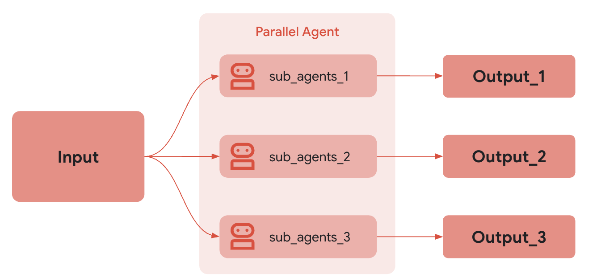

# 並列エージェント

<div class="language-support-tag">
  <span class="lst-supported">ADKでサポート</span><span class="lst-python">Python v0.1.0</span><span class="lst-typescript">TypeScript v0.2.0</span><span class="lst-go">Go v0.1.0</span><span class="lst-java">Java v0.2.0</span><span class="lst-kotlin">Kotlin v0.1.0</span>
</div>

`ParallelAgent`は、サブエージェントを*並列(concurrently)*で実行する[ワークフローエージェント](index.md)です。これにより、タスクが独立して実行可能なワークフローを劇的に高速化します。

速度が重視され、独立したリソース集約型のタスクを伴うシナリオでは、`ParallelAgent` によって効率的な並列実行が可能になります。**サブエージェントが依存関係なしで動作する場合、タスクを並列に実行でき**、全体の処理時間を大幅に短縮できます。

他の[ワークフローエージェント](index.md)と同様に、`ParallelAgent`はLLMによって駆動されないため、その実行方法は決定論的（deterministic）です。ただし、ワークフローエージェントが関与するのはその実行（つまり、サブエージェントを並列実行すること）のみであり、内部ロジックではありません。ワークフローエージェントのツールやサブエージェントは、LLMを利用する場合もあれば、しない場合もあります。

!!! warning "非推奨: グラフベース ワークフローを使用してください"

    ADK Python、TypeScript、Go、および Kotlin では、テンプレート ワークフローは
    [グラフベース ワークフロー](/ja/graphs/) や
    [動的ワークフロー](/ja/graphs/dynamic/) などのより柔軟なワークフロー構造に置き換えられました。

### 例

このアプローチは、複数ソースからのデータ取得や重い計算処理のような操作に特に有益で、並列化によって大幅なパフォーマンス向上が得られます。重要なのは、この戦略では、並列実行されるエージェント間で共有ステートや直接的な情報交換が本質的に不要であると想定している点です。

### 仕組み

`ParallelAgent`の`run_async()`メソッドが呼び出されると：

1.  **並列実行:** `sub_agents`リストに存在する*各*サブエージェントの`run_async()`メソッドを*並列で*開始します。これは、すべてのエージェントが（ほぼ）同時に実行を開始することを意味します。
2.  **独立したブランチ:** 各サブエージェントは独自の実行ブランチで動作し、実行中、これらのブランチ間で会話履歴が***自動的に*共有されることはありません**。サブエージェントが参照できるのは自身のブランチ上のイベントのみです。一方、セッション状態は共有されます。すべてのブランチが同じセッションに対して実行されるため、あるサブエージェントが（たとえば`output_key`を通じて）書き込んだ値は、他のブランチや後続のエージェントから参照できます。
3.  **結果の収集:** `ParallelAgent`はサブエージェントのイベントストリームをマージし、各イベントが生成されるたびにyieldします。後から読み取れるリストに結果をまとめるわけではありません。ブランチがインターリーブされるため、イベントの順序は決定論的ではありません。サブエージェントの結果を使用するには、共有セッション状態（たとえば`output_key`を通じて指定したキー）から読み取ってください。

### 独立した実行と状態管理

`ParallelAgent`内のサブエージェントが独立して実行されることを理解することが*極めて重要です*。これらのエージェント間で通信やデータ共有が*必要な場合*は、明示的に実装する必要があります。考えられるアプローチは以下の通りです。

*   **共有セッション状態:** すべてのブランチは同じセッションに対して実行されるため、各サブエージェントに`output_key`を指定し、後続のエージェントの指示からそれらのキーを読み取ります。ブランチは並列に実行されるため、あるブランチがまだ書き込み中のキーを別のブランチから読み取るような設計には依存しないでください。
*   **外部状態管理:** 外部データベース、メッセージキュー、または他のメカニズムを使用して、共有ステートを管理し、エージェント間の通信を促進します。
*   **後処理 (Post-Processing):** 各ブランチから結果を収集し、その後にデータを調整するロジックを実装します。

{: width="600"}

### 完全な例：並列ウェブ調査

複数のトピックを同時に調査する状況を想像してみてください。

1.  **リサーチャーエージェント1:** 「再生可能エネルギー源」を調査する`LlmAgent`です。
2.  **リサーチャーエージェント2:** 「電気自動車技術」を調査する`LlmAgent`です。
3.  **リサーチャーエージェント3:** 「炭素回収方法」を調査する`LlmAgent`です。

    ```py
    ParallelAgent(name="ParallelWebResearchAgent", sub_agents=[ResearcherAgent1, ResearcherAgent2, ResearcherAgent3])
    ```

これらの調査タスクは独立しています。`ParallelAgent`を使用すると、これらを並列実行でき、シーケンシャルに実行する場合と比較して、総調査時間を大幅に短縮できる可能性があります。後で各エージェントの結果を使用するには、それぞれに`output_key`を指定し、セッション状態からそのキーを読み取ります。

???+ "全コード"

    === "Python"
        ```py
         --8<-- "examples/python/snippets/agents/workflow-agents/parallel_agent_web_research.py:init"
        ```

    === "Go"
        ```go
         --8<-- "examples/go/snippets/agents/workflow-agents/parallel/main.go:init"
        ```

    === "Java"
        ```java
         --8<-- "examples/java/snippets/src/main/java/agents/workflow/ParallelResearchPipeline.java:full_code"
        ```

    === "Kotlin"
        ```kotlin
         --8<-- "examples/kotlin/snippets/agents/workflow-agents/ParallelAgentWebResearch.kt:init"
        ```

## TypeScript の実装例

TypeScript での `ParallelAgent` の実装例を以下に示します。

```typescript
--8<-- "examples/typescript/snippets/agents/workflow-agents/parallel_agent_web_research.ts:init"
```

!!! tip "すべてのエージェントに対するグローバル指示"

    `App` の `GlobalInstructionPlugin`（[Python](https://github.com/google/adk-python/blob/main/src/google/adk/plugins/global_instruction_plugin.py)、[TypeScript](https://github.com/google/adk-js/blob/main/core/src/plugins/global_instruction_plugin.ts)、[Java](https://github.com/google/adk-java/blob/main/core/src/main/java/com/google/adk/plugins/GlobalInstructionPlugin.java)）またはエージェントの `GlobalInstruction` パラメータ（[Go](https://github.com/google/adk-go/blob/main/agent/llmagent/llmagent.go)）を使用して、ワークフロー全体に一貫したルールを適用します。
