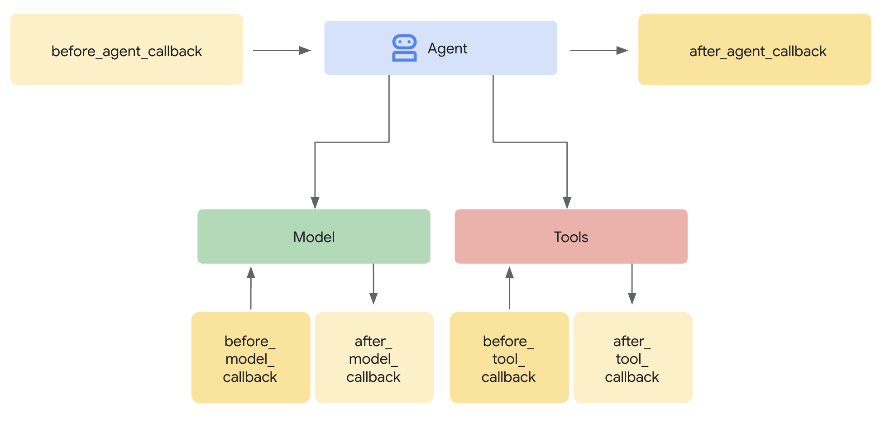

# コールバック：エージェントの振る舞いを監視、カスタマイズ、制御する

<div class="language-support-tag">
  <span class="lst-supported">ADKでサポート</span><span class="lst-python">Python v0.1.0</span><span class="lst-typescript">TypeScript v0.2.0</span><span class="lst-go">Go v0.1.0</span><span class="lst-java">Java v0.1.0</span><span class="lst-kotlin">Kotlin v0.1.0</span>
</div>

コールバックはADKの中核となる機能であり、エージェントの実行プロセスにフックするための強力なメカニズムを提供します。これにより、コアのADKフレームワークコードを変更することなく、事前に定義された特定のポイントでエージェントの振る舞いを監視、カスタマイズ、さらには制御することが可能になります。

**コールバックとは？** 本質的に、コールバックは開発者が定義する標準的な関数です。そして、エージェントを作成する際にこれらの関数をエージェントに関連付けます。ADKフレームワークは、主要なステージであなたの関数を自動的に呼び出し、監視や介入を可能にします。エージェントのプロセスにおけるチェックポイントのようなものだと考えてください。

*   **エージェントがリクエストに対するメインの処理を開始する前と、完了した後：** エージェントに何か（例：質問に答える）を依頼すると、エージェントは応答を導き出すために内部ロジックを実行します。
    *   `Before Agent` コールバックは、その特定のリクエストに対するメインの処理が始まる*直前に*実行されます。
    *   `After Agent` コールバックは、エージェントがそのリクエストに対する全てのステップを終え、最終結果を準備した*直後*、しかし結果が返される直前に実行されます。
    *   この「メインの処理」とは、その単一のリクエストを処理するためのエージェントの*全体*のプロセスを指します。これには、LLMを呼び出す決定、実際のLLM呼び出し、ツールを使用する決定、ツールの使用、結果の処理、そして最終的に回答を組み立てる過程が含まれる場合があります。これらのコールバックは、本質的に、入力を受け取ってからその一つの対話に対する最終的な出力を生成するまでの一連の流れ全体をラップします。
*   **大規模言語モデル（LLM）にリクエストを送信する前、またはレスポンスを受信した後：** これらのコールバック（`Before Model`、`After Model`）により、LLMとの間でやり取りされるデータを具体的に検査または変更できます。
*   **ツール（Python関数や他のエージェントなど）を実行する前、または完了した後：** 同様に、`Before Tool`、`After Tool`コールバックは、エージェントによって呼び出されるツールの実行に特化した制御点を提供します。



**なぜ使うのか？** コールバックは大きな柔軟性を引き出し、高度なエージェント機能を可能にします。

*   **監視とデバッグ：** モニタリングやトラブルシューティングのために、重要なステップで詳細な情報をログに記録します。
*   **カスタマイズと制御：** エージェントを流れるデータ（LLMリクエストやツールの結果など）を変更したり、独自のロジックに基づいて特定のステップを完全にバイパスしたりします。
*   **ガードレールの実装：** 安全規則を強制し、入力/出力を検証したり、許可されていない操作を防いだりします。
*   **状態管理：** 実行中にエージェントのセッション状態を読み取ったり、動的に更新したりします。
*   **統合と機能拡張：** 外部のアクション（API呼び出し、通知）をトリガーしたり、キャッシングなどの機能を追加したりします。

!!! tip
    セキュリティガードレールやポリシーを実装する際には、コールバックよりも
    モジュール性と柔軟性に優れたADKプラグインを使用してください。詳細は
    [セキュリティガードレールのためのコールバックとプラグイン](/ja/safety/#callbacks-and-plugins-for-security-guardrails)を参照してください。

**追加方法：**

??? "Code"
    === "Python"

        ```python
        --8<-- "examples/python/snippets/callbacks/callback_basic.py:callback_basic"
        ```

    === "TypeScript"

        ```typescript
        --8<-- "examples/typescript/snippets/callbacks/callback_basic.ts:callback_basic"
        ```

    === "Go"

        ```go
        --8<-- "examples/go/snippets/callbacks/main.go:imports"


        --8<-- "examples/go/snippets/callbacks/main.go:callback_basic"
        ```

    === "Java"

        ```java
        --8<-- "examples/java/snippets/src/main/java/callbacks/AgentWithBeforeModelCallback.java:init"
        ```

    === "Kotlin"

        ```kotlin
        --8<-- "examples/kotlin/snippets/callbacks/CallbackBasic.kt:callback_basic"
        ```

## コールバックのメカニズム：インターセプトと制御

ADKフレームワークがコールバックを実行できるポイント（例：LLMを呼び出す直前）に達すると、そのエージェントに対応するコールバック関数が提供されているかを確認します。提供されていれば、フレームワークはその関数を実行します。

**コンテキストが鍵となります：** コールバック関数は単独で呼び出されるわけではありません。フレームワークは特別な**コンテキストオブジェクト**（`CallbackContext` または `ToolContext`）を引数として提供します。これらのオブジェクトには、呼び出し（invocation）の詳細、セッションの状態、アーティファクトやメモリなどのサービスへの参照を含む、エージェント実行の現在状態に関する重要な情報が含まれています。これらのコンテキストオブジェクトを使用して状況把握やフレームワークとの対話を行います（詳細は「コンテキストオブジェクト」セクションを参照してください）。

**フローの制御（コアメカニズム）：** コールバックの最も強力な側面は、その**戻り値**によってエージェントの後続アクションを制御できる点です。これにより実行フローをインターセプトし、制御できます。

1.  **`return None`（デフォルトの動作を許可）：**

    *   具体的な戻り値の型は言語によって異なります。Java では `Optional.empty()`、Kotlin では `CallbackChoice.Continue(value)`（`before_*` コールバックの場合）または元のオブジェクトの返却（`after_*` コールバックの場合）がこれに相当します。言語固有のガイダンスについては API ドキュメントを参照してください。
    *   これは、コールバックが自身の処理（ロギング、検査、入力引数の軽微な修正など）を完了し、ADK エージェントが**通常の処理を続行すべき**であることを示す標準的な方法です。
    *   `before_*` コールバック（`before_agent`、`before_model`、`before_tool`）の場合、`None` を返すと、シーケンスの次のステップ（エージェントロジックの実行、LLM の呼び出し、ツールの実行）に進みます。
    *   `after_*` コールバック（`after_agent`、`after_model`、`after_tool`）の場合、`None` を返すと、直前のステップで生成された結果（エージェントの出力、LLM のレスポンス、ツールの結果）がそのまま使用されます。Python の `after_agent_callback` では、`None` の代わりにその結果オブジェクト自体を返すと同等の動作にはならず、同じコンテンツを持つ 2 つ目のイベントが送出される点に注意してください。

2.  **`return <特定のオブジェクト>`（デフォルトの動作を上書き）：**

    *   続行を示す値の代わりに*特定の型のオブジェクト*を返すことで、ADK エージェントのデフォルトの動作を**上書き（override）**します。Kotlin では、`CallbackChoice.Break(value)`（`before_*` コールバックの場合）または置換オブジェクト（`after_*` コールバックの場合）を返すことで実現します。フレームワークは返されたオブジェクトを使用し、通常続くはずのステップを*スキップ*するか、生成されたばかりの結果を*置き換え*ます。
    *   **`before_agent_callback` → `Content`**: エージェントのメイン実行ロジックをスキップします。返された `Content` オブジェクトは、直ちにそのターンにおけるエージェントの最終出力として扱われます。単純なリクエストを直接処理したり、アクセス制御を強制したりするのに便利です。
    *   **`before_model_callback` → `LlmResponse`**: 外部の大規模言語モデルへの呼び出しをスキップします。返された `LlmResponse` オブジェクトは、LLM からの実際のレスポンスであるかのように処理されます。入力ガードレールの実装、プロンプトの検証、キャッシュされたレスポンスの提供に最適です。
    *   **`before_tool_callback` → Python: `dict`、Kotlin: `Map<String, Any>`**: 実際のツール関数（またはサブエージェント）の実行をスキップします。返された `dict` または `Map` はツール呼び出しの結果として使用され、LLM に渡されます。ツールの引数検証、ポリシー制限の適用、モックやキャッシュされたツール結果の返却に役立ちます。
    *   **`after_agent_callback` → `Content`**: エージェントの実行ロジックがすでに出力した後に、返された `Content` を追加イベントとして*追記（append）*します。既存の出力を置き換えるものではありません（モデル応答を変更したい場合は `after_model_callback` を使用してください）。
    *   **`after_model_callback` → `LlmResponse`**: LLM から受け取った `LlmResponse` を*置き換え*ます。出力のサニタイズ、標準的な免責事項の追加、LLM のレスポンス構造の変更に便利です。
    *   **`after_tool_callback` → Python: `dict`、Kotlin: `Map<String, Any>`**: ツールが返した結果を*置き換え*ます。ツール出力を LLM に送り返す前に後処理したり標準化したりできます。

**概念的なコード例（ガードレール）：**

この例は `before_model_callback` を使用したガードレールの一般的なパターンを示しています。

??? "Code"
    === "Python"

        ```python
        --8<-- "examples/python/snippets/callbacks/before_model_callback.py"
        ```

    === "TypeScript"
        ```typescript
        --8<-- "examples/typescript/snippets/callbacks/before_model_callback.ts"
        ```

    === "Go"
        ```go
        --8<-- "examples/go/snippets/callbacks/main.go:imports"


        --8<-- "examples/go/snippets/callbacks/main.go:guardrail_init"
        ```

    === "Java"
        ```java
        --8<-- "examples/java/snippets/src/main/java/callbacks/BeforeModelGuardrailExample.java:init"
        ```

    === "Kotlin"
        ```kotlin
        --8<-- "examples/kotlin/snippets/callbacks/BeforeModelCallback.kt:before_model_callback"
        ```

`None` を返す場合と特定のオブジェクトを返す場合の違いを理解することで、エージェントの実行パスを正確に制御できるようになり、ADK で高度かつ信頼性の高いエージェントを構築するうえでコールバックは不可欠なツールとなります。
