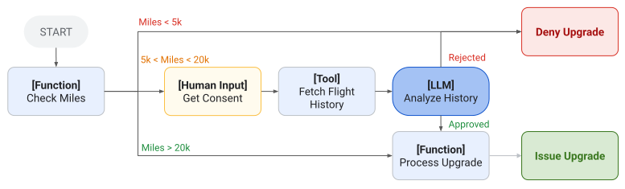
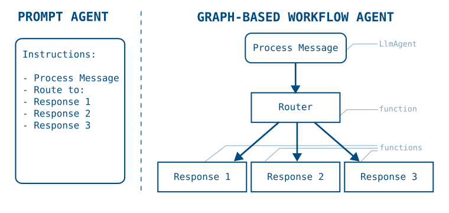

# グラフベースのエージェントワークフロー

<div class="language-support-tag">
  <span class="lst-supported">ADKでサポート</span><span class="lst-python">Python v2.0.0</span><span class="lst-typescript">TypeScript v2.0.0</span><span class="lst-go">Go v2.0.0</span>
</div>

ADK のグラフベースのエージェントワークフローを使用すると、コードロジックと AI の推論能力を組み合わせた決定論的なプロセスを構築でき、より精密な制御を備えたエージェントを作成できます。グラフベースワークフローでは、エージェントのロジックを実行ノードとエッジのグラフとして定義し、AI を活用したエージェントの推論と決定論的なツールやコードを組み合わせることができます。



**図 1.** 関数、人間の入力、ツール、LLM 機能など、異なる種類のワークフローノードを組み合わせた、フライトアップグレード向けのグラフベースエージェント設計です。

[Sequential Agents](/agents/workflow-agents/sequential-agents/) などの事前構築済みの ADK [テンプレートワークフロー](/agents/workflow-agents/)は、一連のエージェント間での定義済みのプロセスフロー制御のみを提供します。長いプロンプトやツールを備えた標準的な ADK エージェントを引き続き構築し、それらをグラフベースワークフローエージェントで使用することもできます。より精密な制御が必要な場合、ワークフローエージェントグラフを使用すると、タスクのルーティングや実行方法をより柔軟に制御できます。グラフベースワークフローには次の利点があります:

-   **精密なロジックの定義:** 異なるノード間の遷移を管理するルーティングロジックを明示的に設計できます。
-   **複雑な構造の実装:** 分岐や状態管理をサポートするエージェントワークフローを構築できます。
-   **AI なしでの関数チェーンの実行:** 生成 AI モデルを呼び出さずに、エージェントツールや独自のコードを呼び出すことができます。
-   **信頼性の向上:** プロンプトだけに頼るのではなく、構造化されたノード定義を用いることで、エージェントの予測可能性を高められます。

!!! note "ADK のワークフロースタイル"

    ADK は、マルチステップの作業を構成するための 3 つの相補的な方法を提供します:

    -   **グラフベースワークフロー**（このセクション）: 明示的なルーティングを備えたノードとエッジの宣言的なグラフであり、決定論的で構造化されたプロセスに最適です。
    -   **[動的ワークフロー](/graphs/dynamic/):** 独自のコード内でのプログラムによるオーケストレーション（ループ、条件分岐、再帰）であり、制御フローが複雑すぎたり反復的であったりして静的グラフには適さない場合に最適です。
    -   **[事前構築済みワークフローエージェント](/agents/workflow-agents/)**（順次、並列、ループ）: 自身でグラフを組み立てることなく一般的なパターンを実現できる、より高レベルのビルディングブロックです。

## はじめに

このセクションでは、グラフベースエージェントの始め方を説明します。次の例では、都市名を生成し、コード関数でその都市の現在時刻を調べ、最後のエージェントがその情報を報告する順次的なグラフベースエージェントワークフローの作成方法を示します。

=== "Python"

    ```python
    from google.adk import Agent
    from google.adk import Workflow
    from google.adk import Event
    from pydantic import BaseModel

    city_generator_agent = Agent(
        name="city_generator_agent",
        model="gemini-flash-latest",
        instruction="""Return the name of a random city.
          Return only the name, nothing else.""",
    )

    class CityTime(BaseModel):
        time_info: str  # time information
        city: str       # city name

    def lookup_time_function(node_input: str):
        """Simulate returning the current time in the specified city."""
        return CityTime(time_info="10:10 AM", city=node_input)

    city_report_agent = Agent(
        name="city_report_agent",
        model="gemini-flash-latest",
        input_schema=CityTime,
        instruction="""Output following line:
        It is {CityTime.time_info} in {CityTime.city} right now.""",
    )

    def completed_message_function(node_input: str):
        return Event(
            message=f"{node_input}\n WORKFLOW COMPLETED.",
        )

    root_agent = Workflow(
        name="root_agent",
        edges=[
            ("START", city_generator_agent, lookup_time_function,
              city_report_agent, completed_message_function)
        ],
    )
    ```

=== "TypeScript"

    ADK TypeScript v2.0.0 では、`Workflow` は `edges` 配列を受け取ります。各行には順番に実行するノードがリストされます。`node()` 関数は、関数、エージェント、ツール、または別の `Workflow` をグラフノードとしてラップし、ノードの名前と `inputSchema` および `outputSchema` の契約を設定します。スキーマには Zod オブジェクトまたは genai の `Schema` を使用します。各ノードの戻り値は次のノードに入力として渡されるため、セッション状態 (session state) への書き込みは不要です。

    ```typescript
    --8<-- "examples/typescript/snippets/graphs/index/get_started.ts:get-started"
    ```

=== "Go"

    ADK Go v2.0.0 では、順次ワークフローにグラフエンジンを使用します。`workflow.NewFunctionNode` が各ステップをラップし、`workflow.Chain` がノードを順次的な `edges` スライスに接続します。フレームワークは `event.Output` を介して各ノードの型付き戻り値を次のノードに自動的に渡すため、セッション状態への書き込みは不要です。グラフ全体は標準の `agent.Agent` を生成する `workflowagent.New` でラップされます。

    ```go
    --8<-- "examples/go/snippets/graphs/index/main.go:sequential-get-started"
    ```

このサンプルコードでは、シンプルな順次ワークフローを組み立て、エージェント処理とコード実行を交互に行う方法を示しています。長いプロンプトとツール呼び出しを持つ単一のエージェントでもこれらのステップを実行できますが、グラフベースのアプローチを使用すると、タスクの実行順序と各ステップからのデータ出力を精密に制御できます。

グラフベースワークフローでのデータ処理の詳細については、[ワークフローノードとエージェントでのデータ処理](/graphs/data-handling/)を参照してください。

## グラフでプロセスを構築する

プロンプトベースのエージェントでは、ADK エージェントの instructions フィールドにタスクや手順の説明を記述することで、マルチステップのプロセスを定義できます。しかし、指示や手順が長く複雑になるにつれて、エージェントが各ステップやガイドラインに従っていることを保証するのはより複雑になり、信頼性も低下します。

グラフベースワークフローエージェントは、プロセス全体のワークフローをコードで具体的に定義できるため、プロンプトベースエージェントに対して大きな利点をもたらします。グラフベースエージェントワークフローでは、プロセスの各ステップをグラフ内の実行 ***Node*** として定義でき、各ノードは AI エージェント、Tool、またはプログラムされたコードにすることができます。次の図は、シンプルなプロンプトベースエージェントがどのようにワークフローエージェントグラフに変換されるかを示しています:



**図 2.** グラフベースワークフローに変換されたプロンプトベースエージェントの指示の構造です。

プロンプトベースエージェントからグラフベースワークフローエージェントに移行すると、手順内のタスクを明示적으로分解して、特定の実行フローを定義できます。一度定義すれば、エージェントアプリケーションはグラフ内のステップに従って進行し、必要に応じて非決定論的な AI 搭載エージェントと決定論的なコードを切り替えます。

次のコードサンプルは、図 2 のワークフローグラフをグラフベースエージェントにどのように変換できるかを示しています:

=== "Python"

    ```python
    process_message = Agent(
        name="process_message",
        model="gemini-flash-latest",
        instruction="""Classify user message into either "BUG", "CUSTOMER_SUPPORT",
          or "LOGISTICS". If you think a message applies to more than one category,
          reply with a comma separated list of categories.
       """,
    )

    def router(node_input: str):
        routes = node_input.split(",")
        routes = [route.strip() for route in routes]
        return Event(route=routes)

    def response_1_bug():
        return Event(message="Handling bug...")

    def response_2_support():
        return Event(message="Handling customer support...")

    def response_3_logistics():
        return Event(message="Handling logistics...")

    root_agent = Workflow(
       name="routing_workflow",
       edges=[
           ("START", process_message, router),
           ( router,
               {
                   "BUG": response_1_bug,
                   "CUSTOMER_SUPPORT": response_2_support,
                   "LOGISTICS": response_3_logistics,
               }
           )
       ],
    )
    ```

=== "TypeScript"

    ADK TypeScript v2.0.0 では、ルーターノードは `createEvent({route})` で作成された `route` 値を含むイベントを返します。2つ目の edge の行では、各ルート値をそれを処理するノードにマッピングします。`route` に配列を設定すると、一致するすべてのブランチにディスパッチされるため、この例の分類器は複数のカテゴリを返すことができます。`DEFAULT_ROUTE` 設定は、どのブランチにも一致しなかったすべての値をキャッチします。

    ```typescript
    --8<-- "examples/typescript/snippets/graphs/index/process_pipeline.ts:process-pipeline"
    ```

=== "Go"

    ADK Go v2.0.0 では、条件付きルーティングに `workflow.NewEmittingFunctionNode` を使用して `event.Routes` を設定し、`workflow.StringRoute` エッジを使用して一致するハンドラにディスパッチします。これは Python の `router` 関数および辞書ディスパッチに直接相当します。`workflow.Concat` はチェーンと条件付きエッジを 1 つの `edges` スライスにマージして `workflowagent.New` に渡します。

    ```go
    --8<-- "examples/go/snippets/graphs/index/main.go:process-pipeline"
    ```

このサンプルコードは、一連のエージェントを構成して、*ノード*（エージェント、ツール、独自のコード、さらには追加のワークフローエージェントを含めることができる個別のタスク）のセット間のルートを持つグラフを定義する方法を示しています。高度なパイプラインの構築については、[ワークフローエージェントのグラフルートを構築する](/graphs/routes/)を参照してください。

!!! tip "すべてのエージェントに対するグローバル指示"

    `App` の `GlobalInstructionPlugin`（[Python](https://github.com/google/adk-python/blob/main/src/google/adk/plugins/global_instruction_plugin.py)、[TypeScript](https://github.com/google/adk-js/blob/main/core/src/plugins/global_instruction_plugin.ts)、[Java](https://github.com/google/adk-java/blob/main/core/src/main/java/com/google/adk/plugins/GlobalInstructionPlugin.java)）またはエージェントの `GlobalInstruction` パラメータ（[Go](https://github.com/google/adk-go/blob/main/agent/llmagent/llmagent.go)）を使用して、ワークフロー全体に一貫したルールを適用します。

## 既知の制限事項 {#known-limitations}

グラフベースワークフローにはいくつかの既知の制限事項があります。次の ADK 機能とは*互換性がありません*:

-   **インテグレーション:** 一部のサードパーティ製[インテグレーション](/integrations/)は、グラフベースワークフローと互換性がない場合があります。

!!! note "Go: グラフワークフロー API"

    ADK Go v2.0.0 の `workflow` パッケージは、Python の `Workflow` クラスに直接相当します。`workflow.NewFunctionNode` と `workflow.NewAgentNode` を使用してノードを定義し、`workflow.Chain` または `[]workflow.Edge` を伴う `workflow.Concat` でそれらを接続し、`workflowagent.New` でグラフを実行可能なエージェントとしてラップします。条件付きルーティングでは、`event.Routes` に対してマッチングされる `workflow.StringRoute`、`workflow.IntRoute`、または `workflow.BoolRoute` を使用します。ファンイン（Fan-in）は `workflow.NewJoinNode` によって処理されます。

    高度なルーティングパターンやファンアウト/ジョインの例については、[ワークフローエージェントのグラフルートを構築する](/graphs/routes/)を参照してください。事前構築済みのより高レベルな代替手段（順次、並列、ループ）については、[事前構築済みワークフローエージェント](/agents/workflow-agents/)を参照してください。
