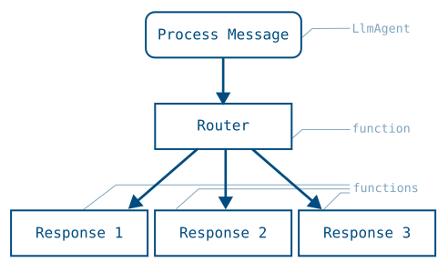
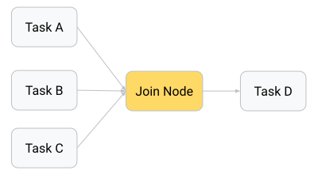
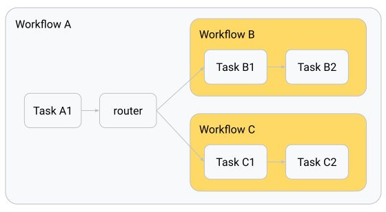

# エージェントワークフローのグラフルートを構築する

<div class="language-support-tag">
  <span class="lst-supported">ADKでサポート</span><span class="lst-python">Python v2.0.0</span><span class="lst-typescript">TypeScript v2.0.0</span><span class="lst-go">Go v2.0.0</span>
</div>

ADK のグラフベースワークフローは、エージェントロジックを実行ノードとエッジのグラフとして定義し、人工知能（AI）の推論とコードロジックを組み合わせたより信頼性の高いプロセスを構築できるようにします。これらのワークフローにより、コード関数、AI 搭載エージェント、ツール、人間の入力をカプセル化できる実行ノードの論理的なルートを作成できます。ルーティングロジックを明示的にマッピングすることで、コード内で具体的なステップごとのプロセスワークフローを定義でき、純粋なプロンプトベースのエージェントよりも高い精度と信頼性を実現できます。



**図 1.** タスクグラフの視覚化とそれを実装するためのルーティングコードです。

=== "Python"

    ```python
    root_agent = Workflow(
      name="routing_workflow",
      edges=[
        ("START", process_message, router),
        (router,
          {
            "output-1": response_1,
            "output-2": response_2,
            "output-3": response_3,
          },
        ),
      ],
    )
    ```

=== "TypeScript"

    ```typescript
    export const rootAgent = new Workflow({
      name: 'routing_workflow',
      edges: [
        ['START', processMessage, router],
        [
          router,
          {
            'output-1': response1,
            'output-2': response2,
            'output-3': response3,
          },
        ],
      ],
    });
    ```

=== "Go"

    ADK Go v2.0.0 は、グラフベースワークフローに対して次のアプローチを提供します:

    **グラフエンジン**（`workflowagent` + `workflow.Edge`）: Python の `Workflow(edges=[...])` に直接マッピングされるノードとエッジのグラフ API です。ノードは `workflow.NewFunctionNode`、`workflow.NewAgentNode`、または `workflow.NewDynamicNode` で定義され、エッジは `[]workflow.Edge` として宣言され、グラフ全体が `workflowagent.New` 呼び出しでラップされます:

    ```go
    edges := workflow.Concat(
        workflow.Chain(workflow.Start, classifyNode),
        []workflow.Edge{
            {From: classifyNode, To: responseA, Route: workflow.StringRoute("output-1")},
            {From: classifyNode, To: responseB, Route: workflow.StringRoute("output-2")},
            {From: classifyNode, To: responseC, Route: workflow.StringRoute("output-3")},
        },
    )
    rootAgent, _ := workflowagent.New(workflowagent.Config{
        Name:  "routing_workflow",
        Edges: edges,
    })
    ```

グラフベースのエージェントワークフローを使用する利点は、プロンプトベースのエージェントと比較して制御性、予測可能性、信頼性が大幅に向上することです。プロセス全体のワークフローをコードで定義することで、タスクのルーティングや実行方法をより細かく制御できます。この構造化されたノード定義により、エージェントの予測可能性が向上し、定義されたステップやプロセス管理を必要とする複雑なタスクの信頼性が高まります。

ADK でグラフベースワークフローを始めるには、[グラフベースのエージェントワークフロー](/graphs/)を確認してください。

## ノード

グラフは実行ノードで構成されます。これらの*ノード*は、***Agents***、ADK ***Tools***、人間の入力タスク、または記述したコード関数にすることができます。ノードは以前に実行されたノードから入力を受け取り、***Event*** オブジェクトを通じてデータを発行できます。

=== "Python"

    以下は、テキスト入力を処理してテキスト出力を送信するシンプルな ***FunctionNode*** を示しています:

    ```python
    from google.adk import Event

    def my_function_node(node_input: str):
        input_text_modified = node_input.upper()
        return Event(output=input_text_modified)
    ```

=== "TypeScript"

    ADK TypeScript v2.0.0 では、プライマリノードタイプは関数を `node()` に渡して作成する `FunctionNode` です。ハンドラーは常に `(ctx, input)` パラメータを受け取ります。ADK はパラメータ名による値の挿入を行いません。値を直接返すと、イベントの `output` フィールドに自動的にラップされます。`route` や `content` も設定する必要がある場合は、明示的な形式である `createEvent({output})` を返します。

    ```typescript
    --8<-- "examples/typescript/snippets/graphs/routes/function_node.ts:function-node"
    ```

=== "Go"

    ADK Go v2.0.0 では、主要なノードタイプは `workflow.NewFunctionNode` です。`FunctionNode` は通常の Go 関数をラップします。関数が型付きの値を返すと、フレームワークはそれを自動的に `session.Event` でラップし、`event.Output` を設定します。後続ノードはこの値を型付き `input` パラメータとして受け取るため、手動での状態の書き込みやイベントの構築は不要です:

    ```go
    --8<-- "examples/go/snippets/graphs/routes/main.go:function-node"
    ```

ノード間でのデータ転送の詳細については、[エージェントワークフローのデータ処理](/graphs/data-handling/)を参照してください。

## ワークフローグラフの構文

ワークフローエージェントを組み合わせることでグラフを定義します。このセクションでは、一般的なルーティングパターンの概要を説明します。

!!! caution "注意: ワークフローエージェントの制限事項"

    グラフベースワークフローに ***LlmAgents*** を追加できます。ただし、それらはシングルターンモードまたはタスクモードで構成する必要があります。エージェントモードの詳細については、[協調エージェントチームの構築](/workflows/collaboration/#mode-configuration-and-behaviors)を参照してください。

### ルートシーケンス

順次ルートは、リストされた順序で各ノードを 1 回ずつ実行します。

=== "Python"

    `edges` 配列は `START` キーワードを使用してグラフ実行の開始を示し、リストされた各ノードが順番に実行されます:

    ```python
    edges=[("START", task_A_node)]  # single node run
    edges=[("START",
            task_A_node,
            task_B_node,
            task_C_node)]           # 3 nodes run in order
    ```

=== "TypeScript"

    `'START'` で始まる `edges` の行は、リストされた各ノードを順番に1回ずつ実行し、すべてのノードの戻り値を次のノードに渡します。

    ```typescript
    edges: [['START', taskANode]]                       // 単一ノード
    edges: [['START', taskANode, taskBNode, taskCNode]] // 3つのノードを順に実行
    ```

    複数の行に `'START'` を指定すると、並列パスが作成されます。詳細については、[ファンアウトと結合](#parallel-tasks-fan-out-and-join-paths) を参照してください。

    ```typescript
    --8<-- "examples/typescript/snippets/graphs/routes/sequence.ts:sequence"
    ```

=== "Go"

    `workflow.Chain(workflow.Start, nodeA, nodeB, nodeC)` は、ノードを順次的なエッジスライスに接続します。各ノードの型付き戻り値は `event.Output` を介して次のノードに転送されるため、セッション状態への書き込みは不要です:

    ```go
    --8<-- "examples/go/snippets/graphs/routes/main.go:sequential-nodes"
    ```

### ルート分岐と条件付き実行

=== "Python"

    Python では、分岐は `Event(route=...)` 値を返す `FunctionNode` によって処理され、`edges` 辞書がそれを異なるノードにディスパッチします。

    ```python
    from google.adk import Event, Workflow
    from google.adk.agents import Agent


    def router(node_input: str):
        """Route to task B or C based on node_input."""
        if condition(node_input):
            return Event(route="RUN_TASK_C")
        return Event(route="RUN_TASK_B")

    task_B_node = Agent(name="task_B_agent") # An agent to execute node B

    def task_C_node(node_input: str):
        """A FunctionNode to execute node C."""
        return Event(output="Task C completed")

    root_agent = Workflow(
        name="routing_workflow",
        edges=[
            ("START", task_A_node, router),
            (router,
              {
                # "route value": node_to_run
                "RUN_TASK_B": task_B_node,
                "RUN_TASK_C": task_C_node,
              },
            ),
        ],
    )
    ```

=== "TypeScript"

    分岐には、`route` 値を出力するノードと、各ルート値をそれを処理するノードにマッピングする edge の行が必要です。ルート値には文字列、数値、またはブール値を使用できます。`DEFAULT_ROUTE` 設定は、同じソースノード上の他のどのルートにも一致しない場合にマッチします。分岐のターゲットにはノードライクな任意の値を指定できます。この例では、`taskBNode` は `LlmAgent`、`taskCNode` は関数です。

    ```typescript
    --8<-- "examples/typescript/snippets/graphs/routes/branches.ts:branches"
    ```

=== "Go"

    ADK Go v2.0.0 では、条件付きディスパッチに `workflow` グラフエンジンを使用します。ノードが `Event.Routes` に 1 つ以上の文字列ルートキーを設定し、各 `workflow.Edge` が `workflow.Route` マッチャーを使用して後続ノードを選択します:

    -   `workflow.StringRoute("category")` — 単一の文字列値に一致
    -   `workflow.IntRoute(n)` または `workflow.MultiRoute[int]{1, 2, 3}` — 整数値に一致
    -   `workflow.BoolRoute(true)` — ブール値に一致
    -   `workflow.Default` — 同じソースノード上の他のどのルートにも一致しない場合に一致

    次のパターンは Python ルーターの Go 版です:

    ```go
    // classifyNode emits an Event with Routes=[]string{"BUG"},
    // ["CUSTOMER_SUPPORT"], or ["LOGISTICS"] based on the message.
    edges := workflow.Concat(
        workflow.Chain(workflow.Start, processMessage, classifyNode),
        []workflow.Edge{
            {From: classifyNode, To: bugHandler,       Route: workflow.StringRoute("BUG")},
            {From: classifyNode, To: supportHandler,   Route: workflow.StringRoute("CUSTOMER_SUPPORT")},
            {From: classifyNode, To: logisticsHandler, Route: workflow.StringRoute("LOGISTICS")},
        },
    )
    rootAgent, _ := workflowagent.New(workflowagent.Config{
        Name:  "routing_workflow",
        Edges: edges,
    })
    ```

    `workflow.EdgeBuilder` は、`[]workflow.Edge` スライスを手動で組み立てる代わりに使える流暢な（fluent）代替手段を提供します。ビルダーの `Add`、`AddFanOut`、`AddFanIn` メソッドにより、繰り返しを抑えて同じトポロジーを表現できます:

    ```go
    eb := workflow.NewEdgeBuilder()
    eb.Add(workflow.Start, processMessage)
    eb.Add(processMessage, classifyNode)
    eb.AddRoute(classifyNode, bugHandler,       workflow.StringRoute("BUG"))
    eb.AddRoute(classifyNode, supportHandler,   workflow.StringRoute("CUSTOMER_SUPPORT"))
    eb.AddRoute(classifyNode, logisticsHandler, workflow.StringRoute("LOGISTICS"))

    rootAgent, _ := workflowagent.New(workflowagent.Config{
        Name:  "routing_workflow",
        Edges: eb.Build(),
    })
    ```

    実行可能な完全なルーティングの例については、[文字列ルーティング](https://github.com/google/adk-go/tree/v2/examples/workflow/routing/string)、[整数 / 複数値ルーティング](https://github.com/google/adk-go/tree/v2/examples/workflow/routing/int)、および [LLM 駆動ルーティング](https://github.com/google/adk-go/tree/v2/examples/workflow/routing/llm)を参照してください。

    !!! note "事前構築済みエージェント: 状態へのルーティングのエンコード"

        グラフエンジンの代わりに `sequentialagent` / `parallelagent` / `loopagent` を使用する場合、`Event.Routes` によるディスパッチはありません。`OutputKey` を介してルーティングの決定をセッション状態にエンコードし、ダウンストリームエージェントが `Instruction` テンプレート内でそれを検査できるようにするか、`Escalate` ベースの終了を伴う `loopagent` を使用してください（以下の[ループとエスカレーション終了の例](#loop-and-escalation-exit)を参照）。

## 並行タスク: Fan-out および Join パス

複数の並列ノードに実行を分割するグラフを作成でき、通常はさらなる処理のために各ノードの出力を集約する必要があります。このタスク実行パターンには 2 つの段階があります。ワークフローはまず複数の並列タスクを開始するときにファンアウト（fan out）し、それらのタスクが完了したときに次のステップに進む前にそれらのパスを再結合（join）します。



**図 2.** 並列タスクノードの出力を集約・結合してから、結果を次のステップに渡すことができます。

=== "Python"

    結合ステップは ***JoinNode*** オブジェクトを使用して実現します。このオブジェクトは各並列タスクが完了するのを待機し、それらのノードからの出力のコレクションを次のノードに渡します。

    ```python
    from google.adk.workflow import JoinNode

    my_join_node = JoinNode(name="my_join_node")

    edges=[
        ("START", parallel_task_A, my_join_node),
        ("START", parallel_task_B, my_join_node),
        ("START", parallel_task_C, my_join_node),
        (my_join_node, final_task_D),
    ]
    ```

=== "TypeScript"

    `JoinNode` はファンイン (fan-in) バリアです。このロジックメカニズムは、すべての先行タスクが完了するのを待機し、後続ノードに先行ノード名をキーとするレコードを渡します。

    ```typescript
    --8<-- "examples/typescript/snippets/graphs/routes/fan_out_join.ts:fan-out-join"
    ```

=== "Go"

    ADK Go v2.0.0 は、グラフエンジンでの真のファンイン（fan-in）のために `workflow.NewJoinNode` を提供します。`workflow.Start`（または任意の共有ソースノード）からのファンアウトエッジが並列にジョインノードへ接続され、ジョインノードはそれらすべてが完了するのを待ってから、先行ノード名をキーとする `map[string]any` を次のノードに発行します。

    `workflow.EdgeBuilder` は、専用の `AddFanOut` および `AddFanIn` ヘルパーによってファンアウト / ファンインの配線を簡潔にします（[複雑なワークフローの例](https://github.com/google/adk-go/tree/v2/examples/workflow/complex)を参照）:

    ```go
    gatherNode := workflow.NewJoinNode("gather")

    eb := workflow.NewEdgeBuilder()
    eb.AddFanOut(workflow.Start, researchNodeA, researchNodeB, researchNodeC)
    eb.AddFanIn(gatherNode, researchNodeA, researchNodeB, researchNodeC)
    eb.Add(gatherNode, formatNode)
    eb.Add(formatNode, synthesisNode)

    rootAgent, _ := workflowagent.New(workflowagent.Config{
        Name:  "research_pipeline",
        Edges: eb.Build(),
    })
    ```

    次のスニペットは、`workflow.NewJoinNode` と `EdgeBuilder.AddFanOut` / `AddFanIn` を使用した完全なファンアウト / ジョインパターンを示しています:

    ```go
    --8<-- "examples/go/snippets/graphs/routes/main.go:parallel-fan-out"
    ```

!!! warning "警告: JoinNode に接続するノードは出力を生成する必要があります"

    `JoinNode` は、すべての先行ノードが終了した後にのみ解放されます。結合に供給するすべてのノードが独自の出力を生成することを確認し、失敗する可能性のあるノードには[再試行構成](/ja/graphs/retry/)を設定してください。出力を生成せずに終了した先行ノードがあると、そのブランチの値が結合に存在しなくなり、その結果のエラーは原因となったノードから離れたダウンストリームで発生します。

## ネストされたワークフロー

より複雑なワークフローを構築する場合、特定のタスクの機能を再利用可能なワークフローにカプセル化したいことがあります。これを実現するために、1 つ以上のワークフローエージェントを別のワークフローエージェント内のサブエージェントとして使用できます。



**図 3.** 親ワークフロー内にサブエージェントとしてネストされたワークフローエージェントです。

=== "Python"

    ```python
    from google.adk import Workflow

    root_agent = Workflow(
        name="parent_workflow",
        edges=[
           ("START", task_A1, router),
           (router, {
                "RUN_WORKFLOW_B": workflow_B,
                "RUN_WORKFLOW_C": workflow_C,
                },
           ),
        ],
    )
    ```

    #### ネストされたワークフローのデータ出力

    ネストされた Workflow オブジェクトの出力は、個々のノードとは少し異なる動作をします。ネストされたワークフローがいずれかのノードを完了すると、ネストされたワークフローのグラフ内の次のノードにデータを送信し、*同時に*システムはプロセスのトレーサビリティのためにそのノードの Event を親ワークフローに伝播（bubble up）します。ネストされたワークフローがそのプロセスの最後のノードを完了すると、親ノードは最終的なリーフノードからデータを抽出し、ネストされたワークフローの出力として発行します。

=== "TypeScript"

    `Workflow` 自体がノードであるため、再利用可能なサブプロセスをカプセル化するために、別のワークフローの edges 内で使用できます。

    ```typescript
    --8<-- "examples/typescript/snippets/graphs/routes/nested_workflow.ts:nested-workflow"
    ```

    **ネストされたワークフローのデータ出力。** 内部ワークフローの実行中、追跡性のために各ノードイベントが親にバブリングされます。終了すると、ターミナルノードの出力がネストされたワークフローノードの出力になります。

=== "Go"

    ADK Go v2.0.0 は、2 つの相補的な方法でネストされたワークフローをサポートします:

    **グラフエンジン**（`workflowagent` + `workflow.Edge`）: `workflowagent.New` で作成された `workflowagent` はそれ自体が `agent.Agent` であるため、`workflow.NewAgentNode` でラップして別のワークフローの `edges` スライス内でノードとして使用できます。外側のグラフの視点からは、内側のワークフローは単一のノードとして完了まで実行され、その最終出力が外側のグラフのエッジ上のノード出力として発行されます:

    ```go
    innerNode, _ := workflow.NewAgentNode(innerWorkflowAgent, workflow.NodeConfig{})

    outerEdges := workflow.Chain(workflow.Start, outerStepNode, innerNode, finalNode)
    rootAgent, _ := workflowagent.New(workflowagent.Config{
        Name:  "parent_workflow",
        Edges: outerEdges,
    })
    ```

    次のスニペットは、内側と外側の両方のグラフ構築を示しています。`workflow.NewAgentNode` は内側の `workflowagent` をラップし、外側のグラフの `workflow.Chain` に配置できるようにします:

    ```go
    --8<-- "examples/go/snippets/graphs/routes/main.go:nested-workflows"
    ```

## ループとエスカレーションの終了

ループは、終了条件が満たされるまで一連のステップを繰り返します。Python では、これは前のノードに戻る `edges` グラフ内のバックエッジ（back-edge）として表現されます。ADK Go v2.0.0 でも、グラフエンジンが同じパターンを直接サポートしています。ルート条件を伴うエッジをダウンストリームノードから前のノードへ追加すると、エンジンは各イテレーションで新しいライフサイクルをもってターゲットノードを再アクティブ化します。

=== "Python"

    ```python
    from google.adk import Event, Workflow


    def router(node_input: str):
        """Route to task B or C based on node_input."""
        if condition(node_input):
            return Event(route="RUN_TASK_C")
        return Event(route="RUN_TASK_B")

    root_agent = Workflow(
        name="routing_workflow",
        edges=[
            ("START", task_A_node, router),
            (router,
              {
                "RUN_TASK_B": task_B_node,
                "RUN_TASK_C": task_C_node,
              },
            ),
        ],
    )
    ```

=== "TypeScript"

    ループはバックエッジ (back-edge) です。ダウンストリームのノードが以前のノードにルーティングし直し、エンジンはイテレーションごとに新しいライフサイクルでそのノードを再アクティブ化します。ルーターが終了ブランチを選択すると、ループが終了します。

    ```typescript
    --8<-- "examples/typescript/snippets/graphs/routes/loop_escalation.ts:loop-escalation"
    ```

=== "Go"

    次の例では、`workflow.EdgeBuilder` とともにグラフエンジンを使用しています。批評（critic）ノードが判定を返し、ルーターノードが `Event.Routes` を設定し、改善（refiner）ノードから批評ノードへのバックエッジがループを形成します。批評ノードが満足すると、代わりに終端の `done` ノードへルーティングします:

    ```go
    --8<-- "examples/go/snippets/graphs/routes/main.go:loop-escalate"
    ```

!!! warning "警告: 制限のないグラフサイクル"

    グラフサイクルは自動的には制限されません。終了条件が最終的に true になるようにするか、ループが独自のコード内で実行され、その境界を制御できる [動的ワークフロー](/graphs/dynamic/#loop-route) として反復を表現してください。
