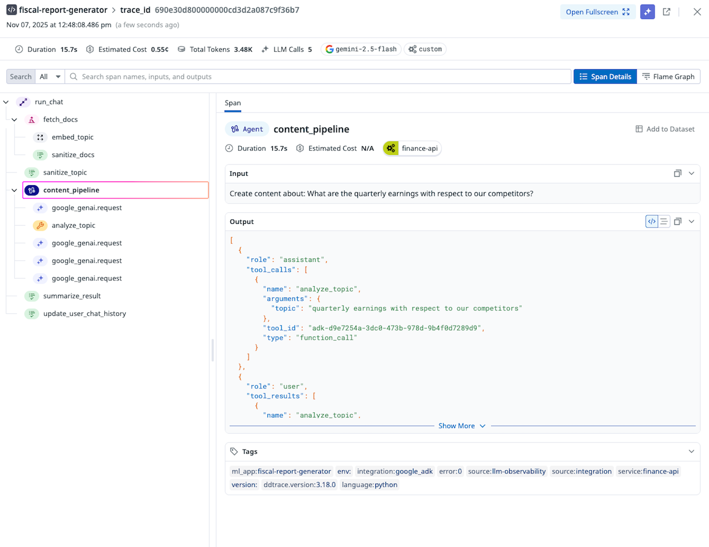

# ADK 向け Datadog オブザーバビリティ

<div class="language-support-tag">
    <span class="lst-supported">ADKでサポート</span><span class="lst-python">Python</span>
</div>

[Datadog LLM Observability](https://www.datadoghq.com/product/llm-observability/) は、AI エンジニア、データサイエンティスト、アプリケーション開発者が LLM アプリケーションを迅速に開発、評価、監視できるよう支援します。構造化された実験、AI エージェント全体のエンドツーエンドのトレース、および評価を通じて、出力品質、パフォーマンス、コスト、全体的なリスクを自信を持って改善できます。

## 概要

Datadog LLM Observability は、[Google ADK で構築したエージェントを自動的に計装・トレース](https://docs.datadoghq.com/llm_observability/instrumentation/auto_instrumentation?tab=python#google-adk)でき、次のことが可能になります。

- **エージェントの実行とやり取りを監視**: エージェント内のすべての実行、ツール呼び出し、コード実行を自動的にキャプチャします。
- **LLM の呼び出しとレスポンスをキャプチャ**: 基盤となる Google GenAI SDK で行われた呼び出しとレスポンスを記録します。
- **問題のデバッグ**: エラー率、トークン使用量とコスト、および LLM 呼び出しとツール使用状況に関する標準でそのまま利用可能な評価を提供します。

## 前提条件

[Datadog アカウント](https://www.datadoghq.com/)をお持ちでない場合はサインアップし、[API キーを取得](https://docs.datadoghq.com/account_management/api-app-keys/#api-keys)してください。

## インストール

必要なパッケージをインストールします。

```bash
pip install ddtrace
```

## セットアップ

### ADK を使用したアプリケーションの作成

ADK を使用したアプリケーションをまだお持ちでない場合は、[ADK Getting Started Guide](https://google.github.io/adk-docs/get-started/) の手順に従ってサンプル ADK エージェントを作成してください。

### 環境変数の構成

以下の環境変数で ML アプリケーション名を指定する必要があります。ML アプリケーションとは、特定の LLM ベースアプリケーションに関連付けられた LLM Observability トレースのグループです。ML アプリケーション名の制約に関する詳細は、[ML Application Naming Guidelines](https://docs.datadoghq.com/llm_observability/instrumentation/sdk?tab=python#application-naming-guidelines) を参照してください。

```shell
export DD_API_KEY=<YOUR_DD_API_KEY>
export DD_SITE=<YOUR_DD_SITE>
export DD_LLMOBS_ENABLED=true
export DD_LLMOBS_ML_APP=<YOUR_ML_APP_NAME>
export DD_LLMOBS_AGENTLESS_ENABLED=true
export DD_APM_TRACING_ENABLED=false  # Only set this if you are not using Datadog APM
```

これらの変数は、エージェントの `.env` ファイルに記述するのではなく、次の `ddtrace-run` コマンドが読み取れるようアプリケーションの実行前にエクスポートしておく必要があります。

### アプリケーションの実行

環境変数を設定したら、アプリケーションを実行して LLM ベースアプリケーションの監視を開始します。

```shell
ddtrace-run adk run my_agent
```

## トレースの確認

[Datadog LLM Observability Traces View](https://app.datadoghq.com/llm/traces) に移動し、アプリケーションによって生成されたトレースを確認します。



## サポートとリソース
- [Datadog LLM Observability](https://www.datadoghq.com/product/llm-observability/)
- [Datadog Support](https://docs.datadoghq.com/help/)
