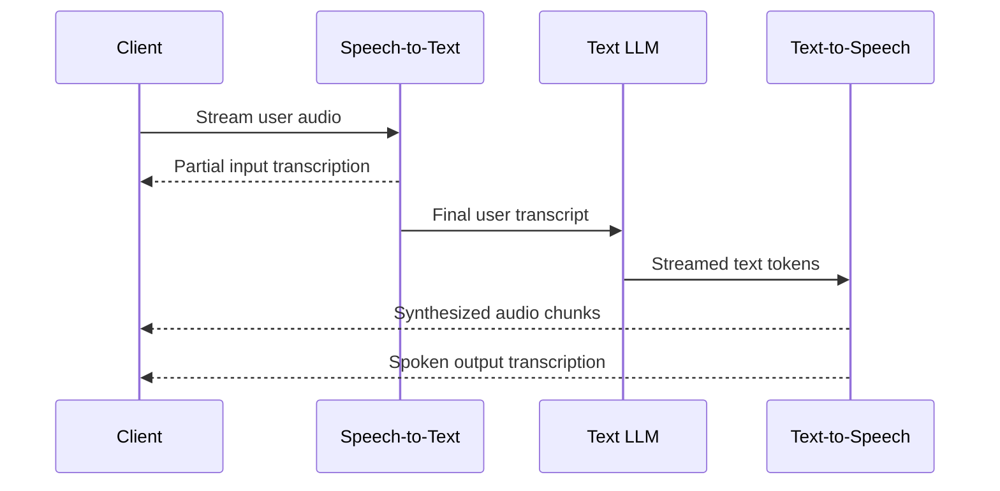

# カスケード（Cascaded）アーキテクチャ

<div class="language-support-tag">
    <span class="lst-supported">ADKでサポート</span><span class="lst-python">Python v2.13.0</span><span class="lst-preview">実験的機能</span>
</div>

カスケードアーキテクチャでは、`CascadeLive` がストリーミング音声テキスト変換（STT）、テキスト推論 LLM、およびストリーミングテキスト音声変換（TTS）を連結します。音声は3つのステージを順番に流れます。音声認識がユーザーの音声をテキストに文字起こしし、LLM がテキストに対して推論を行ってツールを呼び出し、音声合成がストリーミングされたテキスト応答を音声に変換します。

エージェントの `model` パラメータに `CascadeLive` を設定するため、既存の [`Runner.run_live()`](../sessions.md#the-run_live-loop) ループ、リクエストキュー、ツール、コールバック、ワークフローはそのまま変更なしで使用できます。同じエージェントはテキストのみのリクエスト向けに `Runner.run_async()` でも動作し、その場合は音声ステージをバイパスして内部のテキストモデルを直接呼び出します。

ネイティブの Speech-to-speech モデルとの比較については、[音声アーキテクチャの選択](index.md)をご覧ください。

## カスケードエージェントの設定 { #configure-a-cascaded-agent }

テキスト LLM、音声テキスト変換（STT）プロバイダ、およびテキスト音声変換（TTS）プロバイダを指定した `CascadeLive` インスタンスを `Agent` に渡します。

=== "Gemini"

    `google.adk.live` の `GeminiSTT` と `GeminiTTS` は既存の Google 認証情報を使用するため、追加のパッケージは不要です。

    ```python
    from google.adk.agents import Agent
    from google.adk.live import CascadeLive, GeminiSTT, GeminiTTS
    from google.genai import types

    root_agent = Agent(
        name="voice_assistant",
        model=CascadeLive(
            model="gemini-3.8-flash",
            stt=GeminiSTT(),
            tts=GeminiTTS(speech_config="Kore"),
        ),
        instruction=(
            "You are a voice assistant. Keep answers to one or two short "
            "sentences and end every sentence with punctuation. Write numbers, "
            "symbols, and abbreviations as spoken words."
        ),
        tools=[...],
        generate_content_config=types.GenerateContentConfig(
            thinking_config=types.ThinkingConfig(
                thinking_level=types.ThinkingLevel.LOW
            ),
        ),
    )
    ```

=== "ElevenLabs"

    ElevenLabs の追加パッケージ（`pip install "google-adk[elevenlabs]"`）をインストールし、環境に `ELEVENLABS_API_KEY` を設定します。

    ```python
    from google.adk.agents import Agent
    from google.adk.integrations.eleven_labs import ElevenLabsSTT, ElevenLabsTTS
    from google.adk.live import CascadeLive
    from google.genai import types

    root_agent = Agent(
        name="voice_assistant",
        model=CascadeLive(
            model="gemini-3.8-flash",
            stt=ElevenLabsSTT(),
            tts=ElevenLabsTTS(),
        ),
        instruction=(
            "You are a voice assistant. Keep answers to one or two short "
            "sentences and end every sentence with punctuation. Write numbers, "
            "symbols, and abbreviations as spoken words."
        ),
        tools=[...],
        generate_content_config=types.GenerateContentConfig(
            thinking_config=types.ThinkingConfig(
                thinking_level=types.ThinkingLevel.LOW
            ),
        ),
    )
    ```

エージェントの2つの設定が、音声のレイテンシと合成品質に直接影響します。

- **モデルの思考（Thinking）を最小限に抑える**: モデルの思考は最初の応答トークンが出力される前に実行されるため、最初の音声が再生されるまでの時間（time-to-first-audio）に直接加算されます。`generate_content_config` で低い思考レベル（またはトークン予算を使用するモデルではゼロの思考予算）を設定してください。
- **句読点の使用と略語の回避をプロンプトで指示する**: 組み込みの TTS プロバイダは文の境界でテキストを分割するため、LLM が応答全体を生成し終える前に最初の文の再生が開始されます。最初の文に `Dr. Smith` のような略語が含まれていると早期分割が引き起こされる可能性があり、逆に句読点のない出力は再生開始までより長くバッファリングされます。

`adk web` でエージェントを実行するか、[`Runner.run_live()`](../sessions.md#the-run_live-loop) で駆動します。Gemini と ElevenLabs の両方の音声プロバイダを使用した実行可能な完全なサンプルは、[`cascade` サンプル](https://github.com/google/adk-python/tree/main/contributing/samples/live/cascade)で入手できます。

## 仕組み



### キャプションとターン検出

- **ライブキャプションは追記ではなく置換する**: ユーザーが話している間、中間の文字起こしが `event.input_transcription` に届きます。増分の単語断片をストリーミングするネイティブ音声モデルとは異なり、カスケードモードの各中間更新にはその時点までの発話全体の仮説が含まれるため、クライアントは表示中のキャプションに追記するのではなく置換する必要があります。
- **カスタム語彙とクライアント制御の VAD**: サーバー側の音声アクティビティ検出（VAD）はデフォルトで有効になっています。`GeminiSTT` でドメイン固有の語彙を提供したり、クライアント側からターンの境界を制御（プッシュトゥトークなど）したりするには、`audio_transcription_config` を渡すか、自動アクティビティ検出を無効にして [`send_activity_start()` と `send_activity_end()`](../sessions.md#liverequestqueue) を呼び出します。

```python
from google.adk.live import GeminiSTT
from google.genai import types

stt = GeminiSTT(
    audio_transcription_config=types.AudioTranscriptionConfig(
        language_codes=["en-US"],
        custom_vocabulary=["Cymbal Direct", "Altostrat"],
    ),
    activity_detection=types.AutomaticActivityDetection(disabled=True),
)
```

### バージイン（割り込み）はユーザーが聞いた内容まで履歴を切り詰める

TTS プロバイダはリアルタイム再生よりも速く後続の文を合成するため、ユーザーが応答の途中で割り込んだ場合、クライアントのバッファにはユーザーがまだ聞いていない音声が残っていることがよくあります。

割り込みが発生すると、`CascadeLive` は音声合成と LLM の生成を停止し、クライアントが再生を止めるように割り込みイベントを発行して、クライアントで実際に再生された音声の量を推定します。ユーザーが実際に聞いた単語のみがセッション履歴と最終的な `output_transcription` に保存されるため、以降のターンでまだ発話されていないテキストが参照されることはありません。

## カスタム音声変換 { #custom-speech-transforms }

別の音声プロバイダを統合したり、ステージ間でテキストを検査したりするには、`google.adk.live` の `LiveIngress`（音声テキスト変換用）または `LiveEgress`（テキスト音声変換用）をサブクラス化します。

- `LiveIngress` は受信音声ストリームを読み取り、発話開始、部分的な文字起こし、ターン終了の各イベント（`UserSpeechStarted`、`PartialTranscript`、`UserTurnFinished`）を yield します。
- `LiveEgress` はストリーミングされた LLM のテキスト差分を読み取り、完了またはキャンセルされるまで、合成された音声チャンクと発話済み文字起こしイベント（`AudioChunk`、`AgentSpokenOutput`）を yield します。

音声合成前の LLM 出力はプレーンテキストであるため、任意の `LiveEgress` をラップして、1フレームの音声も生成される前にテキストの墨消し（リダクション）や変換を行うことができます。

```python
import asyncio
from typing import AsyncGenerator, AsyncIterator
from google.adk.live import EgressEvent, LiveEgress


class RedactingTTS(LiveEgress):
    """Redacts sensitive patterns from streamed LLM text before synthesis."""

    def __init__(self, inner_tts: LiveEgress, redact_fn):
        self._tts = inner_tts
        self._redact = redact_fn

    async def __call__(
        self, text: AsyncIterator[str], *, cancel: asyncio.Event
    ) -> AsyncGenerator[EgressEvent, None]:
        async def sanitized_text() -> AsyncGenerator[str, None]:
            async for delta in text:
                yield self._redact(delta)

        async for event in self._tts(sanitized_text(), cancel=cancel):
            yield event
```

## 考慮事項と制限事項

- **無音ベースのターン検出**: サーバー VAD は無音のしきい値を超えるとユーザーのターンを終了するため、文の途中で長い間が空くと、1つの発話が2つのターンに分割されることがあります。STT プロバイダで無音のしきい値を調整するか、クライアント制御のアクティビティシグナルを使用してください。
- **同期ツールの実行中は発話を避ける**: 同期ツール呼び出しの実行中にユーザーが話し終えると、新しいユーザーのターンがツール呼び出しとその応答の間に入り込み、そのセッション内の後続のモデルリクエストが失敗する原因になります。
- **クライアントのエコーキャンセレーション**: スピーカーの出力がマイクに拾われて誤ったユーザー割り込みとして検出されないよう、ブラウザやハードウェアの音響エコーキャンセレーション（AEC）またはヘッドフォンを使用してください。
