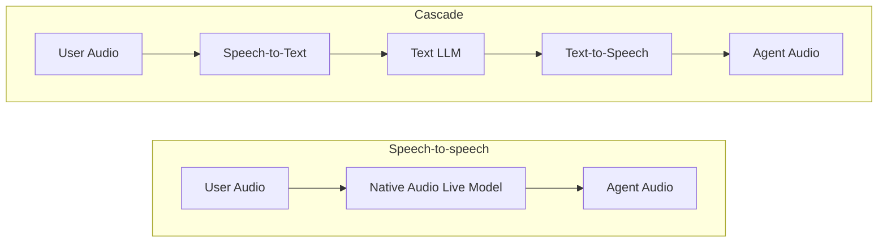

# 音声アーキテクチャの選択

<div class="language-support-tag">
    <span class="lst-supported">ADKでサポート</span><span class="lst-python">Python v2.13.0</span><span class="lst-java">Java v0.2.0</span>
</div>

ADKは、`Runner.run_live()` の下で2つの音声アーキテクチャをサポートしています。

- **[Speech-to-speech](speech-to-speech.md)**: 単一のネイティブ音声モデルが、Gemini Live APIを介して音声入力、推論、音声出力をエンドツーエンドで処理します。最小のレイテンシ、声の感情表現、またはライブ動画入力が最も重要な場合に最適です。
- **[カスケード (Cascade)](cascade.md)**: 音声テキスト変換（STT）、任意のテキスト推論LLM、テキスト音声変換（TTS）を順番に連結します。最先端のテキスト推論、モジュール式の音声プロバイダ、または合成前のテキストガードレールが最も重要な場合に最適です。

どちらのアーキテクチャも同じADKランタイムを使用します。セッションループ、リクエストキュー、イベントストリーム、ツール、コールバック、ワークフローはすべて同じままであり、アーキテクチャの切り替えはエージェントの `model` を変更するだけです。

=== "Speech-to-speech"

    ```python
    from google.adk.agents import Agent

    root_agent = Agent(
        name="voice_assistant",
        model="gemini-live-2.5-flash-native-audio",
        instruction="You are a helpful voice assistant.",
        tools=[...],
    )
    ```

=== "Cascade"

    ```python
    from google.adk.agents import Agent
    from google.adk.live import CascadeLive, GeminiSTT, GeminiTTS

    root_agent = Agent(
        name="voice_assistant",
        model=CascadeLive(
            model="gemini-3.8-flash",
            stt=GeminiSTT(),
            tts=GeminiTTS(speech_config="Kore"),
        ),
        instruction="You are a helpful voice assistant.",
        tools=[...],
    )
    ```

## アーキテクチャの比較



| 項目 | Speech-to-speech | Cascade |
| :--- | :--- | :--- |
| **エンドツーエンドのレイテンシ** | 最小（単一モデルのパス） | 中程度（ストリーミングと文単位のプリフェッチにより直列ステージをオーバーラップ） |
| **推論モデル** | ネイティブ音声Liveモデルのみ（[サポートされているモデル](../models.md)） | 任意のテキストLLM（Gemini Flash、Gemini Pro、またはサードパーティモデル） |
| **音声プロバイダ** | 組み込みのGemini Live音声 | モジュール式（Gemini、ElevenLabs、またはカスタムSTT/TTSプロバイダ） |
| **声のニュアンス** | トーンや感情を直接聞き取る、ネイティブな韻律（プロソディ） | STTが音声をテキストに変換し、TTSが文単位で合成する |
| **動画入力** | サポート（ライブカメラおよび画面フレーム） | 非サポート（音声とテキストのみ） |
| **テキストガードレール** | 音声生成と並行して文字起こしを検査 | ステージ間に完全なテキスト境界があり、合成前にテキストの検査や変更が可能 |
| **テキストのみの実行 (`run_async`)** | 非サポート | サポート（内部のテキストLLMを直接使用） |
| **SDKサポート** | Python、Java | Python（実験的機能） |
