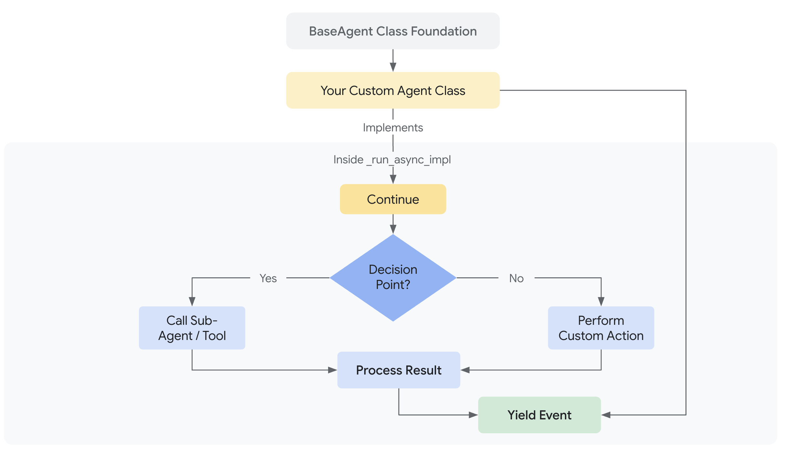

# 커스텀 에이전트

<div class="language-support-tag">
  <span class="lst-supported">ADK에서 지원</span><span class="lst-python">Python v0.1.0</span><span class="lst-typescript">Typescript v0.2.0</span><span class="lst-go">Go v0.1.0</span><span class="lst-java">Java v0.1.0</span><span class="lst-kotlin">Kotlin v0.1.0</span>
</div>

커스텀 에이전트는 `BaseAgent`를 직접 상속하고 자신만의 제어 흐름을 구현하여 **임의의 오케스트레이션 로직**을 정의할 수 있게 함으로써 ADK에서 최고의 유연성을 제공합니다. 이는 `SequentialAgent`, `LoopAgent`, `ParallelAgent`의 사전 정의된 패턴을 넘어서, 매우 특수하고 복잡한 에이전트 워크플로우를 구축할 수 있게 해줍니다.

!!! warning "대안: 그래프 기반 워크플로"

    ADK 2.0부터는 `BaseAgent`를 사용하는 에이전트 기반 워크플로가 [그래프 기반 워크플로](/ko/graphs/) 및 [동적 워크플로](/ko/graphs/dynamic/)를 포함한 보다 유연한 워크플로 구조로 대체되었습니다. 대상 워크플로를 위한 커스텀 에이전트를 빌드하기 ***전에*** 이러한 워크플로 메커니즘의 기능을 먼저 검토해야 합니다.

!!! warning "고급 개념"

    `_run_async_impl`(또는 다른 언어의 해당 메서드)을 직접 구현하여 커스텀 에이전트를 구축하는 것은 강력한 제어 기능을 제공하지만, 사전 정의된 `LlmAgent`나 표준 `WorkflowAgent` 타입을 사용하는 것보다 더 복잡합니다. 커스텀 오케스트레이션 로직을 다루기 전에 이러한 기본 에이전트 타입들을 먼저 이해하는 것을 권장합니다.

## 소개: 사전 정의된 워크플로우를 넘어서

### 커스텀 에이전트란?

커스텀 에이전트는 본질적으로 `google.adk.agents.BaseAgent`를 상속하고 `_run_async_impl` 비동기 메서드 내에 핵심 실행 로직을 구현하여 생성하는 모든 클래스입니다. 이 메서드가 다른 에이전트(하위 에이전트)를 호출하고, 상태를 관리하며, 이벤트를 처리하는 방식을 완벽하게 제어할 수 있습니다.

!!! Note
    에이전트의 핵심 비동기 로직을 구현하는 특정 메서드 이름은 SDK 언어에 따라 약간 다를 수 있습니다(예: Java의 `runAsyncImpl`, Python의 `_run_async_impl`). 자세한 내용은 언어별 API 문서를 참고하세요.

### 왜 사용해야 하는가?

표준 [워크플로우 에이전트](workflow-agents/index.md)(`SequentialAgent`, `LoopAgent`, `ParallelAgent`)가 일반적인 오케스트레이션 패턴을 다루지만, 요구 사항에 다음이 포함될 경우 커스텀 에이전트가 필요합니다.

*   **조건부 로직:** 런타임 조건이나 이전 단계의 결과에 따라 다른 하위 에이전트를 실행하거나 다른 경로를 택해야 할 경우.
*   **복잡한 상태 관리:** 단순한 순차적 전달을 넘어 워크플로우 전반에 걸쳐 상태를 유지하고 업데이트하기 위한 복잡한 로직을 구현해야 할 경우.
*   **외부 통합:** 오케스트레이션 흐름 제어 내에서 외부 API, 데이터베이스 또는 커스텀 라이브러리 호출을 직접 통합해야 할 경우.
*   **동적 에이전트 선택:** 상황이나 입력을 동적으로 평가하여 다음에 실행할 하위 에이전트를 선택해야 할 경우.
*   **독특한 워크플로우 패턴:** 표준적인 순차, 병렬 또는 루프 구조에 맞지 않는 오케스트레이션 로직을 구현해야 할 경우.



## 커스텀 로직 구현:

모든 커스텀 에이전트의 핵심은 고유한 비동기 동작을 정의하는 메서드입니다. 이 메서드를 통해 하위 에이전트를 오케스트레이션하고 실행 흐름을 관리할 수 있습니다.

=== "Python"

      모든 커스텀 에이전트의 심장은 `_run_async_impl` 메서드입니다. 이곳에서 고유한 동작을 정의합니다.
      
      *   **시그니처:** `async def _run_async_impl(self, ctx: InvocationContext) -> AsyncGenerator[Event, None]:`
      *   **비동기 제너레이터:** `async def` 함수여야 하며 `AsyncGenerator`를 반환해야 합니다. 이를 통해 하위 에이전트나 자체 로직에서 생성된 이벤트를 `yield`하여 실행기(runner)에 다시 전달할 수 있습니다.
      *   **`ctx` (InvocationContext):** 핵심적인 런타임 정보, 특히 `ctx.session.state`에 대한 접근을 제공합니다. 이는 커스텀 에이전트가 오케스트레이션하는 단계 간에 데이터를 공유하는 주요 방법입니다.
      *   **라이브 오디오 및 비디오 실행:** `_run_async_impl` 메서드는 비라이브 실행(`run_async()`)만 다룹니다. `run_live()`를 지원하려면 동일한 시그니처를 가진 `_run_live_impl`도 함께 오버라이드하세요. 이를 오버라이드하지 않으면 라이브 실행 시 `NotImplementedError`가 발생합니다.

=== "Go"

    Go에서는 `agent.Config`의 `Run` 함수를 `agent.New`에 전달하여 커스텀 에이전트를 생성합니다. `agent.Agent` 인터페이스에는 외부로 노출되지 않은(unexported) 메서드가 포함되어 있으므로 직접 구현할 수 없습니다. 실제 로직은 일반적으로 커스텀 에이전트 구조체의 메서드가 되며, 이를 `Run`으로 전달합니다.

    *   **시그니처:** `Run(ctx agent.InvocationContext) iter.Seq2[*session.Event, error]`
    *   **이터레이터:** `Run` 메서드는 이벤트와 오류를 반환하는 이터레이터(`iter.Seq2`)를 반환합니다. 이는 에이전트 실행에서 스트리밍 결과를 처리하는 표준적인 방법입니다.
    *   **`ctx` (InvocationContext):** `agent.InvocationContext`는 상태를 포함한 세션 및 기타 핵심적인 런타임 정보에 대한 접근을 제공합니다.
    *   **세션 상태:** `ctx.Session().State()`를 통해 세션 상태에 접근할 수 있습니다.

=== "Java"

    모든 커스텀 에이전트의 심장은 `BaseAgent`로부터 오버라이드하는 `runAsyncImpl` 메서드입니다.

    *   **시그니처:** `protected Flowable<Event> runAsyncImpl(InvocationContext ctx)`
    *   **리액티브 스트림 (`Flowable`):** `io.reactivex.rxjava3.core.Flowable<Event>`를 반환해야 합니다. 이 `Flowable`은 커스텀 에이전트의 로직에 의해 생성될 이벤트의 스트림을 나타내며, 종종 여러 하위 에이전트의 `Flowable`을 결합하거나 변환하여 만들어집니다.
    *   **`ctx` (InvocationContext):** 핵심적인 런타임 정보, 특히 `java.util.concurrent.ConcurrentMap<String, Object>`인 `ctx.session().state()`에 대한 접근을 제공합니다. 이는 커스텀 에이전트가 오케스트레이션하는 단계 간에 데이터를 공유하는 주요 방법입니다.

**핵심 비동기 메서드 내 주요 기능:**

=== "Python"

    1. **하위 에이전트 호출:** `run_async` 메서드를 사용하여 (일반적으로 `self.my_llm_agent`와 같은 인스턴스 속성으로 저장된) 하위 에이전트를 호출하고 그 이벤트를 yield합니다.

          ```python
          async for event in self.some_sub_agent.run_async(ctx):
              # 선택적으로 이벤트를 검사하거나 로그 기록
              yield event # 이벤트를 상위로 전달
          ```

    2. **상태 관리:** 세션 상태 딕셔너리(`ctx.session.state`)를 읽고 써서 하위 에이전트 호출 간에 데이터를 전달하거나 결정을 내립니다.
          ```python
          # 이전 에이전트가 설정한 데이터 읽기
          previous_result = ctx.session.state.get("some_key")
      
          # 상태에 기반한 결정
          if previous_result == "some_value":
              # ... 특정 하위 에이전트 호출 ...
          else:
              # ... 다른 하위 에이전트 호출 ...
      
          # 나중 단계를 위한 결과 저장 (종종 하위 에이전트의 output_key를 통해 수행됨)
          # ctx.session.state["my_custom_result"] = "calculated_value"
          ```

    3. **제어 흐름 구현:** 표준 Python 구문(`if`/`elif`/`else`, `for`/`while` 루프, `try`/`except`)을 사용하여 하위 에이전트를 포함하는 정교하고, 조건부이거나, 반복적인 워크플로우를 만듭니다.

=== "Go"

    1. **하위 에이전트 호출:** `Run` 메서드를 호출하여 하위 에이전트를 호출합니다.

          ```go
          // 예: 하나의 하위 에이전트를 실행하고 그 이벤트를 반환
          for event, err := range someSubAgent.Run(ctx) {
              if err != nil {
                  // 오류를 처리하거나 전파
                  return
              }
              // 호출자에게 이벤트를 반환
              if !yield(event, nil) {
                return
              }
          }
          ```

    2. **상태 관리:** 세션 상태를 읽고 써서 하위 에이전트 호출 간에 데이터를 전달하거나 결정을 내립니다.
          ```go
          // `ctx` (`agent.InvocationContext`)는 에이전트의 `Run` 함수에 직접 전달됨.
          // 이전 에이전트가 설정한 데이터 읽기
          previousResult, err := ctx.Session().State().Get("some_key")
          if err != nil {
              // 키가 아직 존재하지 않을 수 있는 경우 처리
          }

          // 상태에 기반한 결정
          if val, ok := previousResult.(string); ok && val == "some_value" {
              // ... 특정 하위 에이전트 호출 ...
          } else {
              // ... 다른 하위 에이전트 호출 ...
          }

          // 나중 단계를 위한 결과 저장
          if err := ctx.Session().State().Set("my_custom_result", "calculated_value"); err != nil {
              // 오류 처리
          }
          ```

    3. **제어 흐름 구현:** 표준 Go 구문(`if`/`else`, `for`/`switch` 루프, 고루틴, 채널)을 사용하여 하위 에이전트를 포함하는 정교하고, 조건부이거나, 반복적인 워크플로우를 만듭니다.

=== "Java"

    1. **하위 에이전트 호출:** 비동기 실행 메서드를 사용하여 (일반적으로 인스턴스 속성이나 객체로 저장된) 하위 에이전트를 호출하고 그 이벤트 스트림을 반환합니다.

           일반적으로 RxJava 연산자인 `concatWith`, `flatMapPublisher`, `concatArray` 등을 사용하여 하위 에이전트의 `Flowable`들을 연결합니다.

           ```java
           // 예: 하나의 하위 에이전트 실행
           // return someSubAgent.runAsync(ctx);
      
           // 예: 하위 에이전트를 순차적으로 실행
           Flowable<Event> firstAgentEvents = someSubAgent1.runAsync(ctx)
               .doOnNext(event -> System.out.println("에이전트 1의 이벤트: " + event.id()));
      
           Flowable<Event> secondAgentEvents = Flowable.defer(() ->
               someSubAgent2.runAsync(ctx)
                   .doOnNext(event -> System.out.println("에이전트 2의 이벤트: " + event.id()))
           );
      
           return firstAgentEvents.concatWith(secondAgentEvents);
           ```
           `Flowable.defer()`는 후속 단계의 실행이 이전 단계의 완료나 상태에 따라 달라지는 경우에 자주 사용됩니다.

    2. **상태 관리:** 세션 상태를 읽고 써서 하위 에이전트 호출 간에 데이터를 전달하거나 결정을 내립니다. 세션 상태는 `ctx.session().state()`를 통해 얻는 `java.util.concurrent.ConcurrentMap<String, Object>`입니다.
        
        ```java
        // 이전 에이전트가 설정한 데이터 읽기
        Object previousResult = ctx.session().state().get("some_key");

        // 상태에 기반한 결정
        if ("some_value".equals(previousResult)) {
            // ... 특정 하위 에이전트의 Flowable을 포함하는 로직 ...
        } else {
            // ... 다른 하위 에이전트의 Flowable을 포함하는 로직 ...
        }

        // 나중 단계를 위한 결과 저장 (종종 하위 에이전트의 output_key를 통해 수행됨)
        // ctx.session().state().put("my_custom_result", "calculated_value");
        ```

    3. **제어 흐름 구현:** 표준 언어 구문(`if`/`else`, 루프, `try`/`catch`)과 리액티브 연산자(RxJava)를 결합하여 정교한 워크플로우를 만듭니다.

          *   **조건부:** 조건에 따라 구독할 `Flowable`을 선택하기 위해 `Flowable.defer()`를 사용하거나, 스트림 내에서 이벤트를 필터링하는 경우 `filter()`를 사용합니다.
          *   **반복:** `repeat()`, `retry()` 같은 연산자를 사용하거나, 조건에 따라 `Flowable` 체인의 일부를 재귀적으로 호출하도록 구조화합니다(종종 `flatMapPublisher`나 `concatMap`으로 관리).

## 하위 에이전트와 상태 관리

일반적으로 커스텀 에이전트는 다른 에이전트(`LlmAgent`, `LoopAgent` 등)를 오케스트레이션합니다.

*   **초기화:** 보통 이러한 하위 에이전트의 인스턴스를 커스텀 에이전트의 생성자에 전달하고 인스턴스 필드/속성으로 저장합니다(예: `this.story_generator = story_generator_instance` 또는 `self.story_generator = story_generator_instance`). 이렇게 하면 커스텀 에이전트의 핵심 비동기 실행 로직(예: `_run_async_impl` 메서드) 내에서 접근할 수 있습니다. Python에서 `BaseAgent`는 `extra='forbid'`로 구성된 Pydantic 모델이므로, 유지하는 각 하위 에이전트를 `story_generator: LlmAgent`와 같이 타입 어노테이션이 지정된 클래스 수준 필드로 선언하고 `super().__init__(...)`에 전달해야 합니다. `__init__`에서 선언되지 않은 속성을 할당하면 `ValueError`가 발생합니다.
*   **하위 에이전트 목록:** `super()` 생성자를 사용하여 `BaseAgent`를 초기화할 때, `sub agents` 목록을 전달해야 합니다. 이 목록은 ADK 프레임워크에게 이 커스텀 에이전트의 직계 계층에 속한 에이전트가 무엇인지 알려줍니다. 이는 핵심 실행 로직(`_run_async_impl`)이 `self.xxx_agent`를 통해 에이전트를 직접 호출하더라도 생명주기 관리, 인트로스펙션, 그리고 잠재적인 미래 라우팅 기능과 같은 프레임워크 기능에 중요합니다. 커스텀 로직이 최상위 수준에서 직접 호출하는 에이전트들을 포함시키세요.
*   **상태:** 언급했듯이, `ctx.session.state`는 하위 에이전트(특히 `output key`를 사용하는 `LlmAgent`)가 결과를 오케스트레이터에게 다시 전달하고 오케스트레이터가 필요한 입력을 전달하는 표준적인 방법입니다.

## 에이전트 기반 워크플로 기본 요소

다음 섹션에서는 다중 에이전트 시스템을 효과적으로 구축하고 관리할 수 있게 해주는 에이전트 계층 구조, 워크플로 에이전트, 상호작용 메커니즘과 같은 핵심 ADK 기본 요소(primitives)를 자세히 설명합니다. ADK는 다중 에이전트 시스템 내에서 상호작용을 구조화하고 관리할 수 있는 핵심 구성 요소인 기본 요소를 제공합니다.

!!! Note

    기본 요소에 대한 특정 매개변수나 메서드 이름은 SDK 언어에 따라 약간 다를 수 있습니다(예: Python의 `sub_agents`, Java의 `subAgents`). 자세한 내용은 언어별 API 문서를 참고하세요.

### 에이전트 계층 구조: 부모 에이전트와 하위 에이전트

다중 에이전트 시스템을 구조화하는 기반은 `BaseAgent`에 정의된 부모-자식 관계입니다.

* **계층 구조 설정:** 부모 에이전트를 초기화할 때 `sub_agents` 인수에 에이전트 인스턴스 목록을 전달하여 트리 구조를 만듭니다. ADK는 초기화 중에 각 자식 에이전트에 `parent_agent` 속성을 자동으로 설정합니다.
* **단일 부모 규칙:** 에이전트 인스턴스는 한 번만 하위 에이전트로 추가될 수 있습니다. 두 번째 부모를 할당하려고 하면 `ValueError`가 발생합니다.
* **중요성:** 이 계층 구조는 [워크플로 에이전트](#workflow-agents-as-orchestrators)의 범위를 정의하고 LLM 기반 위임의 잠재적 대상을 결정하는 데 영향을 줍니다. `agent.parent_agent`를 사용하여 계층 구조를 탐색하거나 `agent.find_agent(name)`를 사용하여 하위 에이전트를 찾을 수 있습니다.

=== "Python"

    ```python
    # 개념 예시: 계층 구조 정의
    from typing import AsyncGenerator

    from google.adk.agents import LlmAgent, BaseAgent
    from google.adk.agents.invocation_context import InvocationContext
    from google.adk.events import Event


    # 커스텀 비-LLM 에이전트는 _run_async_impl을 구현해야 합니다.
    # BaseAgent를 직접 인스턴스화하면 실행 시 NotImplementedError가 발생합니다.
    class TaskExecutor(BaseAgent):
        async def _run_async_impl(
            self, ctx: InvocationContext
        ) -> AsyncGenerator[Event, None]:
            yield Event(author=self.name)


    # 개별 에이전트 정의
    greeter = LlmAgent(name="Greeter", model="gemini-flash-latest")
    task_doer = TaskExecutor(name="TaskExecutor") # 커스텀 비-LLM 에이전트


    # 부모 에이전트를 생성하고 sub_agents를 통해 자식 할당
    coordinator = LlmAgent(
        name="Coordinator",
        model="gemini-flash-latest",
        description="인사와 작업을 조정합니다.",
        sub_agents=[ # 여기에 sub_agents 할당
            greeter,
            task_doer
        ]
    )


    # 프레임워크가 자동으로 설정:
    # assert greeter.parent_agent == coordinator
    # assert task_doer.parent_agent == coordinator
    ```

=== "TypeScript"

    ```typescript
    // 개념 예시: 계층 구조 정의
    import { LlmAgent, BaseAgent, InvocationContext } from '@google/adk';
    import type { Event, createEventActions } from '@google/adk';

    class TaskExecutorAgent extends BaseAgent {
      async *runAsyncImpl(context: InvocationContext): AsyncGenerator<Event, void, void> {
        yield {
          id: 'event-1',
          invocationId: context.invocationId,
          author: this.name,
          content: { parts: [{ text: 'Task completed!' }] },
          actions: createEventActions(),
          timestamp: Date.now(),
        };
      }
      async *runLiveImpl(context: InvocationContext): AsyncGenerator<Event, void, void> {
        this.runAsyncImpl(context);
      }
    }

    // 개별 에이전트 정의
    const greeter = new LlmAgent({name: 'Greeter', model: 'gemini-flash-latest'});
    const taskDoer = new TaskExecutorAgent({name: 'TaskExecutor'}); // 커스텀 비-LLM 에이전트

    // 부모 에이전트를 생성하고 subAgents를 통해 자식 할당
    const coordinator = new LlmAgent({
        name: 'Coordinator',
        model: 'gemini-flash-latest',
        description: '인사와 작업을 조정합니다.',
        subAgents: [ // 여기에 subAgents 할당
            greeter,
            taskDoer
        ],
    });

    // 프레임워크가 자동으로 설정:
    // console.assert(greeter.parentAgent === coordinator);
    // console.assert(taskDoer.parentAgent === coordinator);
    ```

=== "Go"

    ```go
    import (
        "google.golang.org/adk/v2/agent"
        "google.golang.org/adk/v2/agent/llmagent"
    )

    --8<-- "examples/go/snippets/agents/multi-agent/main.go:hierarchy"
    ```

=== "Java"

    ```java
    // 개념 예시: 계층 구조 정의
    import com.google.adk.agents.SequentialAgent;
    import com.google.adk.agents.LlmAgent;


    // 개별 에이전트 정의
    LlmAgent greeter = LlmAgent.builder().name("Greeter").model("gemini-flash-latest").build();
    SequentialAgent taskDoer = SequentialAgent.builder().name("TaskExecutor").subAgents(...).build(); // 순차 에이전트


    // 부모 에이전트를 생성하고 sub_agents 할당
    LlmAgent coordinator = LlmAgent.builder()
        .name("Coordinator")
        .model("gemini-flash-latest")
        .description("인사와 작업을 조정합니다")
        .subAgents(greeter, taskDoer) // 여기에 sub_agents 할당
        .build();


    // 프레임워크가 자동으로 설정:
    // assert greeter.parentAgent().equals(coordinator);
    // assert taskDoer.parentAgent().equals(coordinator);
    ```

=== "Kotlin"

    ```kotlin
    --8<-- "examples/kotlin/snippets/agents/multi-agent/MultiAgentExample.kt:custom_agent"
    --8<-- "examples/kotlin/snippets/agents/multi-agent/MultiAgentExample.kt:hierarchy"
    ```

### 오케스트레이터로서의 워크플로 에이전트 {#workflow-agents-as-orchestrators}

ADK는 자체적으로 작업을 수행하지 않고 `sub_agents`의 실행 흐름을 조율(orchestrate)하는 `BaseAgent`에서 파생된 특수 에이전트를 포함합니다.

!!! note "Python 및 TypeScript에서 지원 중단됨(Deprecated)"

    Python 및 TypeScript에서 `SequentialAgent`, `ParallelAgent`,
    `LoopAgent`는 `Workflow`로 대체되어 지원 중단(deprecated)되었습니다. 이를 생성하면
    지원 중단 경고가 발생하며, 해당 클래스는 향후 릴리스에서 제거될 예정입니다.
    `Workflow`는 `LlmAgent`의 하위 에이전트로 사용할 수 없습니다.

* **[`SequentialAgent`](workflow-agents/sequential-agents.md):** `sub_agents`를 나열된 순서대로 하나씩 실행합니다.
    * **컨텍스트:** *동일한* [`InvocationContext`](../runtime/index.md)를 순차적으로 전달하여 에이전트가 공유 상태를 통해 쉽게 결과를 전달할 수 있도록 합니다.

=== "Python"

    ```python
    # 개념 예시: 순차 파이프라인
    from google.adk.agents import SequentialAgent, LlmAgent

    step1 = LlmAgent(name="Step1_Fetch", output_key="data") # 출력을 state['data']에 저장
    step2 = LlmAgent(name="Step2_Process", instruction="{data}에서 데이터를 처리합니다.")

    pipeline = SequentialAgent(name="MyPipeline", sub_agents=[step1, step2])
    # pipeline이 실행되면 Step2는 Step1이 설정한 state['data']에 접근할 수 있습니다.
    ```

=== "TypeScript"

    ```typescript
    // 개념 예시: 순차 파이프라인
    import { SequentialAgent, LlmAgent } from '@google/adk';

    const step1 = new LlmAgent({name: 'Step1_Fetch', outputKey: 'data'}); // 출력을 state['data']에 저장
    const step2 = new LlmAgent({name: 'Step2_Process', instruction: 'Process data from {data}.'});

    const pipeline = new SequentialAgent({name: 'MyPipeline', subAgents: [step1, step2]});
    // pipeline이 실행되면 Step2는 Step1이 설정한 state['data']에 접근할 수 있습니다.
    ```

=== "Go"

    ```go
    import (
        "google.golang.org/adk/v2/agent"
        "google.golang.org/adk/v2/agent/llmagent"
        "google.golang.org/adk/v2/agent/workflowagents/sequentialagent"
    )

    --8<-- "examples/go/snippets/agents/multi-agent/main.go:sequential-pipeline"
    ```

=== "Java"

    ```java
    // 개념 예시: 순차 파이프라인
    import com.google.adk.agents.SequentialAgent;
    import com.google.adk.agents.LlmAgent;

    LlmAgent step1 = LlmAgent.builder().name("Step1_Fetch").outputKey("data").build(); // 출력을 state.get("data")에 저장
    LlmAgent step2 = LlmAgent.builder().name("Step2_Process").instruction("Process data from {data}.").build();

    SequentialAgent pipeline = SequentialAgent.builder().name("MyPipeline").subAgents(step1, step2).build();
    // pipeline이 실행되면 Step2는 Step1이 설정한 state.get("data")에 접근할 수 있습니다.
    ```

=== "Kotlin"

    ```kotlin
    --8<-- "examples/kotlin/snippets/agents/multi-agent/MultiAgentExample.kt:sequential_pipeline"
    ```

* **[`ParallelAgent`](workflow-agents/parallel-agents.md):** `sub_agents`를 병렬로 실행합니다. 하위 에이전트의 이벤트는 서로 섞여 발생할 수 있습니다.
    * **컨텍스트:** 각 자식 에이전트에 대해 `InvocationContext.branch`를 수정하여(예: `ParentBranch.ChildName`) 고유한 컨텍스트 경로를 제공하며, 이는 일부 메모리 구현에서 히스토리를 격리하는 데 유용할 수 있습니다.
    * **상태:** 브랜치가 다르더라도 모든 병렬 자식은 *동일한 공유* `session.state`에 접근하여 초기 상태를 읽고 결과를 쓸 수 있습니다(경합 조건을 피하기 위해 고유한 키 사용).

=== "Python"

    ```python
    # 개념 예시: 병렬 실행
    from google.adk.agents import ParallelAgent, LlmAgent

    fetch_weather = LlmAgent(name="WeatherFetcher", output_key="weather")
    fetch_news = LlmAgent(name="NewsFetcher", output_key="news")

    gatherer = ParallelAgent(name="InfoGatherer", sub_agents=[fetch_weather, fetch_news])
    # gatherer가 실행되면 WeatherFetcher와 NewsFetcher가 동시에 실행됩니다.
    # 후속 에이전트는 state['weather']와 state['news']를 읽을 수 있습니다.
    ```

=== "TypeScript"

    ```typescript
    // 개념 예시: 병렬 실행
    import { ParallelAgent, LlmAgent } from '@google/adk';

    const fetchWeather = new LlmAgent({name: 'WeatherFetcher', outputKey: 'weather'});
    const fetchNews = new LlmAgent({name: 'NewsFetcher', outputKey: 'news'});

    const gatherer = new ParallelAgent({name: 'InfoGatherer', subAgents: [fetchWeather, fetchNews]});
    // gatherer가 실행되면 WeatherFetcher와 NewsFetcher가 동시에 실행됩니다.
    // 후속 에이전트는 state['weather']와 state['news']를 읽을 수 있습니다.
    ```

=== "Go"

    ```go
    import (
        "google.golang.org/adk/v2/agent"
        "google.golang.org/adk/v2/agent/llmagent"
        "google.golang.org/adk/v2/agent/workflowagents/parallelagent"
    )

    --8<-- "examples/go/snippets/agents/multi-agent/main.go:parallel-execution"
    ```

=== "Java"

    ```java
    // 개념 예시: 병렬 실행
    import com.google.adk.agents.LlmAgent;
    import com.google.adk.agents.ParallelAgent;


    LlmAgent fetchWeather = LlmAgent.builder()
        .name("WeatherFetcher")
        .outputKey("weather")
        .build();


    LlmAgent fetchNews = LlmAgent.builder()
        .name("NewsFetcher")
        .instruction("news")
        .build();


    ParallelAgent gatherer = ParallelAgent.builder()
        .name("InfoGatherer")
        .subAgents(fetchWeather, fetchNews)
        .build();


    // gatherer가 실행되면 WeatherFetcher와 NewsFetcher가 동시에 실행됩니다.
    // 후속 에이전트는 state['weather']와 state['news']를 읽을 수 있습니다.
    ```

=== "Kotlin"

    ```kotlin
    --8<-- "examples/kotlin/snippets/agents/multi-agent/MultiAgentExample.kt:parallel_execution"
    ```

  * **[`LoopAgent`](workflow-agents/loop-agents.md):** `sub_agents`를 루프 안에서 순차적으로 실행합니다.
      * **종료:** 선택적 `max_iterations`에 도달하거나, 하위 에이전트가 `Event Actions`에 `escalate=True`를 포함한 [`Event`](../events/index.md)를 반환하면 루프가 중지됩니다.
      * **컨텍스트 및 상태:** 각 반복에서 *동일한* `InvocationContext`를 전달하여 상태 변경(예: 카운터, 플래그)이 루프 간에 유지되도록 합니다.

=== "Python"

      ```python
      # 개념 예시: 조건부 루프
      from google.adk.agents import LoopAgent, LlmAgent, BaseAgent
      from google.adk.events import Event, EventActions
      from google.adk.agents.invocation_context import InvocationContext
      from typing import AsyncGenerator

      class CheckCondition(BaseAgent): # 상태를 확인하는 커스텀 에이전트
          async def _run_async_impl(self, ctx: InvocationContext) -> AsyncGenerator[Event, None]:
              status = ctx.session.state.get("status", "pending")
              is_done = (status == "completed")
              yield Event(author=self.name, actions=EventActions(escalate=is_done)) # 완료되면 escalate

      process_step = LlmAgent(name="ProcessingStep") # state['status']를 업데이트할 수 있는 에이전트

      poller = LoopAgent(
          name="StatusPoller",
          max_iterations=10,
          sub_agents=[process_step, CheckCondition(name="Checker")]
      )
      # poller가 실행되면 Checker가 escalate할 때(state['status'] == 'completed')까지 또는 10회 반복될 때까지
      # process_step과 Checker를 반복적으로 실행합니다.
      ```

=== "TypeScript"

    ```typescript
    // 개념 예시: 조건부 루프
    import { LoopAgent, LlmAgent, BaseAgent, InvocationContext } from '@google/adk';
    import type { Event, createEventActions, EventActions } from '@google/adk';

    class CheckConditionAgent extends BaseAgent { // 상태를 확인하는 커스텀 에이전트
        async *runAsyncImpl(ctx: InvocationContext): AsyncGenerator<Event> {
            const status = ctx.session.state['status'] || 'pending';
            const isDone = status === 'completed';
            yield createEvent({ author: 'check_condition', actions: createEventActions({ escalate: isDone }) });
        }

        async *runLiveImpl(ctx: InvocationContext): AsyncGenerator<Event> {
            // 미구현
        }
    };

    const processStep = new LlmAgent({name: 'ProcessingStep'}); // state['status']를 업데이트할 수 있는 에이전트

    const poller = new LoopAgent({
        name: 'StatusPoller',
        maxIterations: 10,
        // sub_agents를 루프 안에서 순차적으로 실행
        subAgents: [processStep, new CheckConditionAgent ({name: 'Checker'})]
    });
    // poller가 실행되면 Checker가 escalate할 때(state['status'] === 'completed')까지 또는 10회 반복될 때까지
    // processStep과 Checker를 반복적으로 실행합니다.
    ```

=== "Go"

    ```go
    import (
        "iter"
        "google.golang.org/adk/v2/agent"
        "google.golang.org/adk/v2/agent/llmagent"
        "google.golang.org/adk/v2/agent/workflowagents/loopagent"
        "google.golang.org/adk/v2/session"
    )

    --8<-- "examples/go/snippets/agents/multi-agent/main.go:loop-with-condition"
    ```

=== "Java"

    ```java
    // 개념 예시: 조건부 루프
    // 상태를 확인하고 잠재적으로 escalate하는 커스텀 에이전트
    public static class CheckConditionAgent extends BaseAgent {
      public CheckConditionAgent(String name, String description) {
        super(name, description, List.of(), null, null);
      }

      @Override
      protected Flowable<Event> runAsyncImpl(InvocationContext ctx) {
        String status = (String) ctx.session().state().getOrDefault("status", "pending");
        boolean isDone = "completed".equalsIgnoreCase(status);

        // 조건이 충족되면 escalate(루프 종료) 신호를 보내는 이벤트를 발행합니다.
        // 완료되지 않으면 escalate 플래그는 false이거나 없어 루프가 계속됩니다.
        Event checkEvent = Event.builder()
                .author(name())
                .id(Event.generateEventId()) // 이벤트에 고유 ID를 부여하는 것이 중요합니다
                .actions(EventActions.builder().escalate(isDone).build()) // 완료되면 escalate
                .build();
        return Flowable.just(checkEvent);
      }
    }

    // state.put("status")를 업데이트할 수 있는 에이전트
    LlmAgent processingStepAgent = LlmAgent.builder().name("ProcessingStep").build();
    // 조건 확인을 위한 커스텀 에이전트 인스턴스
    CheckConditionAgent conditionCheckerAgent = new CheckConditionAgent(
        "ConditionChecker",
        "상태가 'completed'인지 확인합니다."
    );
    LoopAgent poller = LoopAgent.builder().name("StatusPoller").maxIterations(10).subAgents(processingStepAgent, conditionCheckerAgent).build();
    // poller가 실행되면 Checker가 escalate할 때(state.get("status") == "completed")까지 또는 10회 반복될 때까지
    // processingStepAgent와 conditionCheckerAgent를 반복적으로 실행합니다.
    ```

=== "Kotlin"

    ```kotlin
    --8<-- "examples/kotlin/snippets/agents/multi-agent/MultiAgentExample.kt:check_condition_agent"
    --8<-- "examples/kotlin/snippets/agents/multi-agent/MultiAgentExample.kt:loop_with_condition"
    ```

### 상호작용 및 통신 메커니즘

시스템 내의 에이전트는 종종 서로 데이터를 교환하거나 동작을 트리거해야 합니다. ADK는 이를 다음과 같이 지원합니다.

#### 공유 세션 상태

동일한 호출 내에서 작동하여 `InvocationContext`를 통해 동일한 [`Session`](/ko/sessions/session/) 객체를 공유하는 에이전트들이 수동적으로 통신하는 가장 기본적인 방법입니다.

* **메커니즘:** 한 에이전트(또는 그 도구/콜백)가 값을 쓰고(`context.state['data_key'] = processed_data`), 후속 에이전트가 이를 읽습니다(`data = context.state.get('data_key')`). Python에서 [`CallbackContext`](../callbacks/index.md)와 `ToolContext`는 동일한 델타 인식(delta-aware) 컨텍스트 클래스이며, `context.state`에 대한 모든 쓰기는 에이전트가 발행하는 이벤트에 `state_delta`로 기록됩니다.
* **편의성:** [`LlmAgent`](llm-agents.md)의 `output_key` 속성은 에이전트의 최종 응답 텍스트(또는 구조화된 출력)를 지정된 상태 키에 자동으로 저장합니다.
* **특성:** 비동기적, 수동적 통신. `SequentialAgent`에 의해 조율되는 파이프라인이나 `LoopAgent` 반복 간 데이터 전달에 이상적입니다.
* **참고:** [상태 관리](../sessions/state.md)

!!! note "호출 컨텍스트와 `temp:` 상태"
    부모 에이전트가 하위 에이전트를 호출할 때 동일한 `InvocationContext`를 전달합니다. 이는 그들이 동일한 임시(`temp:`) 상태를 공유한다는 것을 의미하며, 현재 턴에만 관련된 데이터를 전달하는 데 이상적입니다.

=== "Python"

    ```python
    # 개념 예시: output_key 사용 및 상태 읽기
    from google.adk.agents import LlmAgent, SequentialAgent


    agent_A = LlmAgent(name="AgentA", instruction="프랑스의 수도를 찾으세요.", output_key="capital_city")
    agent_B = LlmAgent(name="AgentB", instruction="{capital_city}에 저장된 도시에 대해 알려주세요.")


    pipeline = SequentialAgent(name="CityInfo", sub_agents=[agent_A, agent_B])
    # AgentA가 실행되어 "Paris"를 state['capital_city']에 저장합니다.
    # AgentB가 실행되어 instruction 프로세서가 state['capital_city']를 읽어 "Paris"를 가져옵니다.
    ```

=== "TypeScript"

    ```typescript
    // 개념 예시: outputKey 사용 및 상태 읽기
    import { LlmAgent, SequentialAgent } from '@google/adk';

    const agentA = new LlmAgent({name: 'AgentA', instruction: 'Find the capital of France.', outputKey: 'capital_city'});
    const agentB = new LlmAgent({name: 'AgentB', instruction: 'Tell me about the city stored in {capital_city}.'});

    const pipeline = new SequentialAgent({name: 'CityInfo', subAgents: [agentA, agentB]});
    // AgentA가 실행되어 "Paris"를 state['capital_city']에 저장합니다.
    // AgentB가 실행되어 instruction 프로세서가 state['capital_city']를 읽어 "Paris"를 가져옵니다.
    ```

=== "Go"

    ```go
    import (
        "google.golang.org/adk/v2/agent"
        "google.golang.org/adk/v2/agent/llmagent"
        "google.golang.org/adk/v2/agent/workflowagents/sequentialagent"
    )

    --8<-- "examples/go/snippets/agents/multi-agent/main.go:output-key-state"
    ```

=== "Java"

    ```java
    // 개념 예시: outputKey 사용 및 상태 읽기
    import com.google.adk.agents.LlmAgent;
    import com.google.adk.agents.SequentialAgent;


    LlmAgent agentA = LlmAgent.builder()
        .name("AgentA")
        .instruction("Find the capital of France.")
        .outputKey("capital_city")
        .build();


    LlmAgent agentB = LlmAgent.builder()
        .name("AgentB")
        .instruction("Tell me about the city stored in {capital_city}.")
        .outputKey("capital_city")
        .build();


    SequentialAgent pipeline = SequentialAgent.builder().name("CityInfo").subAgents(agentA, agentB).build();
    // AgentA가 실행되어 "Paris"를 state('capital_city')에 저장합니다.
    // AgentB가 실행되어 instruction 프로세서가 state.get("capital_city")를 읽어 "Paris"를 가져옵니다.
    ```

=== "Kotlin"

    ```kotlin
    --8<-- "examples/kotlin/snippets/agents/multi-agent/MultiAgentExample.kt:output_key_state"
    ```

#### LLM 위임 및 에이전트 전환 {#delegation}

[`LlmAgent`](llm-agents.md)의 이해 능력을 활용하여 계층 구조 내의 다른 적합한 에이전트로 작업을 동적으로 라우팅합니다.

* **메커니즘:** 에이전트의 LLM이 특정 함수 호출을 생성합니다: `transfer_to_agent(agent_name='target_agent_name')`.
* **처리:** 하위 에이전트가 존재하거나 전환이 금지되지 않은 경우 기본적으로 사용되는 `AutoFlow`가 이 호출을 가로챕니다. `root_agent.find_agent()`를 사용하여 대상 에이전트를 식별하고 `InvocationContext`를 업데이트하여 실행 초점을 전환합니다.
* **요구사항:** 호출하는 `LlmAgent`는 언제 전환할지에 대한 명확한 `instructions`이 필요하며, 잠재적 대상 에이전트는 LLM이 정보에 입각한 결정을 내릴 수 있도록 고유한 `description`이 필요합니다. 전환 범위(부모, 하위 에이전트, 형제)는 `LlmAgent`에서 구성할 수 있습니다.
* **특성:** LLM 해석에 기반한 동적이고 유연한 라우팅.

=== "Python"

    ```python
    # 개념 설정: LLM 전환
    from google.adk.agents import LlmAgent


    booking_agent = LlmAgent(name="Booker", description="항공편 및 호텔 예약을 처리합니다.")
    info_agent = LlmAgent(name="Info", description="일반 정보 제공 및 질문에 답변합니다.")


    coordinator = LlmAgent(
        name="Coordinator",
        model="gemini-flash-latest",
        instruction="당신은 어시스턴트입니다. 예약 작업은 Booker에게, 정보 요청은 Info에게 위임하세요.",
        description="메인 코디네이터.",
        # AutoFlow는 일반적으로 여기에 암시적으로 사용됩니다
        sub_agents=[booking_agent, info_agent]
    )
    # coordinator가 "항공편 예약해줘"라는 요청을 받으면, LLM은 다음을 생성해야 합니다:
    # FunctionCall(name='transfer_to_agent', args={'agent_name': 'Booker'})
    # 그러면 ADK 프레임워크가 실행을 booking_agent로 라우팅합니다.
    ```

=== "TypeScript"

    ```typescript
    // 개념 설정: LLM 전환
    import { LlmAgent } from '@google/adk';

    const bookingAgent = new LlmAgent({name: 'Booker', description: '항공편 및 호텔 예약을 처리합니다.'});
    const infoAgent = new LlmAgent({name: 'Info', description: '일반 정보 제공 및 질문에 답변합니다.'});

    const coordinator = new LlmAgent({
        name: 'Coordinator',
        model: 'gemini-flash-latest',
        instruction: '당신은 어시스턴트입니다. 예약 작업은 Booker에게, 정보 요청은 Info에게 위임하세요.',
        description: '메인 코디네이터.',
        // AutoFlow는 일반적으로 여기에 암시적으로 사용됩니다
        subAgents: [bookingAgent, infoAgent]
    });
    // coordinator가 "항공편 예약해줘"라는 요청을 받으면, LLM은 다음을 생성해야 합니다:
    // {functionCall: {name: 'transfer_to_agent', args: {agent_name: 'Booker'}}}
    // 그러면 ADK 프레임워크가 실행을 bookingAgent로 라우팅합니다.
    ```

=== "Go"

    ```go
    import (
        "google.golang.org/adk/v2/agent/llmagent"
    )

    --8<-- "examples/go/snippets/agents/multi-agent/main.go:llm-transfer"
    ```

=== "Java"

    ```java
    // 개념 설정: LLM 전환
    import com.google.adk.agents.LlmAgent;


    LlmAgent bookingAgent = LlmAgent.builder()
        .name("Booker")
        .description("항공편 및 호텔 예약을 처리합니다.")
        .build();


    LlmAgent infoAgent = LlmAgent.builder()
        .name("Info")
        .description("일반 정보 제공 및 질문에 답변합니다.")
        .build();


    // 코디네이터 에이전트 정의
    LlmAgent coordinator = LlmAgent.builder()
        .name("Coordinator")
        .model("gemini-flash-latest") // 또는 원하는 모델
        .instruction("당신은 어시스턴트입니다. 예약 작업은 Booker에게, 정보 요청은 Info에게 위임하세요.")
        .description("메인 코디네이터.")
        // AutoFlow는 하위 에이전트가 있고 전환이 금지되지 않았기 때문에
        // 기본적으로 (암시적으로) 사용됩니다.
        .subAgents(bookingAgent, infoAgent)
        .build();

    // coordinator가 "항공편 예약해줘"라는 요청을 받으면, LLM은 다음을 생성해야 합니다:
    // FunctionCall.builder.name("transferToAgent").args(ImmutableMap.of("agent_name", "Booker")).build()
    // 그러면 ADK 프레임워크가 실행을 bookingAgent로 라우팅합니다.
    ```

=== "Kotlin"

    ```kotlin
    --8<-- "examples/kotlin/snippets/agents/multi-agent/MultiAgentExample.kt:llm_transfer"
    ```

#### `AgentTool`을 사용한 명시적 호출

[`LlmAgent`](llm-agents.md)가 다른 `BaseAgent` 인스턴스를 호출 가능한 함수나 [도구](/ko/tools-custom/)로 취급할 수 있게 합니다.

* **메커니즘:** 대상 에이전트 인스턴스를 `AgentTool`로 감싸고 부모 `LlmAgent`의 `tools` 목록에 포함시킵니다. `AgentTool`은 LLM을 위한 해당 함수 선언을 생성합니다.
* **처리:** 부모 LLM이 `AgentTool`을 대상으로 하는 함수 호출을 생성하면, 프레임워크는 `AgentTool.run_async`를 실행합니다. 이 메서드는 대상 에이전트를 실행하고, 최종 응답을 캡처하고, 모든 상태/아티팩트 변경 사항을 부모의 컨텍스트로 다시 전달하며, 응답을 도구의 결과로 반환합니다.
* **특성:** 다른 도구와 마찬가지로 동기적(부모의 흐름 내에서), 명시적이고 제어된 호출.
* **(참고:** `AgentTool`은 명시적으로 가져와서 사용해야 합니다).

=== "Python"

    ```python
    # 개념 설정: 도구로서의 에이전트
    from google.adk import Event
    from google.adk.agents import LlmAgent, BaseAgent
    from google.adk.tools import agent_tool
    from google.genai import types
    from pydantic import BaseModel


    # 대상 에이전트 정의 (LlmAgent 또는 커스텀 BaseAgent 가능)
    class ImageGeneratorAgent(BaseAgent): # 예제 커스텀 에이전트
        name: str = "ImageGen"
        description: str = "프롬프트를 기반으로 이미지를 생성합니다."
        # ... 내부 로직 ...
        async def _run_async_impl(self, ctx): # 단순화된 실행 로직
            prompt = ctx.session.state.get("image_prompt", "default prompt")
            # ... 이미지 바이트 생성 ...
            image_bytes = b"..."
            yield Event(author=self.name, content=types.Content(parts=[types.Part.from_bytes(data=image_bytes, mime_type="image/png")]))


    image_agent = ImageGeneratorAgent()
    image_tool = agent_tool.AgentTool(agent=image_agent) # 에이전트 래핑


    # 부모 에이전트가 AgentTool 사용
    artist_agent = LlmAgent(
        name="Artist",
        model="gemini-flash-latest",
        instruction="프롬프트를 만들고 ImageGen 도구를 사용하여 이미지를 생성하세요.",
        tools=[image_tool] # AgentTool 포함
    )
    # Artist LLM이 프롬프트를 생성한 후 다음을 호출합니다:
    # FunctionCall(name='ImageGen', args={'image_prompt': '모자를 쓴 고양이'})
    # 프레임워크가 image_tool.run_async(...)를 호출하고, 이는 ImageGeneratorAgent를 실행합니다.
    # 결과 이미지 Part는 도구 결과로 Artist 에이전트에게 반환됩니다.
    ```

=== "Go"

    ```go
    import (
        "fmt"
        "iter"
        "google.golang.org/adk/v2/agent"
        "google.golang.org/adk/v2/agent/llmagent"
        "google.golang.org/adk/v2/model"
        "google.golang.org/adk/v2/session"
        "google.golang.org/adk/v2/tool"
        "google.golang.org/adk/v2/tool/agenttool"
        "google.golang.org/genai"
    )

    --8<-- "examples/go/snippets/agents/multi-agent/main.go:agent-as-tool"
    ```

=== "Java"

    ```java
    // 개념 설정: 도구로서의 에이전트
    import com.google.adk.agents.BaseAgent;
    import com.google.adk.agents.LlmAgent;
    import com.google.adk.tools.AgentTool;

    // 예제 커스텀 에이전트 (LlmAgent 또는 커스텀 BaseAgent 가능)
    public class ImageGeneratorAgent extends BaseAgent  {

      public ImageGeneratorAgent(String name, String description) {
        super(name, description, List.of(), null, null);
      }

      // ... 내부 로직 ...
      @Override
      protected Flowable<Event> runAsyncImpl(InvocationContext invocationContext) { // 단순화된 실행 로직
        invocationContext.session().state().get("image_prompt");
        // 이미지 바이트 생성
        // ...

        Event responseEvent = Event.builder()
            .author(this.name())
            .content(Content.fromParts(Part.fromText("\b...")))
            .build();

        return Flowable.just(responseEvent);
      }

      @Override
      protected Flowable<Event> runLiveImpl(InvocationContext invocationContext) {
        return null;
      }
    }

    // AgentTool을 사용하여 에이전트 래핑
    ImageGeneratorAgent imageAgent = new ImageGeneratorAgent("image_agent", "이미지를 생성합니다");
    AgentTool imageTool = AgentTool.create(imageAgent);

    // 부모 에이전트가 AgentTool 사용
    LlmAgent artistAgent = LlmAgent.builder()
            .name("Artist")
            .model("gemini-flash-latest")
            .instruction(
                    "당신은 예술가입니다. 이미지에 대한 상세한 프롬프트를 만든 다음 " +
                            "'ImageGen' 도구를 사용하여 이미지를 생성하세요. " +
                            "'ImageGen' 도구는 이미지 프롬프트를 포함하는 'request'라는 단일 문자열 인수를 기대합니다. " +
                            "도구는 'result' 필드에 'image_base64', 'mime_type', 'status'를 포함하는 JSON 문자열을 반환합니다."
            )
            .description("생성 도구를 사용하여 이미지를 만들 수 있는 에이전트입니다.")
            .tools(imageTool) // AgentTool 포함
            .build();

    // Artist LLM이 프롬프트를 생성한 후 다음을 호출합니다:
    // FunctionCall(name='ImageGen', args={'imagePrompt': '모자를 쓴 고양이'})
    // 프레임워크가 imageTool.runAsync(...)를 호출하고, 이는 ImageGeneratorAgent를 실행합니다.
    // 결과 이미지 Part는 도구 결과로 Artist 에이전트에게 반환됩니다.
    ```

=== "Kotlin"

    ```kotlin
    --8<-- "examples/kotlin/snippets/agents/multi-agent/MultiAgentExample.kt:agent_as_tool"
    ```

## 디자인 패턴 예시: `StoryFlowAgent`

조건부 로직이 포함된 다단계 콘텐츠 생성 워크플로우 예시 패턴으로 커스텀 에이전트의 강력함을 설명해 보겠습니다.

**목표:** 이야기를 생성하고, 비평과 수정을 통해 반복적으로 개선하며, 최종 검사를 수행하고, 결정적으로 *최종 톤 검사에 실패하면 이야기를 재생성하는* 시스템을 만드는 것입니다.

**왜 커스텀인가?** 여기서 커스텀 에이전트가 필요한 핵심 요구 사항은 **톤 검사에 기반한 조건부 재생성**입니다. 표준 워크플로우 에이전트는 하위 에이전트 작업의 결과에 따른 조건부 분기 기능이 내장되어 있지 않습니다. 오케스트레이터 내에 커스텀 로직(`if tone == "negative": ...`)이 필요합니다.

---

### 1부: 단순화된 커스텀 에이전트 초기화 { #part-1-simplified-custom-agent-initialization }

=== "Python"

    `BaseAgent`를 상속하는 `StoryFlowAgent`를 정의합니다. `__init__`에서 (전달받은) 필요한 하위 에이전트를 인스턴스 속성으로 저장하고, 이 커스텀 에이전트가 직접 오케스트레이션할 최상위 에이전트를 `BaseAgent` 프레임워크에 알립니다.
    
    ```python
    --8<-- "examples/python/snippets/agents/custom-agent/storyflow_agent.py:init"
    ```

=== "Go"

    `StoryFlowAgent` 구조체와 생성자를 정의합니다. 생성자에서 필요한 하위 에이전트를 저장하고, 이 커스텀 에이전트가 직접 오케스트레이션할 최상위 에이전트를 `BaseAgent` 프레임워크에 알립니다.

    ```go
    --8<-- "examples/go/snippets/agents/custom-agent/storyflow_agent.go:init"
    ```

=== "Java"

    `BaseAgent`를 확장하여 `StoryFlowAgentExample`을 정의합니다. **생성자**에서 (매개변수로 전달된) 필요한 하위 에이전트 인스턴스를 인스턴스 필드로 저장합니다. 이 커스텀 에이전트가 직접 오케스트레이션할 이 최상위 하위 에이전트들은 `BaseAgent`의 `super` 생성자에도 목록으로 전달됩니다.

    ```java
    --8<-- "examples/java/snippets/src/main/java/agents/StoryFlowAgentExample.java:init"
    ```

---

### 2부: 커스텀 실행 로직 정의 { #part-2-defining-the-custom-execution-logic }

=== "Python"

    이 메서드는 표준 Python async/await 및 제어 흐름을 사용하여 하위 에이전트를 오케스트레이션합니다.
    
    ```python
    --8<-- "examples/python/snippets/agents/custom-agent/storyflow_agent.py:executionlogic"
    ```
    **로직 설명:**

    1. 초기 `story_generator`가 실행됩니다. 그 출력은 `ctx.session.state["current_story"]`에 있을 것으로 예상됩니다.
    2. `loop_agent`가 실행되며, 내부적으로 `critic`과 `reviser`를 `max_iterations` 횟수만큼 순차적으로 호출합니다. 이들은 상태에서 `current_story`와 `criticism`을 읽고 씁니다.
    3. `sequential_agent`가 실행되며, `grammar_check`와 `tone_check`를 차례로 호출하여 `current_story`를 읽고 `grammar_suggestions`와 `tone_check_result`를 상태에 씁니다.
    4. **커스텀 부분:** `if` 문은 상태에서 `tone_check_result`를 확인합니다. 만약 "negative"라면, `story_generator`가 *다시* 호출되어 상태의 `current_story`를 덮어씁니다. 그렇지 않으면 흐름이 종료됩니다.

=== "Go"

    `Run` 메서드는 각 하위 에이전트의 `Run` 메서드를 루프에서 호출하고 그 이벤트를 반환하여 하위 에이전트를 오케스트레이션합니다.

    ```go
    --8<-- "examples/go/snippets/agents/custom-agent/storyflow_agent.go:executionlogic"
    ```
    **로직 설명:**

    1. 초기 `storyGenerator`가 실행됩니다. 그 출력은 세션 상태의 `"current_story"` 키 아래에 있을 것으로 예상됩니다.
    2. `revisionLoopAgent`가 실행되며, 내부적으로 `critic`과 `reviser`를 `max_iterations` 횟수만큼 순차적으로 호출합니다. 이들은 상태에서 `current_story`와 `criticism`을 읽고 씁니다.
    3. `postProcessorAgent`가 실행되며, `grammar_check`와 `tone_check`를 차례로 호출하여 `current_story`를 읽고 `grammar_suggestions`와 `tone_check_result`를 상태에 씁니다.
    4. **커스텀 부분:** 코드는 상태에서 `tone_check_result`를 확인합니다. 만약 "negative"라면, `story_generator`가 *다시* 호출되어 상태의 `current_story`를 덮어씁니다. 그렇지 않으면 흐름이 종료됩니다.

=== "Java"
    
    `runAsyncImpl` 메서드는 RxJava의 Flowable 스트림과 연산자를 사용하여 비동기 제어 흐름으로 하위 에이전트를 오케스트레이션합니다.

    ```java
    --8<-- "examples/java/snippets/src/main/java/agents/StoryFlowAgentExample.java:executionlogic"
    ```
    **로직 설명:**

    1. 초기 `storyGenerator.runAsync(invocationContext)` Flowable이 실행됩니다. 그 출력은 `invocationContext.session().state().get("current_story")`에 있을 것으로 예상됩니다.
    2. (`Flowable.concatArray`와 `Flowable.defer` 덕분에) 다음으로 `loopAgent`의 Flowable이 실행됩니다. LoopAgent는 내부적으로 `critic`과 `reviser` 하위 에이전트를 최대 `maxIterations`만큼 순차적으로 호출합니다. 이들은 상태에서 `current_story`와 `criticism`을 읽고 씁니다.
    3. 그 다음, `sequentialAgent`의 Flowable이 실행됩니다. 이는 `grammar_check`와 `tone_check`를 차례로 호출하여 `current_story`를 읽고 `grammar_suggestions`와 `tone_check_result`를 상태에 씁니다.
    4. **커스텀 부분:** sequentialAgent가 완료된 후, `Flowable.defer` 내의 로직이 `invocationContext.session().state()`에서 "tone_check_result"를 확인합니다. 만약 "negative"라면, `storyGenerator` Flowable이 *조건부로 연결되어* 다시 실행되고 "current_story"를 덮어씁니다. 그렇지 않으면 빈 Flowable이 사용되고 전체 워크플로우는 완료로 진행됩니다.

---

### 3부: LLM 하위 에이전트 정의 { #part-3-defining-the-llm-sub-agents }

이것들은 특정 작업을 책임지는 표준 `LlmAgent` 정의입니다. 그들의 `output key` 매개변수는 결과를 `session.state`에 배치하여 다른 에이전트나 커스텀 오케스트레이터가 접근할 수 있도록 하는 데 중요합니다.

!!! tip "지시문에 상태 직접 주입"
    `story_generator`의 지시문을 주목하세요. `{var}` 구문은 플레이스홀더입니다. 지시문이 LLM으로 전송되기 전에, ADK 프레임워크는 (예: `{topic}`)을 `session.state['topic']`의 값으로 자동으로 대체합니다. 이것은 지시문에서 템플릿을 사용하여 에이전트에 컨텍스트를 제공하는 권장 방법입니다. 자세한 내용은 [상태 문서](../sessions/state.md#accessing-session-state-in-agent-instructions)를 참고하세요.

=== "Python"

    ```python
    GEMINI_2_FLASH = "gemini-flash-latest" # 모델 상수 정의
    --8<-- "examples/python/snippets/agents/custom-agent/storyflow_agent.py:llmagents"
    ```
=== "Java"

    ```java
    --8<-- "examples/java/snippets/src/main/java/agents/StoryFlowAgentExample.java:llmagents"
    ```

=== "Go"

    ```go
    --8<-- "examples/go/snippets/agents/custom-agent/storyflow_agent.go:llmagents"
    ```

---

### 4부: 커스텀 에이전트 인스턴스화 및 실행 { #part-4-instantiating-and-running-the-custom-agent }

마지막으로, `StoryFlowAgent`를 인스턴스화하고 평소처럼 `Runner`를 사용합니다.

=== "Python"

    ```python
    --8<-- "examples/python/snippets/agents/custom-agent/storyflow_agent.py:story_flow_agent"
    ```

=== "Go"

    ```go
    --8<-- "examples/go/snippets/agents/custom-agent/storyflow_agent.go:story_flow_agent"
    ```

=== "Java"

    ```java
    --8<-- "examples/java/snippets/src/main/java/agents/StoryFlowAgentExample.java:story_flow_agent"
    ```

*(참고: import 및 실행 로직을 포함한 전체 실행 가능 코드는 아래 링크에서 찾을 수 있습니다.)*

---

### Storyflow 에이전트 코드 목록 {#storyflow-agent-code-listing}

???+ "Storyflow 에이전트"

    === "Python"
    
        ```python
        # StoryFlowAgent 예제의 전체 실행 가능 코드
        --8<-- "examples/python/snippets/agents/custom-agent/storyflow_agent.py"
        ```

    === "TypeScript"

        ```typescript
        // StoryFlowAgent 예제의 전체 실행 가능 코드
        --8<-- "examples/typescript/snippets/agents/custom-agent/storyflow_agent.ts"
        ```
    
    === "Go"

        ```go
        // StoryFlowAgent 예제의 전체 실행 가능 코드
        --8<-- "examples/go/snippets/agents/custom-agent/storyflow_agent.go:full_code"
        ```

    === "Java"
    
        ```java
        // StoryFlowAgent 예제의 전체 실행 가능 코드
        --8<-- "examples/java/snippets/src/main/java/agents/StoryFlowAgentExample.java:full_code"
        ```

## TypeScript 예제 보강

영어 원문에 포함된 TypeScript StoryFlow 예제를 아래에 함께 제공합니다.

### TypeScript: 초기화

```typescript
--8<-- "examples/typescript/snippets/agents/custom-agent/storyflow_agent.ts:init"
```

### TypeScript: 실행 로직

```typescript
--8<-- "examples/typescript/snippets/agents/custom-agent/storyflow_agent.ts:executionlogic"
```

### TypeScript: LLM 하위 에이전트

```typescript
--8<-- "examples/typescript/snippets/agents/custom-agent/storyflow_agent.ts:llmagents"
```

### TypeScript: StoryFlow 에이전트

```typescript
--8<-- "examples/typescript/snippets/agents/custom-agent/storyflow_agent.ts:story_flow_agent"
```
