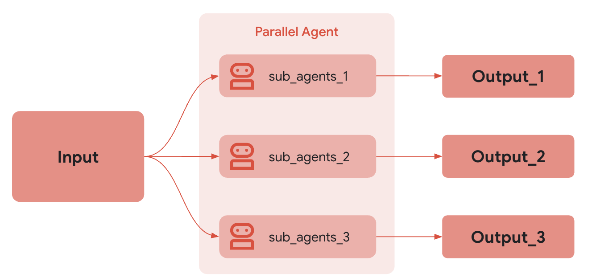

# 병렬 에이전트

<div class="language-support-tag">
  <span class="lst-supported">ADK에서 지원</span><span class="lst-python">Python v0.1.0</span><span class="lst-typescript">TypeScript v0.2.0</span><span class="lst-go">Go v0.1.0</span><span class="lst-java">Java v0.2.0</span><span class="lst-kotlin">Kotlin v0.1.0</span>
</div>

`ParallelAgent`는 하위 에이전트를 *동시에(concurrently)* 실행하는 [워크플로 에이전트](index.md)입니다. 작업이 독립적으로 수행될 수 있는 워크플로의 속도를 크게 향상시킵니다.

처리 속도가 중요하고 서로 독립적이면서 리소스를 많이 사용하는 작업이 포함된 시나리오에서는 `ParallelAgent`를 사용하여 효율적으로 병렬 실행할 수 있습니다. **하위 에이전트가 종속성 없이 작동할 때 각 작업을 동시에 수행하여** 전체 처리 시간을 크게 줄일 수 있습니다.

다른 [워크플로 에이전트](index.md)와 마찬가지로, `ParallelAgent`는 LLM으로 구동되지 않으므로 실행 방식이 결정적(deterministic)입니다. 즉, 워크플로 에이전트는 개별 작업의 내부 추론이 아니라 실행 흐름 제어(하위 에이전트의 병렬 실행)만 담당합니다. 워크플로 에이전트의 도구나 하위 에이전트는 LLM을 활용할 수도 있고, 그렇지 않을 수도 있습니다.

!!! warning "지원 중단됨(Deprecated): 그래프 기반 워크플로 사용"

    ADK Python, TypeScript, Go 및 Kotlin에서 템플릿 워크플로는
    [그래프 기반 워크플로](/ko/graphs/)와
    [동적 워크플로](/ko/graphs/dynamic/)를 포함한 더 유연한 워크플로 구조로 대체되었습니다.

### 예시

이 접근 방식은 다중 소스 데이터 조회(retrieval)나 대규모 연산과 같은 작업에 특히 유용하며, 병렬화를 통해 상당한 성능 향상을 얻을 수 있습니다. 중요한 점은, 이 전략은 동시에 실행되는 에이전트 간에 공유 상태나 직접적인 정보 교환이 필요 없다고 가정한다는 것입니다.

### 작동 방식

`ParallelAgent`의 `run_async()` 메서드가 호출될 때:

1.  **동시 실행:** `sub_agents` 목록에 있는 *각* 하위 에이전트의 `run_async()` 메서드를 *동시에* 시작합니다. 이는 모든 에이전트가 (거의) 동시에 실행을 시작한다는 것을 의미합니다.
2.  **독립적인 분기:** 각 하위 에이전트는 자체 실행 분기에서 작동하며, 실행 중 이러한 분기 간에는 대화 기록이 ***자동으로* 공유되지 않습니다**. 하위 에이전트는 자신의 분기에 있는 이벤트만 볼 수 있습니다. 반면 세션 상태는 공유됩니다. 모든 분기가 동일한 세션에 대해 실행되므로 한 하위 에이전트가(예: `output_key`를 통해) 기록한 값은 다른 분기 및 후속 에이전트에서 볼 수 있습니다.
3.  **결과 수집:** `ParallelAgent`는 하위 에이전트들의 이벤트 스트림을 병합하고 각 이벤트가 생성되는 대로 yield합니다. 나중에 읽을 수 있도록 결과를 목록으로 모아 두지 않습니다. 분기가 서로 교차(interleave)되므로 이벤트 순서는 결정적이지 않습니다. 하위 에이전트의 결과를 사용하려면 공유 세션 상태(예: `output_key`를 통해 지정된 키)에서 읽어야 합니다.

### 독립적인 실행과 상태 관리

`ParallelAgent` 내의 하위 에이전트가 독립적으로 실행된다는 것을 이해하는 것이 *매우 중요합니다*. 만약 이 에이전트들 간의 통신이나 데이터 공유가 *필요하다면*, 명시적으로 구현해야 합니다. 가능한 접근 방식은 다음과 같습니다.

*   **공유 세션 상태:** 모든 분기는 동일한 세션에 대해 실행되므로 각 하위 에이전트에 `output_key`를 지정하고 후속 에이전트의 지침에서 해당 키들을 읽으세요. 분기들이 동시에 실행되므로 한 분기가 아직 쓰고 있는 키를 다른 분기에서 읽는 방식에 의존하지 마세요.
*   **외부 상태 관리:** 외부 데이터베이스, 메시지 큐 또는 다른 메커니즘을 사용하여 공유 상태를 관리하고 에이전트 간의 통신을 용이하게 합니다.
*   **후처리:** 각 분기에서 결과를 수집한 다음, 데이터를 조정하는 로직을 구현합니다.

{: width="600"}

### 전체 예시: 병렬 웹 리서치

여러 주제를 동시에 조사하는 상황을 상상해 보세요.

1.  **리서처 에이전트 1:** "재생 가능 에너지원"을 조사하는 `LlmAgent`입니다.
2.  **리서처 에이전트 2:** "전기 자동차 기술"을 조사하는 `LlmAgent`입니다.
3.  **리서처 에이전트 3:** "탄소 포집 방법"을 조사하는 `LlmAgent`입니다.

    ```py
    ParallelAgent(name="ParallelWebResearchAgent", sub_agents=[ResearcherAgent1, ResearcherAgent2, ResearcherAgent3])
    ```

이러한 연구 작업들은 독립적입니다. `ParallelAgent`를 사용하면 이들을 동시에 실행할 수 있어, 순차적으로 실행하는 것에 비해 총 연구 시간을 잠재적으로 크게 줄일 수 있습니다. 이후에 각 에이전트의 결과를 사용하려면 각 에이전트에 `output_key`를 지정하고 세션 상태에서 해당 키를 읽으세요.

???+ "전체 코드"

    === "Python"
        ```py
         --8<-- "examples/python/snippets/agents/workflow-agents/parallel_agent_web_research.py:init"
        ```

    === "Go"
        ```go
         --8<-- "examples/go/snippets/agents/workflow-agents/parallel/main.go:init"
        ```

    === "Java"
        ```java
         --8<-- "examples/java/snippets/src/main/java/agents/workflow/ParallelResearchPipeline.java:full_code"
        ```

    === "Kotlin"
        ```kotlin
         --8<-- "examples/kotlin/snippets/agents/workflow-agents/ParallelAgentWebResearch.kt:init"
        ```

## TypeScript 예제 보강

영어 원문에 포함된 TypeScript 병렬 에이전트 예제를 아래에 함께 제공합니다.

```typescript
--8<-- "examples/typescript/snippets/agents/workflow-agents/parallel_agent_web_research.ts:init"
```

!!! tip "모든 에이전트를 위한 전역 지침"

    `App`의 `GlobalInstructionPlugin`([Python](https://github.com/google/adk-python/blob/main/src/google/adk/plugins/global_instruction_plugin.py), [TypeScript](https://github.com/google/adk-js/blob/main/core/src/plugins/global_instruction_plugin.ts), [Java](https://github.com/google/adk-java/blob/main/core/src/main/java/com/google/adk/plugins/GlobalInstructionPlugin.java)) 또는 에이전트의 `GlobalInstruction` 매개변수([Go](https://github.com/google/adk-go/blob/main/agent/llmagent/llmagent.go))를 사용하여 워크플로 전체에 일관된 규칙을 적용하세요.
