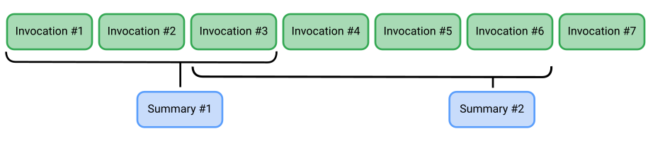

# 성능 향상을 위한 에이전트 컨텍스트 압축

<div class="language-support-tag">
  <span class="lst-supported">ADK 지원</span><span class="lst-python">Python v1.16.0</span><span class="lst-go">Go v2.3.0</span><span class="lst-java">Java v0.2.0</span><span class="lst-typescript">TypeScript v0.6.0</span><span class="lst-kotlin">Kotlin v0.7.0</span>
</div>

ADK 에이전트는 실행되면서 사용자 지침(instruction), 조회된 데이터, 도구 응답, 생성된 콘텐츠 등 다양한 *컨텍스트* 정보를 누적합니다. 컨텍스트 크기가 커질수록 생성형 AI 모델로 전송되는 페이로드가 늘어나 처리 시간이 길어지고 응답 속도가 저하됩니다. ADK의 컨텍스트 압축(Context Compaction) 기능은 에이전트 실행 중 지침, 입력, 모델 응답을 포함한 이전 세션 히스토리를 요약하여 컨텍스트 크기를 줄여줍니다. 컨텍스트 윈도우를 작게 유지함으로써 최근 상호작용에 필요한 핵심 맥락은 보존하면서도 **지연 시간(latency)을 줄이고 토큰 비용을 절감**합니다.

컨텍스트 압축은 `EventsCompactionConfig`에 정의한 규칙에 따라 자동으로 실행됩니다. 토큰 기반 압축은 SingleFlow에서 모델 호출 직전에 `CompactionRequestProcessor`를 통해 먼저 검사되고, 각 호출(invocation)이 끝난 뒤 `Runner`에서 다시 한 번 검사됩니다. 슬라이딩 윈도우 압축은 각 호출이 완료된 후 `Runner`에서 실행됩니다.

## 전략 선택

`EventsCompactionConfig`에서는 다음 두 가지 전략으로 세션 컨텍스트를 관리할 수 있습니다.

- **토큰 기반 (주요 전략)**: 실제로 소비된 토큰 수를 기준으로 압축을 트리거합니다. 예측하기 어려운 대용량 코드 블록 입력이나 파일 업로드 같은 워크로드에서 컨텍스트 한도를 지키는 안전장치 역할을 합니다.
- **슬라이딩 윈도우 (턴 기반)**: 일정 횟수의 대화 턴(turn)이 진행된 후 압축을 트리거합니다. 길이가 비교적 일정하고 예측 가능한 일반 텍스트 대화에 적합합니다.

두 전략을 함께 설정하면 토큰 기반 압축이 우선 적용됩니다. 세션 토큰 수가 설정된 임계값을 초과하면 토큰 기반 압축이 실행되며, 해당 턴에서는 슬라이딩 윈도우 압축을 건너뜁니다.

## 토큰 기반 압축

토큰 기반 압축은 이벤트나 턴 횟수가 아니라 실제 토큰 사용량을 기준으로 컨텍스트 압축을 수행합니다.

### 구성 설정

`App` 객체에 `EventsCompactionConfig`를 설정하여 에이전트 워크플로에 토큰 기반 압축을 적용합니다. 다음 두 매개변수를 함께 지정해야 합니다.

- **`token_threshold`**: 도달 시 테일 유지(tail-retention) 압축을 자동으로 트리거할 토큰 임계값입니다.
- **`event_retention_size`**: 압축 실행 시 요약하지 않고 원본(raw) 상태 그대로 남겨둘 최근 이벤트 수입니다. 직전 대화 맥락과 대명사 참조 해석(pronoun resolution)을 자연스럽게 유지해 줍니다.

프로젝트에서 토큰 기반 압축을 구현하려면 다음 구성을 사용하세요.

=== "Python"

    ```python
    # 1. google.adk 네임스페이스를 사용하도록 가져오기 경로 수정
    from google.adk.apps.app import App, EventsCompactionConfig
    from google.adk.agents import Agent

    # 2. 루트 에이전트 초기화 (App 설정에 필수)
    root_agent = Agent(
        name="my_root_agent",
        description="Main coordinating agent for the workflow."
    )

    # 3. 토큰 기반 구성: 우선순위/사전 호출 레이어 활성화
    compaction_config = EventsCompactionConfig(
        token_threshold=4000,     # 실제 토큰 수가 이를 초과할 때 압축 트리거
        event_retention_size=5    # 토큰 한도 도달 시 원본 그대로 유지할 최근 이벤트 수
    )

    # 4. 필수 name 및 root_agent 필드와 구성 객체를 사용하여 등록
    app = App(
        name="my_compacting_agent_app",
        root_agent=root_agent,
        events_compaction_config=compaction_config
    )
    ```

=== "Go"

    ```go
    import (
        "google.golang.org/adk/v2/runner"
        "google.golang.org/adk/v2/session/compaction"
    )

    // 두 필드를 모두 설정하지 않으면 runner.New가 오류를 반환합니다.
    r, err := runner.New(runner.Config{
        AppName:        "my_compacting_agent_app",
        Agent:          rootAgent,
        SessionService: sessionService,
        Compaction: &compaction.Config{
            TokenThreshold:     4000, // 프롬프트가 이 토큰 수에 도달하면 압축을 실행합니다.
            EventRetentionSize: 5,    // 원본 그대로 유지할 최근 이벤트 수입니다.
        },
    })
    ```

## 슬라이딩 윈도우 압축

슬라이딩 윈도우 방식은 [세션](/ko/sessions/session/) 내 에이전트 워크플로 이벤트를 일정 구간 단위로 묶어 요약합니다. 이 기능을 구성하면 현재 세션에서 새로 완료된 호출(invocation) 횟수가 지정한 임계값에 도달할 때마다 이전 이벤트 기록을 요약합니다.

```python
# (선택 사항) 보조 설정으로 호출 횟수 기반 슬라이딩 윈도우 사용
compaction_config = EventsCompactionConfig(
    compaction_interval=10,   # 압축을 실행할 신규 호출(invocation) 주기
    overlap_size=2,           # 문맥 연속성을 위해 중복 포함할 이전 호출 수
)
```

## 컨텍스트 압축 구성

`App` 객체(Python/Java/Kotlin)에 이벤트 압축 설정을 추가하거나, `LlmAgent`(TypeScript)에 `contextCompactors`를 구성하거나, `Runner` 구성(Go)에 `Compaction`을 설정하여 에이전트 워크플로에 컨텍스트 압축을 적용합니다. 다음 샘플 코드와 같이 언어에 따라 압축 주기와 오버랩 크기(Python/Java), 압축 주기와 선택적 오버랩 크기(Go), 또는 토큰 임계값과 이벤트 유지 개수(TypeScript/Kotlin/Go)를 지정해야 합니다.

=== "Python"

    ```python
    from google.adk.apps.app import App
    from google.adk.apps.app import EventsCompactionConfig

    app = App(
        name='my-agent',
        root_agent=root_agent,
        events_compaction_config=EventsCompactionConfig(
            compaction_interval=3,  # 3개의 새 호출마다 압축을 트리거합니다.
            overlap_size=1          # 이전 창의 마지막 호출을 포함합니다.
        ),
    )
    ```

=== "Java"

    ```java
    import com.google.adk.apps.App;
    import com.google.adk.summarizer.EventsCompactionConfig;

    App app = App.builder()
        .name("my-agent")
        .rootAgent(rootAgent)
        .eventsCompactionConfig(EventsCompactionConfig.builder()
            .compactionInterval(3)  // 3개의 새 호출마다 압축을 트리거합니다.
            .overlapSize(1)         // 이전 창의 마지막 호출을 포함합니다.
            .build())
        .build();
    ```

=== "TypeScript"

    ```typescript
    import {Gemini, LlmAgent, LlmSummarizer, TokenBasedContextCompactor} from '@google/adk';

    const agent = new LlmAgent({
      name: 'my-agent',
      model: 'gemini-flash-latest',
      contextCompactors: [
        new TokenBasedContextCompactor({
          tokenThreshold: 1000, // 세션이 1000토큰을 넘으면 압축을 트리거합니다.
          eventRetentionSize: 1, // 원본 이벤트를 최소 1개 유지합니다(오버랩).
          summarizer: new LlmSummarizer({
            llm: new Gemini({model: 'gemini-flash-latest'}),
          }),
        }),
      ],
    });
    ```

=== "Kotlin"

    ```kotlin
    import com.google.adk.kt.apps.App
    import com.google.adk.kt.summarizer.EventsCompactionConfig

    // tokenThreshold와 eventRetentionSize는 반드시 함께 설정해야 하며, 둘 중 하나만 설정하면 예외가 발생합니다.
    // Kotlin은 다른 탭에서 사용된 compactionInterval/overlapSize 쌍도 허용합니다.
    val app =
        App(
            appName = "my-agent",
            rootAgent = rootAgent,
            eventsCompactionConfig =
                EventsCompactionConfig(
                    tokenThreshold = 1000, // 마지막 프롬프트가 1000 토큰을 초과할 때 압축합니다.
                    eventRetentionSize = 1, // 최소 1개의 원시 이벤트를 유지합니다.
                ),
        )
    ```

=== "Go"

    ```go
    import (
    	"google.golang.org/adk/v2/runner"
    	"google.golang.org/adk/v2/session/compaction"
    )

    // Compaction is set on the runner rather than on an App object.
    r, err := runner.New(runner.Config{
    	AppName:        "my-agent",
    	Agent:          rootAgent,
    	SessionService: sessionService,
    	Compaction: &compaction.Config{
    		CompactionInterval: 3, // Trigger compaction every 3 new invocations.
    		OverlapSize:        1, // Include last invocation from the previous window.
    	},
    })
    ```

구성을 마치면 세션이 설정된 주기나 토큰 임계값에 도달할 때마다 ADK `Runner`가 자동으로 압축을 수행합니다.

## 컨텍스트 압축 예시

`compaction_interval`을 `3`, `overlap_size`를 `1`로 설정하면 3번째, 6번째, 9번째 호출(invocation)이 완료될 때마다 이벤트 데이터가 압축됩니다. 오버랩 설정에 따라 그림 1과 같이 두 번째 요약부터는 직전 윈도우의 마지막 호출이 함께 포함됩니다.


**그림 1.** 주기(`compaction_interval`) 3, 오버랩(`overlap_size`) 1로 설정한 컨텍스트 압축 동작 예시.

이 구성에서 컨텍스트 압축은 다음 순서로 동작합니다.

1.  **3번째 호출 완료**: 호출 1~3 전체가 하나의 요약 이벤트로 압축됩니다.
1.  **6번째 호출 완료**: 직전 호출 1개(호출 3)를 오버랩으로 포함하여 호출 3~6이 압축됩니다.
1.  **9번째 호출 완료**: 직전 호출 1개(호출 6)를 오버랩으로 포함하여 호출 6~9가 압축됩니다.

## 구성 설정

컨텍스트 압축 설정은 이벤트 압축 실행 주기와 워크플로 실행 중 유지할 컨텍스트 범위를 제어합니다. 필요에 따라 커스텀 컴팩터(compactor)나 요약기(summarizer) 객체를 지정할 수도 있습니다.

*   **`compaction_interval`**: 이전 이벤트 데이터의 압축을 트리거할 신규 사용자 호출(invocation) 완료 횟수입니다. `0`보다 커야 하며 반드시 `overlap_size`와 함께 설정해야 합니다.
*   **`overlap_size`**: 새로 압축할 컨텍스트 범위에 중복해서 포함할 직전 윈도우의 호출 수입니다.
*   **`summarizer`**: (선택 사항) 요약 생성에 사용할 AI 모델을 지정하는 요약기(summarizer) 객체입니다. 자세한 내용은 [요약기 정의](#define-summarizer)를 참고하세요.

### 요약기 정의 {#define-summarizer}
요약기를 정의하여 컨텍스트 압축 프로세스를 사용자 지정할 수 있습니다. `LlmEventSummarizer`(Python, Java 및 Kotlin), `LlmSummarizer`(TypeScript) 또는 `LLMSummarizer`(Go) 클래스를 사용하면 요약에 특정 모델을 지정할 수 있습니다. 다음 코드 예시는 사용자 지정 요약기를 정의하고 구성하는 방법을 보여줍니다.

=== "Python"

    ```python
    from google.adk.apps.app import App, EventsCompactionConfig
    from google.adk.apps.llm_event_summarizer import LlmEventSummarizer
    from google.adk.models import Gemini

    # 요약에 사용할 AI 모델 정의:
    summarization_llm = Gemini(model="gemini-flash-latest")

    # 사용자 지정 모델로 요약기 생성:
    my_summarizer = LlmEventSummarizer(llm=summarization_llm)

    # 사용자 지정 요약기 및 압축 설정으로 App 구성:
    app = App(
        name='my-agent',
        root_agent=root_agent,
        events_compaction_config=EventsCompactionConfig(
            compaction_interval=3,
            overlap_size=1,
            summarizer=my_summarizer,
        ),
    )
    ```

=== "Java"

    ```java
    import com.google.adk.apps.App;
    import com.google.adk.models.Gemini;
    import com.google.adk.summarizer.EventsCompactionConfig;
    import com.google.adk.summarizer.LlmEventSummarizer;

    // 요약에 사용할 AI 모델 정의:
    Gemini summarizationLlm = Gemini.builder()
        .model("gemini-flash-latest")
        .build();

    // 사용자 지정 모델로 요약기 생성:
    LlmEventSummarizer mySummarizer = new LlmEventSummarizer(summarizationLlm);

    // 사용자 지정 요약기 및 압축 설정으로 App 구성:
    App app = App.builder()
        .name("my-agent")
        .rootAgent(rootAgent)
        .eventsCompactionConfig(EventsCompactionConfig.builder()
            .compactionInterval(3)
            .overlapSize(1)
            .summarizer(mySummarizer)
            .build())
        .build();
    ```

=== "TypeScript"

    ```typescript
    import {Gemini, LlmAgent, LlmSummarizer, TokenBasedContextCompactor} from '@google/adk';

    // 요약에 사용할 AI 모델 정의:
    const summarizationLlm = new Gemini({model: 'gemini-flash-latest'});

    // 사용자 지정 모델로 요약기 생성:
    const mySummarizer = new LlmSummarizer({llm: summarizationLlm});

    // 사용자 지정 요약기와 압축 설정으로 에이전트 구성:
    const agent = new LlmAgent({
      name: 'my-agent',
      model: 'gemini-flash-latest',
      contextCompactors: [
        new TokenBasedContextCompactor({
          tokenThreshold: 1000,
          eventRetentionSize: 1,
          summarizer: mySummarizer,
        }),
      ],
    });
    ```

=== "Kotlin"

    ```kotlin
    import com.google.adk.kt.apps.App
    import com.google.adk.kt.models.Gemini
    import com.google.adk.kt.summarizer.EventsCompactionConfig
    import com.google.adk.kt.summarizer.LlmEventSummarizer

    // 요약에 사용할 AI 모델 정의:
    val summarizationLlm = Gemini(name = "gemini-flash-latest")

    // 사용자 지정 모델로 요약기 생성:
    val mySummarizer = LlmEventSummarizer(model = summarizationLlm)

    // 사용자 지정 요약기 및 압축 설정으로 App 구성:
    val app =
        App(
            appName = "my-agent",
            rootAgent = rootAgent,
            eventsCompactionConfig =
                EventsCompactionConfig(
                    compactionInterval = 3,
                    overlapSize = 1,
                    summarizer = mySummarizer,
                ),
        )
    ```

=== "Go"

    ```go
    import (
    	"google.golang.org/adk/v2/model/gemini"
    	"google.golang.org/adk/v2/runner"
    	"google.golang.org/adk/v2/session/compaction"
    )

    // Define the AI model to be used for summarization:
    summarizationLLM, err := gemini.NewModel(ctx, "gemini-flash-latest", nil)

    // Create the summarizer with the custom model:
    mySummarizer, err := compaction.NewLLMSummarizer(compaction.LLMSummarizerConfig{
    	Model: summarizationLLM,
    })

    // Configure the runner with the custom summarizer and compaction settings:
    r, err := runner.New(runner.Config{
    	AppName:        "my-agent",
    	Agent:          rootAgent,
    	SessionService: sessionService,
    	Compaction: &compaction.Config{
    		CompactionInterval: 3,
    		OverlapSize:        1,
    		Summarizer:         mySummarizer,
    	},
    })
    ```

요약기를 조정해 압축기의 동작을 더 세밀하게 제어할 수도 있습니다. Python, Java 및 Kotlin에서는 `LlmEventSummarizer`의 프롬프트 템플릿을 사용자 지정할 수 있습니다. 프로퍼티 이름은 Python에서는 `prompt_template`, Java와 Kotlin에서는 `promptTemplate`입니다. TypeScript에서는 `LlmSummarizer`의 `prompt`를 사용자 지정할 수 있습니다. Go에서는 `LLMSummarizerConfig`에 `PromptTemplate`을 설정하며, 여기에는 반드시 `{conversation_history}` 플레이스홀더가 포함되어야 합니다. 자세한 내용은 [`LlmEventSummarizer` 코드](https://github.com/google/adk-python/blob/main/src/google/adk/apps/llm_event_summarizer.py#L60) 또는 [`LlmSummarizer` 코드](https://github.com/google/adk-js/blob/main/core/src/context/summarizers/llm_summarizer.ts)를 참고하세요.
