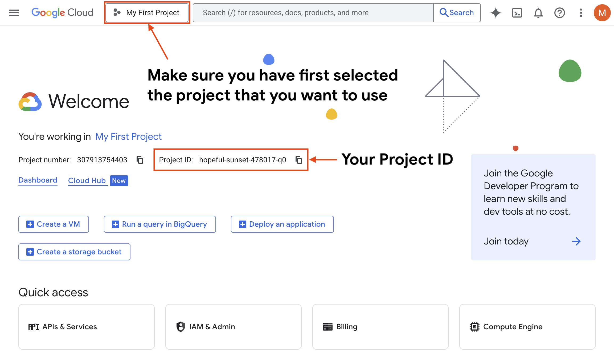

# Agent Runtime에 배포하기

<div class="language-support-tag" title="Agent Runtime은 현재 Python과 Go를 지원합니다.">
    <span class="lst-supported">ADK에서 지원</span><span class="lst-python">Python</span><span class="lst-go">Go v1.2.0</span>
</div>

이 문서에서는 Google Cloud [Agent Runtime](https://cloud.google.com/vertex-ai/generative-ai/docs/agent-engine/overview)에 ADK 에이전트 코드를 표준 방식으로 배포하는 절차를 설명합니다. 기존 Google Cloud 프로젝트가 있고 ADK 에이전트를 Agent Runtime 환경에 배포하는 과정을 세밀하게 관리하려는 경우 이 배포 경로를 따르세요. 이 안내에서는 Google Cloud 콘솔, `gcloud` 명령줄 인터페이스, ADK 명령줄 인터페이스(ADK CLI)를 사용합니다. Google Cloud 프로젝트 구성에 이미 익숙한 사용자나 프로덕션 배포를 준비하는 사용자에게 권장됩니다.

Google Cloud Agent Runtime 환경에 ADK 프로젝트를 배포하는 과정은 다음 단계로 구성됩니다.

* [Google Cloud 프로젝트 설정](#setup-cloud-project)
* [에이전트 프로젝트 폴더 준비](#define-your-agent)
* [에이전트 배포](#deploy-agent)

## Google Cloud 프로젝트 설정 {#setup-cloud-project}

Agent Runtime에 에이전트를 배포하려면 Google Cloud 프로젝트가 필요합니다.

1. **Google Cloud에 로그인**:
    * Google Cloud **기존 사용자**인 경우:
        * [https://console.cloud.google.com](https://console.cloud.google.com)을 통해 로그인합니다.
        * 이전에 무료 체험판을 사용했고 기간이 만료되었다면 [유료 결제 계정](https://docs.cloud.google.com/free/docs/free-cloud-features#how-to-upgrade)으로 업그레이드해야 할 수 있습니다.
    * Google Cloud **신규 사용자**인 경우:
        * [무료 체험 프로그램](https://docs.cloud.google.com/free/docs/free-cloud-features)에 가입할 수 있습니다. 무료 체험을 신청하면 91일 동안 다양한 [Google Cloud 제품](https://docs.cloud.google.com/free/docs/free-cloud-features#during-free-trial)에 사용할 수 있는 \$300의 환영 크레딧이 제공되며 별도 요금이 청구되지 않습니다. 무료 체험 기간 중에는 매월 지정된 한도 내에서 일부 제품을 무료로 사용할 수 있는 [Google Cloud 무료 등급](https://docs.cloud.google.com/free/docs/free-cloud-features#free-tier) 및 제품별 무료 체험도 이용할 수 있습니다.

2. **Google Cloud 프로젝트 만들기**
    * 기존 Google Cloud 프로젝트가 있다면 그대로 사용할 수 있지만, 이 과정에서 프로젝트에 새로운 서비스가 추가될 수 있다는 점에 유의하세요.
    * 새 Google Cloud 프로젝트를 만들려면 [프로젝트 만들기](https://console.cloud.google.com/projectcreate) 페이지에서 생성하면 됩니다.

3. **Google Cloud 프로젝트 ID 확인**
    * GCP 홈 페이지에서 확인할 수 있는 Google Cloud 프로젝트 ID가 필요합니다. 프로젝트 번호(숫자)가 _아니라_ 프로젝트 ID(하이픈이 포함된 영숫자)를 기록해 두세요.

    

4. **프로젝트에서 Agent Platform 활성화**
    * Agent Runtime을 사용하려면 [Agent Platform API를 활성화](https://console.cloud.google.com/apis/library/aiplatform.googleapis.com)해야 합니다. "사용(Enable)" 버튼을 클릭해 API를 활성화하세요. 활성화가 완료되면 "API 사용 설정됨(API Enabled)"이 표시됩니다.

5. **프로젝트에서 Cloud Resource Manager API 활성화**
    * Agent Runtime을 사용하려면 [Cloud Resource Manager API를 활성화](https://console.developers.google.com/apis/api/cloudresourcemanager.googleapis.com/overview)해야 합니다. "사용(Enable)" 버튼을 클릭해 API를 활성화하세요. 활성화가 완료되면 "API 사용 설정됨(API Enabled)"이 표시됩니다.

## 코딩 환경 설정 {#prerequisites-coding-env}

Google Cloud 프로젝트 준비를 마쳤다면 코딩 환경으로 돌아갑니다. 이후 단계에서는 명령줄 명령어를 실행하기 위해 코딩 환경 내 터미널에 접근할 수 있어야 합니다.

### Google Cloud로 코딩 환경 인증

* 사용자와 코드가 Google Cloud와 상호작용할 수 있도록 코딩 환경을 인증해야 합니다. 이를 위해 `gcloud` CLI가 필요합니다. `gcloud` CLI를 사용해 본 적이 없다면 아래 단계를 진행하기 전에 먼저 [다운로드 및 설치](https://docs.cloud.google.com/sdk/docs/install-sdk)하세요.

* 사용자 계정으로 Google Cloud 프로젝트에 접근하려면 터미널에서 다음 명령어를 실행하세요.

    ```shell
    gcloud auth login
    ```

    인증을 마치면 `You are now authenticated with the gcloud CLI!` 메시지가 표시됩니다.

* 코드가 Google Cloud와 연동될 수 있도록 다음 명령어를 실행해 애플리케이션 기본 사용자 인증 정보를 설정하세요.

    ```shell
    gcloud auth application-default login
    ```

    인증을 마치면 `You are now authenticated with the gcloud CLI!` 메시지가 표시됩니다.

* (선택 사항) `gcloud`에서 기본 프로젝트를 설정하거나 변경해야 하는 경우 다음 명령어를 사용할 수 있습니다.

    ```shell
    gcloud config set project MY-PROJECT-ID
    ```

### 에이전트 정의 {#define-your-agent}

Google Cloud와 코딩 환경 준비가 끝나면 에이전트를 배포할 수 있습니다. 아래 지침에서는 다음과 같은 구조의 에이전트 프로젝트 폴더가 준비되어 있다고 가정합니다.

=== "Python"

    ```shell
    multi_tool_agent/
    ├── .env
    ├── __init__.py
    └── agent.py
    ```

    프로젝트 파일 및 형식에 대한 자세한 내용은
    [multi_tool_agent](https://github.com/google/adk-docs/tree/main/examples/python/snippets/get-started/multi_tool_agent)
    코드 샘플을 참고하세요.

=== "Go"

    ```shell
    multi_tool_agent/
    ├── go.mod
    ├── go.sum
    └── main.go
    ```

    `main.go`에서는 `full.NewLauncher()` 대신 `google.golang.org/adk/v2/cmd/launcher/agentengine` 패키지의 런처로 에이전트를 실행해야 하며, 이때 `GOOGLE_CLOUD_AGENT_ENGINE_ID` 환경 변수에서 가져온 Agent Runtime 리소스 ID를 전달해야 합니다.

    ```go
    import "google.golang.org/adk/v2/cmd/launcher/agentengine"

    // ...

    l := agentengine.NewLauncher(os.Getenv("GOOGLE_CLOUD_AGENT_ENGINE_ID"))
    if err = l.Execute(ctx, config, os.Args[1:]); err != nil {
        log.Fatalf("Run failed: %v\n\n%s", err, l.CommandLineSyntax())
    }
    ```

    전체 예제는 ADK Go 저장소의 [examples/agentengine](https://github.com/google/adk-go/tree/v2.5.0/examples/agentengine)을 참고하세요.

## 에이전트 배포 {#deploy-agent}

터미널에서 `adk deploy` 명령줄 도구를 사용하여 배포할 수 있습니다. 이 과정은 코드를 패키징하고 컨테이너로 빌드한 다음 관리형 Agent Runtime 서비스에 배포하며, 몇 분 정도 걸릴 수 있습니다.

다음 배포 명령어 예시는 `multi_tool_agent` 샘플 코드를 배포할 프로젝트로 사용합니다.

=== "Python"

    ```shell
    PROJECT_ID=my-project-id
    LOCATION_ID=us-central1

    adk deploy agent_engine \
            --project=$PROJECT_ID \
            --region=$LOCATION_ID \
            --display_name="My First Agent" \
            multi_tool_agent
    ```

=== "Go"

    ```shell
    PROJECT_ID=my-project-id
    LOCATION_ID=us-central1

    adkgo deploy agentengine \
        -e ./main.go \
        -s "multi_tool_agent" \
        -p $PROJECT_ID \
        -r $LOCATION_ID \
        -d .
    ```

`region`에 사용할 수 있는 지원 리전 목록은 [Agent Builder 리전 페이지](https://docs.cloud.google.com/agent-builder/locations#supported-regions-agent-engine)에서 확인할 수 있습니다.

=== "Python"

    `adk deploy agent_engine` 명령어의 CLI 옵션은
    [ADK CLI 레퍼런스](/api-reference/cli/#adk-deploy-agent-engine)를 참고하세요.

=== "Go"

    `adkgo deploy agentengine` 명령어의 CLI 옵션을 알아보려면 `adkgo help deploy agentengine`을 실행하세요. 사용 가능한 옵션 중 주요 옵션은 다음과 같습니다.

    ```shell
    -e, --entry_point_path string   Path to an entry point (go 'main')
    -s, --name string               Agent Engine name
    -p, --project_name string       GCP Project Name
    -r, --region string             GCP Region
    -d, --source_dir string         Directory to archive, defaults to current working directory
        --agent_engine_id string    ID of the Agent Engine instance to update if it exists
    ```

    새 인스턴스를 만드는 대신 기존 Agent Runtime 인스턴스에 다시 배포하려면 `--agent_engine_id`에 해당 `RESOURCE_ID`를 전달하세요.

### 배포 명령어 출력

배포가 성공적으로 완료되면 다음과 같은 출력이 표시됩니다.

=== "Python"

    ```shell
    Creating AgentEngine
    Create AgentEngine backing LRO: projects/123456789/locations/us-central1/reasoningEngines/751619551677906944/operations/2356952072064073728
    View progress and logs at https://console.cloud.google.com/logs/query?project=hopeful-sunset-478017-q0
    AgentEngine created. Resource name: projects/123456789/locations/us-central1/reasoningEngines/751619551677906944
    To use this AgentEngine in another session:
    agent_engine = vertexai.agent_engines.get('projects/123456789/locations/us-central1/reasoningEngines/751619551677906944')
    Cleaning up the temp folder: /var/folders/k5/pv70z5m92s30k0n7hfkxszfr00mz24/T/agent_engine_deploy_src/20251219_134245
    ```

=== "Go"

    ```shell
    Computing flags & preparing temp : Starting

    ...

        >  [Deployed Reasoning Engine: projects/887748635400/locations/us-central1/reasoningEngines/751619551677906944]
        >  [Display Name: simpleText]

    Deploying to Agent Engine : Finished successfully
    Cleaning temp : Starting
        >  [Clean temp starting with /tmp/agentEngine_20260424_141040__2470352066]

    Cleaning temp : Finished successfully
    ```

이제 에이전트가 배포된 `RESOURCE_ID`(위 예시에서는 `751619551677906944`)를 확인할 수 있습니다. Agent Runtime에서 에이전트를 사용하려면 다른 프로젝트 정보와 함께 이 ID 번호가 필요합니다.

## Agent Runtime에서 에이전트 사용하기

ADK 프로젝트 배포를 완료하면 Agent Platform SDK, Python `requests` 라이브러리 또는 REST API 클라이언트를 사용하여 에이전트에 쿼리를 보낼 수 있습니다. 이 섹션에서는 에이전트와 상호작용하는 데 필요한 정보와 에이전트의 REST API 호출 URL을 구성하는 방법을 안내합니다.

Agent Runtime의 에이전트와 상호작용하려면 다음 값이 필요합니다.

* **PROJECT_ID**(예: `"my-project-id"`): [프로젝트 세부정보 페이지](https://console.cloud.google.com/iam-admin/settings)에서 확인할 수 있습니다.
* **LOCATION_ID**(예: `"us-central1"`): 에이전트를 배포할 때 사용한 리전입니다.
* **RESOURCE_ID**(예: `"751619551677906944"`): [Agent Runtime UI](https://console.cloud.google.com/vertex-ai/agents/agent-engines)에서 확인할 수 있습니다.

쿼리 URL 구조는 다음과 같습니다.

```shell
https://$(LOCATION_ID)-aiplatform.googleapis.com/v1/projects/$(PROJECT_ID)/locations/$(LOCATION_ID)/reasoningEngines/$(RESOURCE_ID):query
```

이 URL 구조를 사용하여 에이전트에 요청을 보낼 수 있습니다. 요청 방법에 대한 자세한 내용은 Agent Runtime 문서의 [Agent Development Kit 에이전트 사용](https://docs.cloud.google.com/agent-builder/agent-engine/use/adk#rest-api)을 참고하세요. 또한 Agent Runtime 문서에서 [배포된 에이전트 관리 방법](https://docs.cloud.google.com/agent-builder/agent-engine/manage/overview)을 확인할 수 있으며, 배포된 에이전트를 테스트하고 상호작용하는 방법은 [Agent Runtime에 배포된 에이전트 테스트](/deploy/agent-runtime/test/)를 참고하세요.

### 모니터링 및 확인

* Google Cloud 콘솔의 [Agent Runtime UI](https://console.cloud.google.com/vertex-ai/agents/agent-engines)에서 배포 상태를 모니터링할 수 있습니다.
* 추가 세부정보는 Agent Runtime 문서의 [에이전트 배포](https://cloud.google.com/vertex-ai/generative-ai/docs/agent-engine/deploy) 및 [배포된 에이전트 관리](https://cloud.google.com/vertex-ai/generative-ai/docs/agent-engine/manage/overview)를 참고하세요.

## 배포된 에이전트 테스트

ADK 에이전트 배포를 완료한 후에는 새로운 호스팅 환경에서 워크플로를 테스트해야 합니다. Agent Runtime에 배포된 ADK 에이전트 테스트 방법은 [Agent Runtime에 배포된 에이전트 테스트](/deploy/agent-runtime/test/)를 참고하세요.
