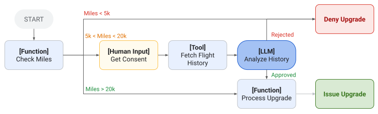
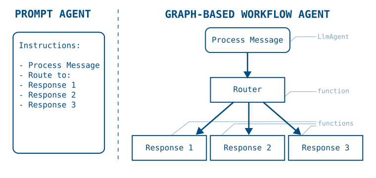

# 그래프 기반 에이전트 워크플로

<div class="language-support-tag">
  <span class="lst-supported">ADK에서 지원</span><span class="lst-python">Python v2.0.0</span><span class="lst-typescript">TypeScript v2.0.0</span><span class="lst-go">Go v2.0.0</span>
</div>

ADK의 그래프 기반 에이전트 워크플로를 사용하면 더 정밀한 제어를 갖춘 에이전트를 구축하여, 코드 로직과 AI 추론 기능을 결합한 결정론적 프로세스를 만들 수 있습니다. 그래프 기반 워크플로를 사용하면 에이전트 로직을 실행 노드와 에지의 그래프로 정의하여, AI 기반 에이전트 추론과 결정론적 도구 및 코드를 결합할 수 있습니다.



**그림 1.** 함수, 사람 입력, 도구, LLM 기능 등 다양한 유형의 워크플로 노드를 결합한 항공편 업그레이드용 그래프 기반 에이전트 설계입니다.

[순차 에이전트](/agents/workflow-agents/sequential-agents/)와 같은 사전 구축된 ADK [템플릿 워크플로](/agents/workflow-agents/)는 에이전트 집합 간의 정의된 프로세스 흐름 제어만 제공합니다. 긴 프롬프트와 도구를 사용하는 표준 ADK 에이전트를 계속 구축하고 이를 그래프 기반 워크플로 에이전트에서 사용할 수 있습니다. 더 정밀한 제어가 필요한 경우, 워크플로 에이전트 그래프를 통해 작업이 라우팅되고 실행되는 방식을 더 유연하게 제어할 수 있습니다. 그래프 기반 워크플로는 다음과 같은 장점을 제공합니다:

-   **정밀한 로직 정의:** 다양한 노드 간의 전환을 관리하는 라우팅 로직을 명시적으로 설계합니다.
-   **복잡한 구조 구현:** 분기 및 상태 관리를 지원하는 에이전트 워크플로를 구축합니다.
-   **AI 없이 함수 체인 실행:** 생성형 AI 모델을 호출하지 않고 에이전트 도구와 자체 코드를 호출합니다.
-   **신뢰성 향상:** 프롬프트에만 의존하지 않고 구조화된 노드 정의를 사용하여 에이전트의 예측 가능성을 높입니다.

!!! note "ADK의 워크플로 스타일"

    ADK는 다단계 작업을 구성하는 세 가지 상호 보완적인 방법을 제공합니다:

    -   **그래프 기반 워크플로**(이 섹션): 명시적 라우팅을 갖춘 노드와 에지의 선언적 그래프로, 결정론적이고 구조화된 프로세스에 가장 적합합니다.
    -   **[동적 워크플로](/graphs/dynamic/):** 자체 코드에서의 프로그래밍 방식 오케스트레이션(루프, 조건문, 재귀)으로, 정적 그래프로 표현하기에는 제어 흐름이 너무 복잡하거나 반복적인 경우에 가장 적합합니다.
    -   **[사전 구축된 워크플로 에이전트](/agents/workflow-agents/)**(순차, 병렬, 루프): 그래프를 직접 조립하지 않고 일반적인 패턴을 구현할 수 있는 상위 수준의 빌딩 블록입니다.

## 시작하기

이 섹션에서는 그래프 기반 에이전트를 시작하는 방법을 설명합니다. 다음 예제는 도시 이름을 생성하고, 코드 함수로 해당 도시의 현재 시간을 조회한 뒤, 마지막 에이전트가 그 정보를 보고하는 순차적 그래프 기반 에이전트 워크플로를 만드는 방법을 보여줍니다.

=== "Python"

    ```python
    from google.adk import Agent
    from google.adk import Workflow
    from google.adk import Event
    from pydantic import BaseModel

    city_generator_agent = Agent(
        name="city_generator_agent",
        model="gemini-flash-latest",
        instruction="""Return the name of a random city.
          Return only the name, nothing else.""",
    )

    class CityTime(BaseModel):
        time_info: str  # time information
        city: str       # city name

    def lookup_time_function(node_input: str):
        """Simulate returning the current time in the specified city."""
        return CityTime(time_info="10:10 AM", city=node_input)

    city_report_agent = Agent(
        name="city_report_agent",
        model="gemini-flash-latest",
        input_schema=CityTime,
        instruction="""Output following line:
        It is {CityTime.time_info} in {CityTime.city} right now.""",
    )

    def completed_message_function(node_input: str):
        return Event(
            message=f"{node_input}\n WORKFLOW COMPLETED.",
        )

    root_agent = Workflow(
        name="root_agent",
        edges=[
            ("START", city_generator_agent, lookup_time_function,
              city_report_agent, completed_message_function)
        ],
    )
    ```

=== "TypeScript"

    ADK TypeScript v2.0.0에서 `Workflow`는 `edges` 배열을 받습니다. 각 행에는 순서대로 실행할 노드가 나열됩니다. `node()` 함수는 함수, 에이전트, 도구 또는 다른 `Workflow`를 그래프 노드로 래핑하며 노드의 이름과 `inputSchema` 및 `outputSchema` 계약을 설정합니다. 스키마는 Zod 객체 또는 genai `Schema`입니다. 각 노드의 반환 값은 다음 노드의 입력으로 전달되므로 세션 상태(session state)에 별도로 기록할 필요가 없습니다.

    ```typescript
    --8<-- "examples/typescript/snippets/graphs/index/get_started.ts:get-started"
    ```

=== "Go"

    ADK Go v2.0.0에서 순차 워크플로는 그래프 엔진을 사용합니다. `workflow.NewFunctionNode`가 각 단계를 래핑하고, `workflow.Chain`이 노드들을 순차적인 `edges` 슬라이스로 연결합니다. 프레임워크는 `event.Output`을 통해 각 노드의 타입이 지정된 반환 값을 다음 노드로 자동 전달하므로 세션 상태에 별도로 쓸 필요가 없습니다. 전체 그래프는 표준 `agent.Agent`를 생성하는 `workflowagent.New`로 래핑됩니다.

    ```go
    --8<-- "examples/go/snippets/graphs/index/main.go:sequential-get-started"
    ```

이 샘플 코드는 간단한 순차 워크플로를 조립하고 에이전트 처리와 코드 실행을 번갈아 수행하는 방법을 보여줍니다. 긴 프롬프트와 도구 호출을 가진 단일 에이전트를 사용하여 이 단계들을 수행할 수도 있지만, 그래프 기반 접근 방식은 작업 실행 순서와 각 단계의 데이터 출력을 정밀하게 제어할 수 있게 해 줍니다.

그래프 기반 워크플로의 데이터 처리에 대한 자세한 내용은 [워크플로 노드 및 에이전트의 데이터 처리](/graphs/data-handling/)를 참조하세요.

## 그래프로 프로세스 구축하기

프롬프트 기반 에이전트를 사용하여 ADK 에이전트의 `instructions` 필드에 작업 및 절차에 대한 설명을 작성함으로써 다단계 프로세스를 정의할 수 있습니다. 그러나 지침과 절차가 길고 복잡해질수록 에이전트가 각 단계와 가이드라인을 따르고 있는지 확인하는 것이 더 복잡해지고 신뢰성이 떨어집니다.

그래프 기반 워크플로 에이전트는 전체 프로세스 워크플로를 코드로 구체적으로 정의할 수 있게 해 주므로 프롬프트 기반 에이전트에 비해 큰 이점을 제공합니다. 그래프 기반 에이전트 워크플로에서는 프로세스의 각 단계를 그래프의 실행 ***노드(Node)***로 정의할 수 있으며, 각 노드는 AI 에이전트, 도구(Tool) 또는 프로그래밍된 코드가 될 수 있습니다. 다음 다이어그램은 간단한 프롬프트 기반 에이전트가 워크플로 에이전트 그래프로 어떻게 변환되는지 보여줍니다:



**그림 2.** 그래프 기반 워크플로로 변환된 프롬프트 기반 에이전트 지침의 구조입니다.

프롬프트 기반 에이전트에서 그래프 기반 워크플로 에이전트로 전환하면 절차의 작업들을 명시적으로 분리하여 특정 실행 흐름을 정의할 수 있습니다. 일단 정의되면 에이전트 애플리케이션은 그래프의 단계를 따라 흐르며, 필요에 따라 비결정론적 AI 기반 에이전트와 결정론적 코드 사이를 전환합니다.

다음 코드 샘플은 그림 2의 워크플로 그래프를 그래프 기반 에이전트로 어떻게 변환할 수 있는지 보여줍니다:

=== "Python"

    ```python
    process_message = Agent(
        name="process_message",
        model="gemini-flash-latest",
        instruction="""Classify user message into either "BUG", "CUSTOMER_SUPPORT",
          or "LOGISTICS". If you think a message applies to more than one category,
          reply with a comma separated list of categories.
       """,
    )

    def router(node_input: str):
        routes = node_input.split(",")
        routes = [route.strip() for route in routes]
        return Event(route=routes)

    def response_1_bug():
        return Event(message="Handling bug...")

    def response_2_support():
        return Event(message="Handling customer support...")

    def response_3_logistics():
        return Event(message="Handling logistics...")

    root_agent = Workflow(
       name="routing_workflow",
       edges=[
           ("START", process_message, router),
           ( router,
               {
                   "BUG": response_1_bug,
                   "CUSTOMER_SUPPORT": response_2_support,
                   "LOGISTICS": response_3_logistics,
               }
           )
       ],
    )
    ```

=== "TypeScript"

    ADK TypeScript v2.0.0에서 라우터 노드는 `createEvent({route})`로 생성된 `route` 값을 담은 이벤트를 반환합니다. 두 번째 edge 행은 각 라우트 값을 이를 처리하는 노드에 매핑합니다. `route`를 배열로 설정하면 일치하는 모든 브랜치로 디스패치되므로, 이 예제의 분류기는 둘 이상의 카테고리를 반환할 수 있습니다. `DEFAULT_ROUTE` 설정은 어떤 브랜치와도 일치하지 않는 모든 값을 처리합니다.

    ```typescript
    --8<-- "examples/typescript/snippets/graphs/index/process_pipeline.ts:process-pipeline"
    ```

=== "Go"

    ADK Go v2.0.0에서 조건부 라우팅은 `workflow.NewEmittingFunctionNode`를 사용하여 `event.Routes`를 설정하고 `workflow.StringRoute` 에지를 사용하여 일치하는 핸들러로 디스패치하며, 이는 Python의 `router` 함수 및 딕셔너리 디스패치에 직접 대응됩니다. `workflow.Concat`은 체인과 조건부 에지를 하나의 `edges` 슬라이스로 병합하여 `workflowagent.New`에 전달합니다.

    ```go
    --8<-- "examples/go/snippets/graphs/index/main.go:process-pipeline"
    ```

이 샘플 코드는 에이전트 시퀀스를 구성하여 *노드*(에이전트, 도구, 자체 코드, 심지어 추가 워크플로 에이전트까지 포함할 수 있는 개별 작업) 집합 간의 라우트를 가진 그래프를 정의하는 방법을 보여줍니다. 고급 파이프라인을 구축하는 방법에 대한 자세한 내용은 [워크플로 에이전트를 위한 그래프 라우트 구축](/graphs/routes/)을 참조하세요.

!!! tip "모든 에이전트를 위한 전역 지침"

    `App`의 `GlobalInstructionPlugin`([Python](https://github.com/google/adk-python/blob/main/src/google/adk/plugins/global_instruction_plugin.py), [TypeScript](https://github.com/google/adk-js/blob/main/core/src/plugins/global_instruction_plugin.ts), [Java](https://github.com/google/adk-java/blob/main/core/src/main/java/com/google/adk/plugins/GlobalInstructionPlugin.java)) 또는 에이전트의 `GlobalInstruction` 매개변수([Go](https://github.com/google/adk-go/blob/main/agent/llmagent/llmagent.go))를 사용하여 워크플로 전체에 일관된 규칙을 적용하세요.

## 알려진 제한사항 {#known-limitations}

그래프 기반 워크플로에는 몇 가지 알려진 제한사항이 있습니다. 다음 ADK 기능과는 *호환되지 않습니다*:

-   **통합(Integrations):** 일부 서드파티 [통합](/integrations/)은 그래프 기반 워크플로와 호환되지 않을 수 있습니다.

!!! note "Go: 그래프 워크플로 API"

    ADK Go v2.0.0의 `workflow` 패키지는 Python `Workflow` 클래스에 직접 대응됩니다. `workflow.NewFunctionNode` 및 `workflow.NewAgentNode`를 사용하여 노드를 정의하고, `workflow.Chain` 또는 `[]workflow.Edge`와 함께 `workflow.Concat`을 사용하여 노드들을 연결하며, `workflowagent.New`를 사용하여 그래프를 실행 가능한 에이전트로 래핑하세요. 조건부 라우팅은 `event.Routes`와 매칭되는 `workflow.StringRoute`, `workflow.IntRoute` 또는 `workflow.BoolRoute`를 사용합니다. 팬인(Fan-in)은 `workflow.NewJoinNode`로 처리됩니다.

    고급 라우팅 패턴과 팬아웃/조인 예제는 [워크플로 에이전트를 위한 그래프 라우트 구축](/graphs/routes/)을 참조하세요. 사전 구축된 상위 수준의 대안(순차, 병렬, 루프)은 [사전 구축된 워크플로 에이전트](/agents/workflow-agents/)를 참조하세요.
