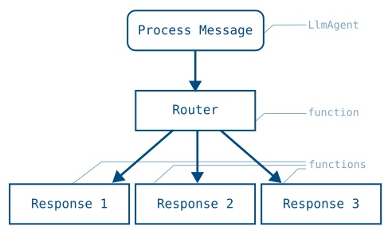
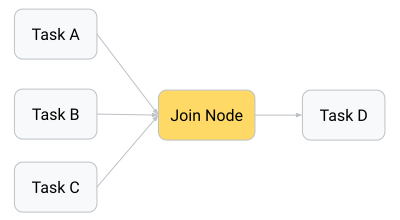
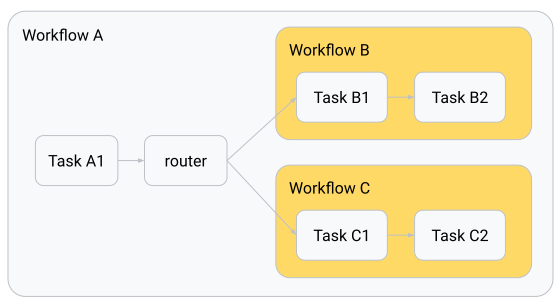

# 에이전트 워크플로를 위한 그래프 라우트 구축

<div class="language-support-tag">
  <span class="lst-supported">ADK에서 지원</span><span class="lst-python">Python v2.0.0</span><span class="lst-typescript">TypeScript v2.0.0</span><span class="lst-go">Go v2.0.0</span>
</div>

ADK의 그래프 기반 워크플로는 에이전트 로직을 실행 노드와 에지의 그래프로 정의하므로, 인공 지능(AI) 추론과 코드 로직을 결합한 보다 신뢰할 수 있는 프로세스를 구축할 수 있습니다. 이러한 워크플로를 사용하면 코드 함수, AI 기반 에이전트, 도구 및 사람 입력을 캡슐화할 수 있는 실행 노드의 논리적 라우트를 생성할 수 있습니다. 라우팅 로직을 명시적으로 설계하는 이 접근 방식을 통해 코드에서 구체적이고 단계적인 프로세스 워크플로를 정의할 수 있으므로, 순수 프롬프트 기반 에이전트에 비해 향상된 정밀도와 신뢰성을 제공합니다.



**그림 1.** 태스크 그래프의 시각화와 이를 구현하기 위한 라우팅 코드입니다.

=== "Python"

    ```python
    root_agent = Workflow(
      name="routing_workflow",
      edges=[
        ("START", process_message, router),
        (router,
          {
            "output-1": response_1,
            "output-2": response_2,
            "output-3": response_3,
          },
        ),
      ],
    )
    ```

=== "TypeScript"

    ```typescript
    export const rootAgent = new Workflow({
      name: 'routing_workflow',
      edges: [
        ['START', processMessage, router],
        [
          router,
          {
            'output-1': response1,
            'output-2': response2,
            'output-3': response3,
          },
        ],
      ],
    });
    ```

=== "Go"

    ADK Go v2.0.0은 그래프 기반 워크플로에 대해 다음과 같은 접근 방식을 제공합니다:

    **그래프 엔진**(`workflowagent` + `workflow.Edge`): Python의 `Workflow(edges=[...])`에 직접 매핑되는 노드 및 에지 그래프 API입니다. 노드는 `workflow.NewFunctionNode`, `workflow.NewAgentNode` 또는 `workflow.NewDynamicNode`로 정의되고, 에지는 `[]workflow.Edge`로 선언되며, 전체 그래프는 `workflowagent.New` 호출로 래핑됩니다:

    ```go
    edges := workflow.Concat(
        workflow.Chain(workflow.Start, classifyNode),
        []workflow.Edge{
            {From: classifyNode, To: responseA, Route: workflow.StringRoute("output-1")},
            {From: classifyNode, To: responseB, Route: workflow.StringRoute("output-2")},
            {From: classifyNode, To: responseC, Route: workflow.StringRoute("output-3")},
        },
    )
    rootAgent, _ := workflowagent.New(workflowagent.Config{
        Name:  "routing_workflow",
        Edges: edges,
    })
    ```

그래프 기반 에이전트 워크플로를 사용할 때의 장점은 프롬프트 기반 에이전트에 비해 제어력, 예측 가능성 및 신뢰성이 크게 향상된다는 점입니다. 전체 프로세스 워크플로를 코드로 정의함으로써 작업이 라우팅되고 실행되는 방식을 더 세밀하게 제어할 수 있습니다. 이러한 구조화된 노드 정의는 에이전트의 예측 가능성을 높이고, 정의된 단계와 프로세스 관리가 필요한 복잡한 작업에 대한 신뢰성을 향상시킵니다.

[그래프 기반 에이전트 워크플로](/graphs/)를 확인하여 ADK에서 그래프 기반 워크플로를 시작해 보세요.

## 노드

그래프는 실행 노드로 구성됩니다. 이러한 *노드*는 ***Agents***, ADK ***Tools***, 사람 입력 작업 또는 직접 작성한 코드 함수가 될 수 있습니다. 노드는 이전에 실행된 노드로부터 입력을 받고 ***Event*** 객체를 통해 데이터를 방출할 수 있습니다.

=== "Python"

    다음은 텍스트 입력을 처리하고 텍스트 출력을 보내는 간단한 ***FunctionNode***를 보여줍니다:

    ```python
    from google.adk import Event

    def my_function_node(node_input: str):
        input_text_modified = node_input.upper()
        return Event(output=input_text_modified)
    ```

=== "TypeScript"

    ADK TypeScript v2.0.0에서 기본 노드 유형은 함수를 `node()`에 전달하여 생성하는 `FunctionNode`입니다. 핸들러는 항상 `(ctx, input)` 매개변수를 받으며, ADK는 매개변수 이름을 통해 값을 주입하지 않습니다. 값을 직접 반환하면 이벤트의 `output` 필드로 자동 래핑됩니다. `route` 또는 `content`를 함께 설정해야 하는 경우에는 명시적인 형태인 `createEvent({output})`를 반환합니다:

    ```typescript
    --8<-- "examples/typescript/snippets/graphs/routes/function_node.ts:function-node"
    ```

=== "Go"

    ADK Go v2.0.0에서 기본 노드 유형은 `workflow.NewFunctionNode`입니다. `FunctionNode`는 일반 Go 함수를 래핑합니다. 함수가 타입이 지정된 값을 반환하면 프레임워크가 이를 자동으로 `session.Event`로 래핑하고 `event.Output`을 설정합니다. 후속 노드는 이 값을 타입이 지정된 `input` 매개변수로 받으므로 수동 상태 쓰기나 이벤트 생성이 필요하지 않습니다:

    ```go
    --8<-- "examples/go/snippets/graphs/routes/main.go:function-node"
    ```

노드 간 데이터 전송에 대한 자세한 내용은 [에이전트 워크플로의 데이터 처리](/graphs/data-handling/)를 참조하세요.

## 워크플로 그래프 구문

워크플로 에이전트를 조합하여 그래프를 정의합니다. 이 섹션에서는 일반적인 라우팅 패턴의 개요를 제공합니다.

!!! caution "주의: 워크플로 에이전트 제한사항"

    그래프 기반 워크플로에 ***LlmAgents***를 추가할 수 있습니다. 그러나 단일 턴(single-turn) 또는 태스크(task) 모드로 구성되어야 합니다. 에이전트 모드에 대한 자세한 내용은 [협업 에이전트 팀 구축](/workflows/collaboration/#mode-configuration-and-behaviors)을 참조하세요.

### 순차 라우트

순차 라우트는 나열된 순서대로 각 노드를 한 번씩 실행합니다.

=== "Python"

    `edges` 배열은 그래프 실행의 시작을 나타내기 위해 `START` 키워드를 사용하며, 나열된 각 노드가 순차적으로 실행됩니다:

    ```python
    edges=[("START", task_A_node)]  # single node run
    edges=[("START",
            task_A_node,
            task_B_node,
            task_C_node)]           # 3 nodes run in order
    ```

=== "TypeScript"

    `'START'`로 시작하는 `edges` 행은 나열된 각 노드를 순서대로 한 번씩 실행하고, 모든 노드의 반환 값을 다음 노드로 전달합니다:

    ```typescript
    edges: [['START', taskANode]]                       // 단일 노드
    edges: [['START', taskANode, taskBNode, taskCNode]] // 3개 노드 순차 실행
    ```

    둘 이상의 행에 `'START'`를 나열하면 병렬 경로가 생성됩니다. 자세한 내용은 [팬아웃 및 조인](#parallel-tasks-fan-out-and-join-paths)을 참조하세요.

    ```typescript
    --8<-- "examples/typescript/snippets/graphs/routes/sequence.ts:sequence"
    ```

=== "Go"

    `workflow.Chain(workflow.Start, nodeA, nodeB, nodeC)`은 노드들을 순차적인 에지 슬라이스로 연결합니다. 각 노드의 타입이 지정된 반환 값은 `event.Output`을 통해 다음 노드로 전달되므로 세션 상태 쓰기가 필요하지 않습니다:

    ```go
    --8<-- "examples/go/snippets/graphs/routes/main.go:sequential-nodes"
    ```

### 라우트 분기 및 조건부 실행

=== "Python"

    Python에서 분기는 `Event(route=...)` 값을 반환하는 `FunctionNode`에 의해 처리되며, `edges` 딕셔너리가 이를 서로 다른 노드로 디스패치합니다.

    ```python
    from google.adk import Event, Workflow
    from google.adk.agents import Agent


    def router(node_input: str):
        """Route to task B or C based on node_input."""
        if condition(node_input):
            return Event(route="RUN_TASK_C")
        return Event(route="RUN_TASK_B")

    task_B_node = Agent(name="task_B_agent") # An agent to execute node B

    def task_C_node(node_input: str):
        """A FunctionNode to execute node C."""
        return Event(output="Task C completed")

    root_agent = Workflow(
        name="routing_workflow",
        edges=[
            ("START", task_A_node, router),
            (router,
              {
                # "route value": node_to_run
                "RUN_TASK_B": task_B_node,
                "RUN_TASK_C": task_C_node,
              },
            ),
        ],
    )
    ```

=== "TypeScript"

    브랜칭에는 `route` 값을 방출하는 노드와 각 라우트 값을 처리하는 노드에 매핑하는 edge 행이 필요합니다. 라우트 값은 문자열, 숫자 또는 불리언일 수 있습니다. `DEFAULT_ROUTE` 설정은 동일한 소스 노드의 다른 어떤 라우트와도 일치하지 않을 때 매칭됩니다. 브랜치 대상은 모든 노드 유사(node-like) 값이 될 수 있습니다. 이 예제에서 `taskBNode`는 `LlmAgent`이고 `taskCNode`는 함수입니다.

    ```typescript
    --8<-- "examples/typescript/snippets/graphs/routes/branches.ts:branches"
    ```

=== "Go"

    ADK Go v2.0.0에서 조건부 디스패치는 `workflow` 그래프 엔진을 사용합니다. 노드가 `Event.Routes`를 하나 이상의 문자열 라우트 키로 설정하면, 각 `workflow.Edge`는 `workflow.Route` 매처를 사용하여 후속 노드를 선택합니다:

    -   `workflow.StringRoute("category")` — 단일 문자열 값과 일치
    -   `workflow.IntRoute(n)` 또는 `workflow.MultiRoute[int]{1, 2, 3}` — 정수 값과 일치
    -   `workflow.BoolRoute(true)` — 불리언 값과 일치
    -   `workflow.Default` — 동일한 소스 노드의 다른 어떤 라우트와도 일치하지 않을 때 매칭

    다음 패턴은 Python 라우터의 Go 버전입니다:

    ```go
    // classifyNode emits an Event with Routes=[]string{"BUG"},
    // ["CUSTOMER_SUPPORT"], or ["LOGISTICS"] based on the message.
    edges := workflow.Concat(
        workflow.Chain(workflow.Start, processMessage, classifyNode),
        []workflow.Edge{
            {From: classifyNode, To: bugHandler,       Route: workflow.StringRoute("BUG")},
            {From: classifyNode, To: supportHandler,   Route: workflow.StringRoute("CUSTOMER_SUPPORT")},
            {From: classifyNode, To: logisticsHandler, Route: workflow.StringRoute("LOGISTICS")},
        },
    )
    rootAgent, _ := workflowagent.New(workflowagent.Config{
        Name:  "routing_workflow",
        Edges: edges,
    })
    ```

    `workflow.EdgeBuilder`는 `[]workflow.Edge` 슬라이스를 수동으로 조립하는 대신 사용할 수 있는 플루언트(fluent) 대안을 제공합니다. 빌더의 `Add`, `AddFanOut`, `AddFanIn` 메서드는 반복을 줄이면서 동일한 토폴로지를 표현합니다:

    ```go
    eb := workflow.NewEdgeBuilder()
    eb.Add(workflow.Start, processMessage)
    eb.Add(processMessage, classifyNode)
    eb.AddRoute(classifyNode, bugHandler,       workflow.StringRoute("BUG"))
    eb.AddRoute(classifyNode, supportHandler,   workflow.StringRoute("CUSTOMER_SUPPORT"))
    eb.AddRoute(classifyNode, logisticsHandler, workflow.StringRoute("LOGISTICS"))

    rootAgent, _ := workflowagent.New(workflowagent.Config{
        Name:  "routing_workflow",
        Edges: eb.Build(),
    })
    ```

    실행 가능한 전체 라우팅 예제는 [문자열 라우팅](https://github.com/google/adk-go/tree/v2/examples/workflow/routing/string), [정수 / 다중 값 라우팅](https://github.com/google/adk-go/tree/v2/examples/workflow/routing/int) 및 [LLM 기반 라우팅](https://github.com/google/adk-go/tree/v2/examples/workflow/routing/llm)을 참조하세요.

    !!! note "사전 구축된 에이전트: 상태에 라우팅 인코딩하기"

        그래프 엔진 대신 `sequentialagent` / `parallelagent` / `loopagent`를 사용하는 경우에는 `Event.Routes` 디스패치가 없습니다. `OutputKey`를 통해 세션 상태에 라우팅 결정을 인코딩하고 다운스트림 에이전트가 `Instruction` 템플릿에서 이를 검사하도록 하거나, `Escalate` 기반 종료를 사용하는 `loopagent`를 사용하세요(아래의 [루프 및 에스컬레이션 종료 예제](#loop-and-escalation-exit) 참조).

## 병렬 작업: Fan-out 및 Join 경로

여러 병렬 노드에 걸쳐 실행을 분할하는 그래프를 만들 수 있으며, 일반적으로 추가 처리를 위해 각 노드의 출력을 모아야 합니다. 이 작업 실행 패턴에는 두 단계가 있습니다. 워크플로는 먼저 여러 병렬 작업을 시작할 때 팬아웃(fan out)하고, 해당 작업들이 완료되면 다음 단계로 진행하기 전에 경로들을 다시 조인(join)합니다.



**그림 2.** 병렬 작업 노드의 출력을 모아서 조인한 후 결과를 다음 단계로 전달할 수 있습니다.

=== "Python"

    각 병렬 작업이 완료될 때까지 기다린 후 이 노드들의 출력 모음을 다음 노드로 전달하는 ***JoinNode*** 객체를 사용하여 조인 단계를 수행합니다.

    ```python
    from google.adk.workflow import JoinNode

    my_join_node = JoinNode(name="my_join_node")

    edges=[
        ("START", parallel_task_A, my_join_node),
        ("START", parallel_task_B, my_join_node),
        ("START", parallel_task_C, my_join_node),
        (my_join_node, final_task_D),
    ]
    ```

=== "TypeScript"

    `JoinNode`는 팬인(fan-in) 배리어입니다. 이 로직 메커니즘은 모든 이전(predecessor) 태스크가 완료될 때까지 대기한 후, 이전 노드 이름을 키로 하는 레코드를 후속 노드에 전달합니다:

    ```typescript
    --8<-- "examples/typescript/snippets/graphs/routes/fan_out_join.ts:fan-out-join"
    ```

=== "Go"

    ADK Go v2.0.0은 그래프 엔진에서 진정한 팬인(fan-in)을 위해 `workflow.NewJoinNode`를 제공합니다. `workflow.Start`(또는 공유 소스 노드)에서 나온 팬아웃 에지들이 병렬로 조인 노드에 입력되며, 조인 노드는 모든 노드가 완료될 때까지 기다린 후 이전 노드 이름을 키로 하는 `map[string]any`를 다음 노드로 방출합니다.

    `workflow.EdgeBuilder`는 전용 `AddFanOut` 및 `AddFanIn` 헬퍼를 통해 팬아웃 / 팬인 연결을 간결하게 만들어 줍니다([복잡한 워크플로 예제](https://github.com/google/adk-go/tree/v2/examples/workflow/complex) 참조):

    ```go
    gatherNode := workflow.NewJoinNode("gather")

    eb := workflow.NewEdgeBuilder()
    eb.AddFanOut(workflow.Start, researchNodeA, researchNodeB, researchNodeC)
    eb.AddFanIn(gatherNode, researchNodeA, researchNodeB, researchNodeC)
    eb.Add(gatherNode, formatNode)
    eb.Add(formatNode, synthesisNode)

    rootAgent, _ := workflowagent.New(workflowagent.Config{
        Name:  "research_pipeline",
        Edges: eb.Build(),
    })
    ```

    다음 스니펫은 `workflow.NewJoinNode`와 `EdgeBuilder.AddFanOut` / `AddFanIn`을 사용하는 전체 팬아웃 / 조인 패턴을 보여줍니다:

    ```go
    --8<-- "examples/go/snippets/graphs/routes/main.go:parallel-fan-out"
    ```

!!! warning "주의: JoinNode로 연결되는 노드는 반드시 출력을 생성해야 합니다"

    `JoinNode`는 모든 이전 노드가 완료된 후에만 해제됩니다. 조인으로 연결되는 모든 노드가 자체 출력을 생성하는지 확인하고, 실패할 수 있는 모든 노드에 [재시도 구성](/ko/graphs/retry/)을 연결하세요. 출력을 생성하지 않고 완료된 이전 노드가 있으면 조인에 해당 브랜치의 값이 남지 않으며, 결과적인 실패는 문제를 유발한 노드에서 떨어진 다운스트림에서 발생합니다.

## 중첩 워크플로

더 복잡한 워크플로를 구축할 때 특정 작업의 기능을 재사용 가능한 워크플로로 캡슐화하고 싶을 수 있습니다. 이를 위해 하나 이상의 워크플로 에이전트를 다른 워크플로 에이전트 내의 하위 에이전트로 사용할 수 있습니다.



**그림 3.** 상위 워크플로 내부에 하위 에이전트로 중첩된 워크플로 에이전트입니다.

=== "Python"

    ```python
    from google.adk import Workflow

    root_agent = Workflow(
        name="parent_workflow",
        edges=[
           ("START", task_A1, router),
           (router, {
                "RUN_WORKFLOW_B": workflow_B,
                "RUN_WORKFLOW_C": workflow_C,
                },
           ),
        ],
    )
    ```

    #### 중첩 워크플로 데이터 출력

    중첩된 Workflow 객체의 출력은 개별 노드와 약간 다르게 작동합니다. 중첩 워크플로가 노드 중 하나를 완료하면 중첩 워크플로 그래프의 다음 노드로 데이터를 전송하며, *동시에* 시스템은 프로세스 추적성을 위해 해당 노드의 Event를 상위 워크플로로 전달(bubble up)합니다. 중첩 워크플로가 프로세스의 마지막 노드를 완료하면 상위 노드는 최종 리프 노드에서 데이터를 추출하여 중첩 워크플로의 출력으로 방출합니다.

=== "TypeScript"

    `Workflow` 자체가 하나의 노드이므로, 재사용 가능한 하위 프로세스를 캡슐화하기 위해 다른 워크플로의 edges 내부에서 워크플로를 노드로 사용할 수 있습니다:

    ```typescript
    --8<-- "examples/typescript/snippets/graphs/routes/nested_workflow.ts:nested-workflow"
    ```

    **중첩 워크플로 데이터 출력.** 내부 워크플로가 실행되는 동안 각 노드 이벤트는 추적성을 위해 상위 노드로 전달(bubble up)됩니다. 내부 워크플로가 완료되면 최종 노드의 출력이 중첩 워크플로 노드의 출력이 됩니다.

=== "Go"

    ADK Go v2.0.0은 두 가지 상호 보완적인 방식으로 중첩 워크플로를 지원합니다:

    **그래프 엔진**(`workflowagent` + `workflow.Edge`): `workflowagent.New`로 생성된 `workflowagent`는 그 자체로 `agent.Agent`이므로 `workflow.NewAgentNode`로 래핑하여 다른 워크플로의 `edges` 슬라이스 내부에서 노드로 사용할 수 있습니다. 외부 그래프의 관점에서 내부 워크플로는 단일 노드로 완료될 때까지 실행되며, 최종 출력은 외부 그래프 에지의 노드 출력으로 방출됩니다:

    ```go
    innerNode, _ := workflow.NewAgentNode(innerWorkflowAgent, workflow.NodeConfig{})

    outerEdges := workflow.Chain(workflow.Start, outerStepNode, innerNode, finalNode)
    rootAgent, _ := workflowagent.New(workflowagent.Config{
        Name:  "parent_workflow",
        Edges: outerEdges,
    })
    ```

    다음 스니펫은 내부 및 외부 그래프 구성을 모두 보여줍니다. `workflow.NewAgentNode`는 외부 그래프의 `workflow.Chain`에 배치할 수 있도록 내부 `workflowagent`를 래핑합니다:

    ```go
    --8<-- "examples/go/snippets/graphs/routes/main.go:nested-workflows"
    ```

## 루프 및 에스컬레이션 종료

루프는 종료 조건이 충족될 때까지 일련의 단계를 반복합니다. Python에서는 이전 노드로 다시 라우팅되는 `edges` 그래프의 역방향 에지(back-edge)로 표현됩니다. ADK Go v2.0.0에서도 그래프 엔진이 동일한 패턴을 직접 지원합니다. 라우트 조건과 함께 다운스트림 노드에서 이전 노드로 돌아가는 에지를 추가하면, 엔진이 각 반복마다 새로운 수명 주기로 대상 노드를 다시 활성화합니다.

=== "Python"

    ```python
    from google.adk import Event, Workflow


    def router(node_input: str):
        """Route to task B or C based on node_input."""
        if condition(node_input):
            return Event(route="RUN_TASK_C")
        return Event(route="RUN_TASK_B")

    root_agent = Workflow(
        name="routing_workflow",
        edges=[
            ("START", task_A_node, router),
            (router,
              {
                "RUN_TASK_B": task_B_node,
                "RUN_TASK_C": task_C_node,
              },
            ),
        ],
    )
    ```

=== "TypeScript"

    루프는 역방향 에지(back-edge)입니다. 다운스트림 노드가 이전 노드로 다시 라우팅되며, 엔진은 반복마다 새로운 라이프사이클로 해당 노드를 다시 활성화합니다. 라우터가 종료 브랜치를 선택하면 루프가 종료됩니다:

    ```typescript
    --8<-- "examples/typescript/snippets/graphs/routes/loop_escalation.ts:loop-escalation"
    ```

=== "Go"

    다음 예제는 `workflow.EdgeBuilder`와 함께 그래프 엔진을 사용합니다. 비평(critic) 노드가 판정을 반환하면 라우터 노드가 `Event.Routes`를 설정하고, 개선(refiner) 노드에서 비평 노드로 이어지는 역방향 에지가 루프를 생성합니다. 비평 노드가 만족하면 대신 최종 `done` 노드로 라우팅합니다:

    ```go
    --8<-- "examples/go/snippets/graphs/routes/main.go:loop-escalate"
    ```

!!! warning "주의: 제한 없는 그래프 순환"

    그래프 사이클은 자동으로 제한되지 않습니다. 종료 조건이 결국 참(true)이 되도록 보장하거나, 루프가 자체 코드에서 실행되고 범위를 제어할 수 있는 [동적 워크플로](/graphs/dynamic/#loop-route)로 반복을 표현하세요.
