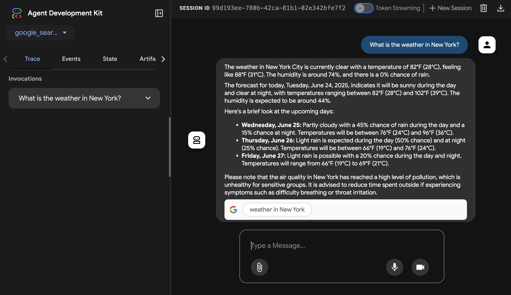
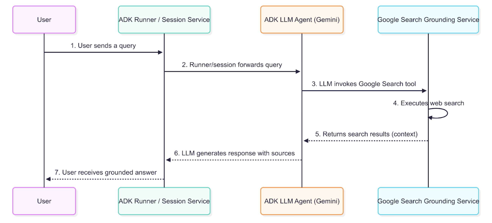
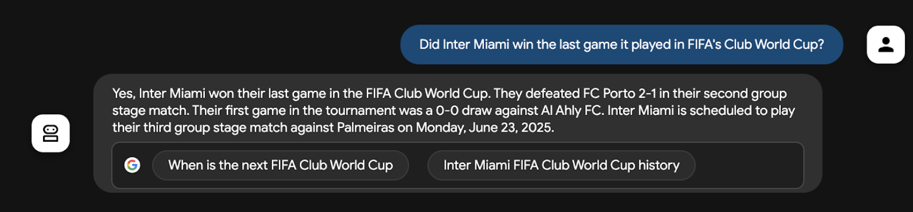

# Google 검색 그라운딩 이해

<div class="language-support-tag">
  <span class="lst-supported">ADK에서 지원</span><span class="lst-python">Python v0.1.0</span><span class="lst-typescript">TypeScript v0.2.0</span><span class="lst-java">Java v0.1.0</span>
</div>

[Google 검색 그라운딩 도구](/ko/tools/gemini-api/google-search/)는 ADK(Agent Development Kit)의 강력한 기능으로, AI 에이전트가 웹에서 공신력 있는 실시간 정보에 접근할 수 있도록 지원합니다. 에이전트를 Google 검색에 연결하면 신뢰할 수 있는 출처를 바탕으로 사용자에게 최신 답변을 제공할 수 있습니다.

이 기능은 날씨 정보, 최신 뉴스, 주가 또는 모델의 학습 데이터 기준 시점 이후 변경되었을 수 있는 사실처럼 최신 정보가 필요한 질의에 특히 유용합니다. 에이전트는 외부 정보가 필요하다고 판단하면 자동으로 웹 검색을 수행하고, 적절한 출처 표시와 함께 검색 결과를 응답에 통합합니다.

## 학습할 내용

이 가이드에서는 다음을 학습합니다.

- **빠른 설정**: Google 검색 지원 에이전트를 처음부터 생성하고 실행하는 방법
- **그라운딩 아키텍처**: 웹 그라운딩의 데이터 흐름 및 기술 프로세스
- **응답 구조**: 그라운딩된 응답 및 메타데이터를 해석하는 방법
- **모범 사례**: 사용자에게 검색 결과 및 출처를 표시하기 위한 지침

### 추가 자료

추가 자료로, [Gemini 풀스택 에이전트 개발 키트(ADK) 빠른 시작](https://github.com/google/adk-samples/tree/main/python/agents/gemini-fullstack)에는 풀스택 애플리케이션 예시로 [Google 검색 그라운딩을 훌륭하게 실용적으로 사용한 사례](https://github.com/google/adk-samples/blob/main/python/agents/gemini-fullstack/app/agent.py)가 있습니다.

## Google 검색 그라운딩 빠른 시작

이 빠른 시작은 Google 검색 그라운딩 기능이 있는 ADK 에이전트를 생성하는 과정을 안내합니다. 이 빠른 시작은 Python 3.10+ 및 터미널 액세스가 가능한 로컬 IDE(VS Code 또는 PyCharm 등)를 가정합니다.

### 1. 환경 설정 및 ADK 설치 { #set-up-environment-install-adk }

가상 환경 생성 및 활성화:

```bash
# 생성
python -m venv .venv

# 활성화(새 터미널마다)
# macOS/Linux: source .venv/bin/activate
# Windows CMD: .venv\Scripts\activate.bat
# Windows PowerShell: .venv\Scripts\Activate.ps1
```

ADK 설치:

```bash
pip install google-adk==1.4.2
```

### 2. 에이전트 프로젝트 생성 { #create-agent-project }

프로젝트 디렉토리에서 다음 명령을 실행합니다.

=== "OS X &amp; Linux"
    ```bash
    # 1단계: 에이전트용 새 디렉토리 생성
    mkdir google_search_agent

    # 2단계: 에이전트용 __init__.py 생성
    echo "from . import agent" > google_search_agent/__init__.py

    # 3단계: agent.py(에이전트 정의) 및 .env(Gemini 인증 구성) 생성
    touch google_search_agent/agent.py .env
    ```

=== "Windows"
    ```shell
    # 1단계: 에이전트용 새 디렉토리 생성
    mkdir google_search_agent

    # 2단계: 에이전트용 __init__.py 생성
    echo "from . import agent" > google_search_agent/__init__.py

    # 3단계: agent.py(에이전트 정의) 및 .env(Gemini 인증 구성) 생성
    type nul > google_search_agent\agent.py 
    type nul > google_search_agent\.env
    ```


#### `agent.py` 편집

다음 코드를 `agent.py`에 복사하여 붙여넣습니다.

```python title="google_search_agent/agent.py"
from google.adk.agents import Agent
from google.adk.tools import google_search

root_agent = Agent(
    name="google_search_agent",
    model="gemini-flash-latest",
    instruction="필요할 때 Google 검색을 사용하여 질문에 답변합니다. 항상 출처를 인용하십시오.",
    description="Google 검색 기능이 있는 전문 검색 도우미",
    tools=[google_search]
)
```

이제 다음과 같은 디렉토리 구조가 됩니다.

```console
my_project/
    google_search_agent/
        __init__.py
        agent.py
    .env
```

### 3. 플랫폼 선택 { #choose-a-platform }

에이전트를 실행하려면 에이전트가 Gemini 모델을 호출하는 데 사용할 플랫폼을 선택해야 합니다. Google AI Studio 또는 Vertex AI 중 하나를 선택합니다.

=== "Gemini - Google AI Studio"
    1. [Google AI Studio](https://aistudio.google.com/apikey)에서 API 키를 가져옵니다.
    2. Python을 사용하는 경우 **`.env`** 파일을 열고 다음 코드를 복사하여 붙여넣습니다.

        ```env title=".env"
        GOOGLE_GENAI_USE_ENTERPRISE=FALSE
        GOOGLE_API_KEY=PASTE_YOUR_ACTUAL_API_KEY_HERE
        ```

    3. `PASTE_YOUR_ACTUAL_API_KEY_HERE`를 실제 `API KEY`로 바꿉니다.

=== "Gemini - Google Cloud Vertex AI"
    1. 기존 [Google Cloud](https://cloud.google.com/?e=48754805&hl=en) 계정 및 프로젝트가 필요합니다.
        * [Google Cloud 프로젝트](https://cloud.google.com/vertex-ai/generative-ai/docs/start/quickstarts/quickstart-multimodal#setup-gcp)를 설정합니다.
        * [gcloud CLI](https://cloud.google.com/vertex-ai/generative-ai/docs/start/quickstarts/quickstart-multimodal#setup-local)를 설정합니다.
        * 터미널에서 `gcloud auth login`을 실행하여 Google Cloud에 인증합니다.
        * [Vertex AI API를 활성화](https://console.cloud.google.com/flows/enableapi?apiid=aiplatform.googleapis.com)합니다.
    2. Python을 사용하는 경우 **`.env`** 파일을 열고 다음 코드를 복사하여 붙여넣고 프로젝트 ID와 위치를 업데이트합니다.

        ```env title=".env"
        GOOGLE_GENAI_USE_ENTERPRISE=TRUE
        GOOGLE_CLOUD_PROJECT=YOUR_PROJECT_ID
        GOOGLE_CLOUD_LOCATION=LOCATION
        ```

### 4. 에이전트 실행 { #run-your-agent }

에이전트와 상호 작용하는 여러 가지 방법이 있습니다.

=== "개발 UI (adk web)"
    다음 명령을 실행하여 **개발 UI**를 시작합니다.

    ```shell
    adk web
    ```
    
    !!!info "Windows 사용자 참고 사항"

        `_make_subprocess_transport NotImplementedError`가 발생하는 경우 대신 `adk web --no-reload`를 사용해 보세요.


    **1단계:** 제공된 URL(일반적으로 `http://localhost:8000` 또는 `http://127.0.0.1:8000`)을 브라우저에서 직접 엽니다.

    **2단계:** UI 왼쪽 상단의 드롭다운 메뉴에서 에이전트를 선택할 수 있습니다. "google_search_agent"를 선택합니다.

    !!!note "문제 해결"

        드롭다운 메뉴에 "google_search_agent"가 표시되지 않으면 에이전트 폴더의 **상위 폴더**(즉, `google_search_agent`의 상위 폴더)에서 `adk web`을 실행하고 있는지 확인하세요.

    **3단계:** 이제 텍스트 입력창을 사용하여 에이전트와 대화할 수 있습니다.

=== "터미널 (adk run)"

    에이전트와 대화하려면 다음 명령을 실행하세요.

    ```
    adk run google_search_agent
    ```
    종료하려면 Cmd/Ctrl+C를 누르세요.

### 📝 테스트용 예시 프롬프트

다음 질문들을 통해 에이전트가 최신 날씨와 현재 시각을 확인하기 위해 실제로 Google 검색을 호출하는지 테스트할 수 있습니다.

* 뉴욕의 날씨는 어떻습니까?
* 뉴욕의 시간은 몇 시입니까?
* 파리의 날씨는 어떻습니까?
* 파리의 시간은 몇 시입니까?



ADK를 사용하여 Google 검색 에이전트를 성공적으로 만들고 실행해 보았습니다!

## Google 검색 그라운딩 작동 방식

그라운딩(Grounding)은 에이전트를 웹의 실시간 정보와 연결하여 AI 에이전트가 더 정확하고 최신 상태의 응답을 생성할 수 있도록 하는 프로세스입니다. 사용자 프롬프트에 모델이 학습하지 않은 정보나 시의성이 중요한 정보가 필요한 경우, 에이전트의 기반 대규모 언어 모델(LLM)은 관련 사실을 찾기 위해 `google_search` 도구를 호출할지 지능적으로 판단합니다.

### **데이터 흐름 다이어그램**

다음 다이어그램은 사용자 질의가 그라운딩된 응답으로 이어지는 단계별 프로세스를 보여줍니다.



### **상세 설명**

그라운딩 에이전트는 다이어그램에 설명된 데이터 흐름에 따라 외부 정보를 조회하고 처리하여 사용자에게 제공되는 최종 답변에 통합합니다.

1. **사용자 쿼리**: 최종 사용자가 질문을 하거나 요청을 보내 에이전트와 상호작용합니다.
2. **ADK 오케스트레이션**: Agent Development Kit가 에이전트의 동작을 오케스트레이션하고 사용자의 메시지를 에이전트 코어로 전달합니다.
3. **LLM 분석 및 도구 호출**: 에이전트의 LLM(예: Gemini 모델)이 프롬프트를 분석합니다. 외부의 최신 정보가 필요하다고 판단하면 `google_search` 도구를 호출하여 그라운딩 메커니즘을 트리거합니다. 이는 최신 뉴스, 날씨 또는 모델의 학습 데이터에 없는 사실에 대한 질의에 답변할 때 적합합니다.
4. **그라운딩 서비스 상호작용**: `google_search` 도구는 내부 그라운딩 서비스와 통신하며, 이 서비스는 하나 이상의 검색 쿼리를 구성해 Google 검색 인덱스로 전송합니다.
5. **컨텍스트 주입**: 그라운딩 서비스는 관련 웹페이지와 스니펫을 가져온 뒤, 최종 응답이 생성되기 전에 이러한 검색 결과를 모델의 컨텍스트에 통합합니다. 이 핵심 단계를 통해 모델은 실시간 사실 데이터를 바탕으로 추론할 수 있습니다.
6. **그라운딩된 응답 생성**: 최신 검색 결과를 전달받은 LLM은 조회된 정보를 반영하여 응답을 생성합니다.
7. **출처와 함께 응답 표시**: ADK는 출처 URL과 `groundingMetadata`가 포함된 최종 그라운딩 응답을 수신하여 출처 표시와 함께 사용자에게 전달합니다. 이를 통해 최종 사용자는 정보를 직접 검증할 수 있으며 에이전트 답변에 대한 신뢰도가 높아집니다.

### Google 검색 그라운딩 응답 이해하기

에이전트가 Google 검색을 사용하여 응답을 그라운딩하면 최종 텍스트 답변뿐만 아니라 해당 답변을 생성하는 데 사용한 출처에 관한 상세 메타데이터도 함께 반환합니다. 이 메타데이터는 응답을 검증하고 원본 출처를 표시하는 데 핵심적인 역할을 합니다.

#### **그라운딩된 응답의 예시**

다음은 그라운딩된 쿼리 후 모델이 반환한 콘텐츠 객체의 예시입니다.

**최종 답변 텍스트:**

```
"네, 인터 마이애미는 FIFA 클럽 월드컵에서 마지막 경기에서 승리했습니다. 2차 조별 리그 경기에서 FC 포르투를 2-1로 이겼습니다. 토너먼트의 첫 경기는 알 아흘리 FC와 0-0 무승부였습니다. 인터 마이애미는 2025년 6월 23일 월요일에 팔메이라스를 상대로 3차 조별 리그 경기를 치를 예정입니다."
```

**그라운딩 메타데이터 스니펫:**

```json
"groundingMetadata": {
  "groundingChunks": [
    { "web": { "title": "mlssoccer.com", "uri": "..." } },
    { "web": { "title": "intermiamicf.com", "uri": "..." } },
    { "web": { "title": "mlssoccer.com", "uri": "..." } }
  ],
  "groundingSupports": [
    {
      "groundingChunkIndices": [0, 1],
      "segment": {
        "startIndex": 65,
        "endIndex": 126,
        "text": "2차 조별 리그 경기에서 FC 포르투를 2-1로 이겼습니다."
      }
    },
    {
      "groundingChunkIndices": [1],
      "segment": {
        "startIndex": 127,
        "endIndex": 196,
        "text": "토너먼트의 첫 경기는 알 아흘리 FC와 0-0 무승부였습니다."
      }
    },
    {
      "groundingChunkIndices": [0, 2],
      "segment": {
        "startIndex": 197,
        "endIndex": 303,
        "text": "인터 마이애미는 2025년 6월 23일 월요일에 팔메이라스를 상대로 3차 조별 리그 경기를 치를 예정입니다."
      }
    }
  ],
  "searchEntryPoint": { ... }
}

```

#### **응답을 해석하는 방법**

메타데이터는 모델이 생성한 텍스트와 이를 뒷받침하는 출처 간의 연결 정보를 제공합니다. 단계별 구조는 다음과 같습니다.

1. **groundingChunks**: 모델이 참조한 웹페이지 목록입니다. 각 청크에는 웹페이지의 `title`과 출처로 연결되는 `uri`가 포함됩니다.
2. **groundingSupports**: 최종 답변의 특정 문장을 `groundingChunks`의 출처에 연결하는 목록입니다.
   * **segment**: `startIndex`, `endIndex`, 그리고 `text` 자체로 정의되는 최종 텍스트 답변의 특정 구간을 식별합니다.
   * **groundingChunkIndices**: `groundingChunks`에 나열된 출처에 해당하는 인덱스 번호 배열입니다. 예를 들어, "FC 포르투를 2-1로 이겼습니다..."라는 문장은 인덱스 0과 1의 `groundingChunks`(`mlssoccer.com` 및 `intermiamicf.com` 모두) 정보로 뒷받침됩니다.

### Google 검색 그라운딩 응답 표시 방법

그라운딩을 사용할 때는 인용 출처와 검색 제안을 포함한 정보를 최종 사용자에게 올바르게 표시하는 것이 중요합니다. 이를 통해 신뢰를 높이고 사용자가 정보를 직접 검증할 수 있습니다.



#### **검색 제안 표시**

`groundingMetadata`의 `searchEntryPoint` 객체에는 추천 검색어를 표시하기 위해 미리 서식이 지정된 HTML이 포함되어 있습니다. 예시 이미지에서 볼 수 있듯이, 일반적으로 사용자가 관련 주제를 탐색할 수 있도록 클릭 가능한 칩(chip) 형태로 렌더링됩니다.

**`searchEntryPoint`에서 렌더링된 HTML:** 메타데이터는 Google 로고와 "다음 FIFA 클럽 월드컵은 언제인가", "인터 마이애미 FIFA 클럽 월드컵 역사" 같은 관련 검색어 칩이 포함된 검색 제안 바를 렌더링하는 데 필요한 HTML 및 CSS를 제공합니다. 이 HTML을 애플리케이션의 프런트엔드에 직접 통합하면 검색 제안이 의도한 대로 표시됩니다.

자세한 내용은 Vertex AI 문서의 [Google 검색 제안 사용](https://cloud.google.com/vertex-ai/generative-ai/docs/grounding/grounding-search-suggestions)을 참고하세요.

## 요약

Google 검색 그라운딩은 AI 에이전트를 정적 지식에 머무르는 모델에서 실시간으로 정확한 정보를 제공하는 동적 웹 연결 어시스턴트로 확장해 줍니다. 이 기능을 ADK 에이전트에 통합하면 다음과 같은 이점을 얻을 수 있습니다.

- 학습 데이터 범위를 벗어나는 최신 정보에 접근
- 투명성과 신뢰 확보를 위한 명확한 출처 표시 제공
- 검증 가능한 사실에 기반한 포괄적인 답변 제공
- 관련 검색 제안을 통한 사용자 경험 향상

그라운딩 프로세스는 자연스러운 대화 흐름을 유지하면서도 사용자 질의를 Google의 방대한 검색 인덱스와 매끄럽게 연결하여 최신 컨텍스트로 응답을 풍부하게 만듭니다. 그라운딩된 응답을 올바르게 구현하고 표시하면 에이전트를 정보 탐색과 의사결정을 위한 강력한 도구로 활용할 수 있습니다.
