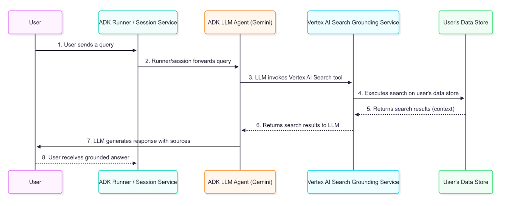

# 에이전트를 위한 검색 그라운딩(Grounding with Search)

<div class="language-support-tag">
  <span class="lst-supported">ADK에서 지원</span><span class="lst-python">Python v0.1.0</span><span class="lst-java">Java v0.1.0</span><span class="lst-kotlin">Kotlin v0.2.0</span>
</div>

[Agent Search](/integrations/agent-search/)는 AI 에이전트가 비공개 엔터프라이즈 문서 및 데이터 저장소의 정보에 접근할 수 있도록 지원하는 ADK(Agent Development Kit)의 강력한 도구입니다. 에이전트를 색인화된 엔터프라이즈 콘텐츠에 연결하면 조직의 지식 베이스에 그라운딩된 답변을 사용자에게 제공할 수 있습니다.

이 기능은 내부 문서, 사내 정책, 연구 논문 등 [Agent Search](https://cloud.google.com/enterprise-search) 데이터 스토어에 색인화된 사내 고유 콘텐츠가 필요한 엔터프라이즈 전용 질의에 특히 유용합니다. 에이전트가 지식 베이스의 정보가 필요하다고 판단하면 색인화된 문서를 자동으로 검색하고, 적절한 출처 표시와 함께 결과를 응답에 통합합니다.

## Agent Search 준비하기

그라운딩 에이전트를 생성하기 전에 기존 Agent Search 데이터 스토어가 준비되어 있어야 합니다. 아직 없다면 [Get started with custom search](https://cloud.google.com/generative-ai-app-builder/docs/try-enterprise-search#unstructured-data) 안내에 따라 데이터 스토어를 생성하세요. 에이전트를 구성하려면 `Data store ID`(예: `projects/YOUR_PROJECT_ID/locations/global/collections/default_collection/dataStores/YOUR_DATASTORE_ID`)가 필요합니다.

## 인증 설정

Agent Search를 사용하려면 ADK 에이전트에 Google Cloud 프로젝트 인증이 연결되어 있어야 합니다. 이 도구를 사용할 때는 Google AI Studio의 Gemini API 키를 사용할 수 없습니다. ADK 에이전트를 Google Cloud 프로젝트에 연결하는 자세한 방법은 [Google Cloud에 연결](/ko/get-started/google-cloud/) 가이드를 참고하세요.

* [gcloud CLI](https://cloud.google.com/vertex-ai/generative-ai/docs/start/quickstarts/quickstart-multimodal#setup-local)를 설정합니다.
* 터미널에서 `gcloud auth login`을 실행하여 Google Cloud에 인증합니다.
* Python의 경우 **`.env`** 파일을 열고 프로젝트 ID와 위치를 지정합니다.
* Java 및 Kotlin의 경우 애플리케이션 환경에 Google Cloud 기본 사용자 인증 정보(`GOOGLE_APPLICATION_CREDENTIALS`)가 구성되어 있는지 확인하고, `.env` 파일 대신 동일한 환경에 아래 변수들을 설정하세요.

```env title=".env"
GOOGLE_GENAI_USE_ENTERPRISE=TRUE
GOOGLE_CLOUD_PROJECT=YOUR_PROJECT_ID
GOOGLE_CLOUD_LOCATION=LOCATION
```

## 그라운딩 에이전트 생성

검색 그라운딩(Grounding with Search)을 활성화하려면 `data_store_id`를 지정하여 에이전트 정의에 검색 도구를 추가합니다.

=== "Python"

    ```python
    from google.adk.agents import Agent
    from google.adk.tools import VertexAiSearchTool

    # Configuration
    DATASTORE_ID = "projects/YOUR_PROJECT_ID/locations/global/collections/default_collection/dataStores/YOUR_DATASTORE_ID"

    root_agent = Agent(
        name="vertex_search_agent",
        model="gemini-flash-latest",
        instruction="Answer questions using Agent Search to find information from internal documents. Always cite sources when available.",
        description="Enterprise document search assistant with Agent Search capabilities",
        tools=[VertexAiSearchTool(data_store_id=DATASTORE_ID)]
    )
    ```

=== "Java"

    ```java
    import com.google.adk.agents.LlmAgent;
    import com.google.adk.tools.VertexAiSearchTool;

    // Configuration
    String DATASTORE_ID = "projects/YOUR_PROJECT_ID/locations/global/collections/default_collection/dataStores/YOUR_DATASTORE_ID";

    LlmAgent rootAgent = LlmAgent.builder()
        .name("vertex_search_agent")
        .model("gemini-flash-latest")
        .instruction("Answer questions using Agent Search to find information from internal documents. Always cite sources when available.")
        .description("Enterprise document search assistant with Agent Search capabilities")
        .tools(VertexAiSearchTool.builder().dataStoreId(DATASTORE_ID).build())
        .build();
    ```

=== "Kotlin"

    ```kotlin
    import com.google.adk.kt.agents.Instruction
    import com.google.adk.kt.agents.LlmAgent
    import com.google.adk.kt.models.Gemini
    import com.google.adk.kt.tools.VertexAiSearchTool

    // Configuration
    val DATASTORE_ID =
        "projects/YOUR_PROJECT_ID/locations/global/collections/default_collection/dataStores/YOUR_DATASTORE_ID"

    val rootAgent =
        LlmAgent(
            name = "vertex_search_agent",
            model = Gemini(name = "gemini-flash-latest"),
            instruction =
                Instruction(
                    "Answer questions using Agent Search to find information from internal " +
                        "documents. Always cite sources when available.",
                ),
            description = "Enterprise document search assistant with Agent Search capabilities",
            tools = listOf(VertexAiSearchTool(dataStoreId = DATASTORE_ID)),
        )
    ```

## 검색 그라운딩 작동 방식

검색 그라운딩은 에이전트를 조직의 색인화된 문서 및 데이터와 연결하여 비공개 엔터프라이즈 콘텐츠에 기반한 정확한 응답을 생성할 수 있도록 하는 프로세스입니다. 사용자 프롬프트에 내부 지식 베이스의 정보가 필요한 경우, 에이전트의 기반 LLM은 색인화된 문서에서 관련 사실을 찾기 위해 `VertexAiSearchTool` 호출을 지능적으로 결정합니다.

### 데이터 흐름 다이어그램

다음 다이어그램은 사용자 질의가 그라운딩된 응답으로 이어지는 단계별 프로세스를 보여줍니다.



### 상세 설명

그라운딩 에이전트는 다이어그램에 설명된 데이터 흐름에 따라 엔터프라이즈 정보를 검색하고 처리하여 사용자에게 제공되는 최종 답변에 통합합니다.

1. **사용자 쿼리**: 최종 사용자가 내부 문서나 기업 데이터에 대해 질문하며 에이전트와 상호작용합니다.
2. **ADK 오케스트레이션**: Agent Development Kit가 에이전트의 동작을 오케스트레이션하고 사용자의 메시지를 에이전트 코어로 전달합니다.
3. **LLM 분석 및 도구 호출**: 에이전트의 LLM(예: Gemini 모델)이 프롬프트를 분석합니다. 색인화된 문서의 정보가 필요하다고 판단하면 `VertexAiSearchTool`을 호출하여 그라운딩 메커니즘을 트리거합니다. 이는 사내 정책, 기술 문서 또는 비공개 연구 자료에 대한 질문에 답변할 때 적합합니다.
4. **Vertex AI Search 서비스 상호작용**: `VertexAiSearchTool`은 색인화된 엔터프라이즈 문서가 저장된 Agent Search 데이터 스토어와 통신합니다. 이 서비스는 비공개 콘텐츠를 대상으로 검색 쿼리를 구성하고 실행합니다.
5. **문서 검색 및 순위 지정**: Agent Search는 의미적 유사도와 관련성 점수를 기준으로 데이터 스토어에서 가장 관련성이 높은 문서 청크를 검색하고 순위를 매깁니다.
6. **컨텍스트 주입**: 검색 서비스는 최종 응답이 생성되기 전에 검색된 문서 스니펫을 모델의 컨텍스트에 통합합니다. 이 핵심 단계를 통해 모델은 조직의 사실 데이터를 바탕으로 추론할 수 있습니다.
7. **그라운딩된 응답 생성**: 관련 엔터프라이즈 콘텐츠를 전달받은 LLM은 문서에서 검색된 정보를 반영하여 응답을 생성합니다.
8. **출처와 함께 응답 표시**: ADK는 원본 문서 참조와 `groundingMetadata`가 포함된 최종 그라운딩 응답을 수신하여 출처 표시와 함께 사용자에게 전달합니다. 이를 통해 최종 사용자는 사내 원본 문서를 기준으로 정보를 검증할 수 있습니다.

## 검색 그라운딩 응답 이해하기

에이전트가 Agent Search를 사용하여 응답을 그라운딩하면 최종 텍스트 답변과 함께 해당 답변 생성에 사용된 문서 메타데이터를 포함한 상세 정보를 반환합니다. 이 메타데이터는 응답을 검증하고 엔터프라이즈 원본 문서의 출처를 표시하는 데 중요합니다.

### 그라운딩된 응답 예시

다음은 엔터프라이즈 문서를 대상으로 그라운딩된 쿼리를 실행한 후 모델이 반환한 콘텐츠 객체의 예시입니다.

**최종 답변 텍스트:**

```text
"Developing models for a medical scribe presents several significant challenges, primarily due to the complex nature of medical documentation, the sensitive data involved, and the demanding requirements of clinical workflows. Key challenges include: **Accuracy and Reliability:** Medical documentation requires extremely high levels of accuracy, as errors can lead to misdiagnoses, incorrect treatments, and legal repercussions. Ensuring that AI models can reliably capture nuanced medical language, distinguish between subjective and objective information, and accurately transcribe physician-patient interactions is a major hurdle. **Natural Language Understanding (NLU) and Speech Recognition:** Medical conversations are often rapid, involve highly specialized jargon, acronyms, and abbreviations, and can be spoken by individuals with diverse accents or speech patterns... [response continues with detailed analysis of privacy, integration, and technical challenges]"
```

**그라운딩 메타데이터 스니펫:**

```json
{
  "groundingMetadata": {
    "groundingChunks": [
      {
        "document": {
          "title": "AI in Medical Scribing: Technical Challenges",
          "uri": "projects/your-project/locations/global/dataStores/your-datastore-id/documents/doc-medical-scribe-ai-tech-challenges",
          "id": "doc-medical-scribe-ai-tech-challenges"
        }
      },
      {
        "document": {
          "title": "Regulatory and Ethical Hurdles for AI in Healthcare",
          "uri": "projects/your-project/locations/global/dataStores/your-datastore-id/documents/doc-ai-healthcare-ethics",
          "id": "doc-ai-healthcare-ethics"
        }
      }
    ],
    "groundingSupports": [
      {
        "groundingChunkIndices": [0, 1],
        "segment": {
          "endIndex": 637,
          "startIndex": 433,
          "text": "Ensuring that AI models can reliably capture nuanced medical language..."
        }
      }
    ],
    "retrievalQueries": [
      "challenges in natural language processing medical domain",
      "AI medical scribe challenges",
      "difficulties in developing AI for medical scribes"
    ]
  }
}
```

### 응답을 해석하는 방법

메타데이터는 모델이 생성한 텍스트와 이를 뒷받침하는 엔터프라이즈 문서 간의 연결 정보를 제공합니다. 단계별 구조는 다음과 같습니다.

- **groundingChunks**: 모델이 참조한 엔터프라이즈 문서 목록입니다. 각 청크에는 문서 `title`, `uri`(문서 경로), `id`가 포함됩니다.
- **groundingSupports**: 최종 답변의 특정 문장을 `groundingChunks`의 출처에 연결하는 목록입니다.
- **segment**: `startIndex`, `endIndex`, 그리고 `text` 자체로 정의되는 최종 텍스트 답변의 특정 구간을 식별합니다.
- **groundingChunkIndices**: `groundingChunks`에 나열된 출처에 해당하는 인덱스 번호 배열입니다. 예를 들어, "HIPAA 규정 준수"에 관한 텍스트는 인덱스 1의 `groundingChunks`("Regulatory and Ethical Hurdles" 문서) 정보로 뒷받침됩니다.
- **retrievalQueries**: 관련 정보를 찾기 위해 데이터 스토어를 대상으로 실행된 구체적인 검색 쿼리 배열입니다.

## 검색 그라운딩 응답 표시 방법

Google 검색 그라운딩과 달리 검색 그라운딩에는 별도의 필수 UI 표시 컴포넌트가 요구되지 않습니다. 하지만 인용 출처와 문서 참조를 함께 표시하면 신뢰도를 높이고 사용자가 조직의 공식 문서를 기준으로 정보를 직접 검증할 수 있습니다.

### 선택적 인용 표시

그라운딩 메타데이터가 제공되므로 애플리케이션 요구 사항에 맞게 인용 표시를 구현할 수 있습니다.

**간단한 텍스트 표시(최소 구현):**

=== "Python"

    ```python
    for event in events:
        if event.is_final_response():
            print(event.content.parts[0].text)

            # Optional: Show source count
            if event.grounding_metadata:
                print(f"\nBased on {len(event.grounding_metadata.grounding_chunks)} documents")
    ```

=== "Java"

    ```java
    for (Event event : events) {
        if (event.finalResponse()) {
            System.out.println(event.content().parts().get(0).text());

            // Optional: Show source count
            if (event.groundingMetadata().isPresent()) {
                System.out.println("\nBased on " + event.groundingMetadata().get().groundingChunks().size() + " documents");
            }
        }
    }
    ```

=== "Kotlin"

    ```kotlin
    events.collect { event ->
        if (event.isFinalResponse) {
            println(event.content?.parts?.firstOrNull()?.text)

            // Optional: Show source count
            val chunks = event.groundingMetadata?.groundingChunks
            if (!chunks.isNullOrEmpty()) {
                println("\nBased on ${chunks.size} documents")
            }
        }
    }
    ```

**향상된 인용 표시(선택 사항):** 각 문장을 뒷받침하는 문서를 보여주는 대화형 인용 UI를 구현할 수 있습니다. 그라운딩 메타데이터는 텍스트 구간을 원본 문서에 매핑하는 데 필요한 모든 정보를 제공합니다.

### 구현 고려 사항

검색 그라운딩 응답 표시를 구현할 때 다음 사항을 고려하세요.

1. **문서 접근 권한**: 참조된 문서에 대한 사용자의 열람 권한을 확인합니다.
2. **간단한 통합**: 기본 텍스트 출력만 사용하는 경우 별도의 화면 표시 로직이 필요하지 않습니다.
3. **선택적 개선**: 출처 표시가 유용한 사용 사례에만 인용 UI를 추가하세요.
4. **문서 링크**: 필요한 경우 문서 URI를 사용자가 접근할 수 있는 사내 링크로 변환합니다.
5. **검색 쿼리**: `retrievalQueries` 배열을 통해 데이터 스토어를 대상으로 어떤 검색이 수행되었는지 확인할 수 있습니다.
