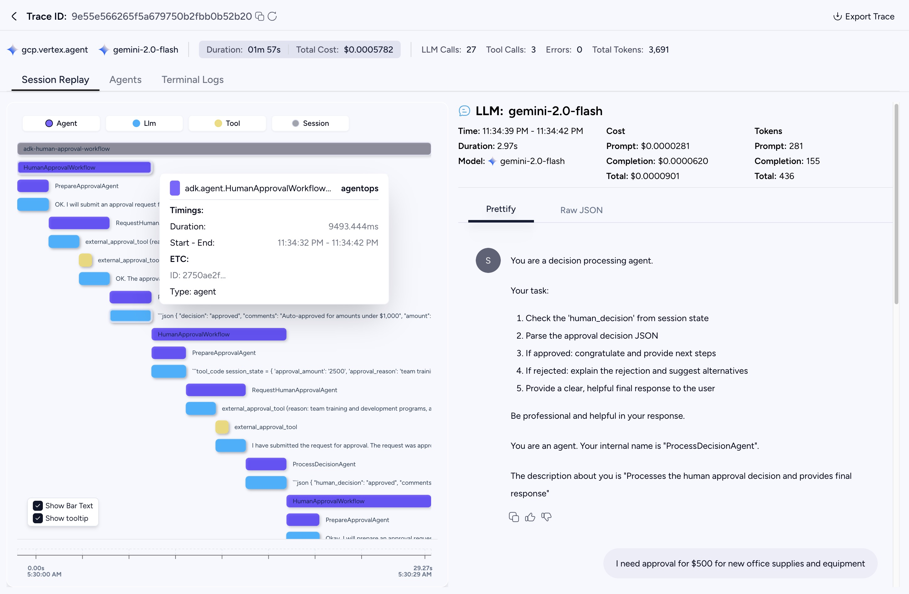

# AgentOps를 사용한 에이전트 관측 가능성

<div class="language-support-tag">
  <span class="lst-supported">ADK에서 지원</span><span class="lst-python">Python</span>
</div>

**단 두 줄의 코드**만으로 [AgentOps](https://www.agentops.ai)는 에이전트에 대한 세션 리플레이, 메트릭 및 모니터링을 제공합니다.

## ADK에 AgentOps를 사용하는 이유는 무엇인가요?

관측 가능성은 대화형 AI 에이전트를 개발하고 배포하는 데 있어 핵심적인 측면입니다. 이를 통해 개발자는 에이전트의 성능, 사용자와의 상호 작용 방식, 외부 도구 및 API 사용 방식을 이해할 수 있습니다.

AgentOps를 통합함으로써 개발자는 ADK 에이전트의 동작, LLM 상호 작용 및 도구 사용에 대한 깊은 인사이트를 얻을 수 있습니다.

Google ADK에는 에이전트 내부의 기본 실행 흐름을 추적하기 위한 OpenTelemetry 기반 트레이싱 시스템이 기본 포함되어 있습니다. AgentOps는 다음과 같은 기능을 갖춘 전용 종합 관측 가능성 플랫폼을 제공하여 이를 한층 강화합니다.

*   **통합 트레이싱 및 리플레이 분석:** ADK를 비롯한 AI 스택의 여러 구성 요소에서 발생한 트레이스를 하나로 통합합니다.
*   **풍부한 시각화:** 에이전트 실행 흐름, LLM 호출 및 도구 성능을 시각화하는 직관적인 대시보드를 제공합니다.
*   **상세한 디버깅:** 특정 스팬으로 드릴다운하여 프롬프트, 생성 응답(completion), 토큰 수 및 오류를 확인합니다.
*   **LLM 비용 및 지연 시간 추적:** 지연 시간(latency)과 비용(토큰 사용량 기준)을 추적하고 병목 구간을 식별합니다.
*   **간소화된 설정:** 단 몇 줄의 코드로 시작할 수 있습니다.




*다단계 ADK 애플리케이션 실행의 추적을 표시하는 AgentOps 대시보드. 기본 에이전트 워크플로, 개별 하위 에이전트, LLM 호출 및 도구 실행을 포함한 스팬의 계층 구조를 볼 수 있습니다. 명확한 계층 구조에 주목하세요. 기본 워크플로 에이전트 스팬에는 다양한 하위 에이전트 작업, LLM 호출 및 도구 실행에 대한 자식 스팬이 포함됩니다.*

## AgentOps 및 ADK 시작하기

AgentOps를 ADK 애플리케이션에 통합하는 것은 간단합니다.

1.  **AgentOps 설치:**
    ```bash
    pip install -U agentops
    ```

2. **API 키 생성**
    [API 키 생성](https://app.agentops.ai/settings/projects) 페이지에서 사용자 API 키를 발급받고 환경을 구성합니다.

    환경 변수에 API 키를 추가하세요:
    ```
    AGENTOPS_API_KEY=<YOUR_AGENTOPS_API_KEY>
    ```

3.  **AgentOps 초기화:**
    ADK 애플리케이션 스크립트(예: ADK `Runner`를 실행하는 기본 Python 파일)의 시작 부분에 다음 줄을 추가합니다.

    ```python
    import agentops
    agentops.init()
    ```

    이렇게 하면 AgentOps 세션이 시작되고 ADK 에이전트가 자동으로 추적됩니다.

    자세한 예:

    ```python
    import agentops
    import os
    from dotenv import load_dotenv

    # 환경 변수 로드 (선택 사항, API 키에 .env 파일을 사용하는 경우)
    load_dotenv()

    agentops.init(
        api_key=os.getenv("AGENTOPS_API_KEY"), # AgentOps API 키
        trace_name="my-adk-app-trace"  # 선택 사항: 추적 이름
        # auto_start_session=True가 기본값입니다.
        # 세션 시작/종료를 수동으로 제어하려면 False로 설정하세요.
    )
    ```

    > 🚨 🔑 가입 후 [AgentOps 대시보드](https://app.agentops.ai/)에서 AgentOps API 키를 찾을 수 있습니다. 환경 변수(`AGENTOPS_API_KEY`)로 설정하는 것이 좋습니다.

초기화되면 AgentOps는 ADK 에이전트를 자동으로 계측하기 시작합니다.

**이 설정만으로 ADK 에이전트의 모든 텔레메트리(telemetry) 데이터를 수집할 수 있습니다.**

## AgentOps가 ADK를 계측하는 방법

AgentOps는 ADK의 기본 텔레메트리와 충돌하지 않고 원활한 관측 가능성을 제공하기 위해 정교한 전략을 사용합니다.

1.  **ADK의 기본 텔레메트리 비활성화:**
    AgentOps는 ADK를 감지하고 ADK의 내부 OpenTelemetry 트레이서(일반적으로 `trace.get_tracer('gcp.vertex.agent')`)를 지능적으로 패치합니다. 이를 `NoOpTracer`로 교체하여 ADK 자체가 별도의 텔레메트리 스팬을 생성하지 않도록 비활성화합니다. 이렇게 하면 중복 트레이스를 방지하고 AgentOps가 관측 가능성 데이터의 단일 기준 소스가 됩니다.

2.  **AgentOps 제어 스팬 생성:**
    AgentOps는 주요 ADK 메서드를 래핑하여 논리적인 스팬 계층 구조를 생성하고 제어합니다.

    *   **에이전트 실행 스팬 (예: `adk.agent.MySequentialAgent`):**
        ADK 에이전트(`BaseAgent`, `SequentialAgent` 또는 `LlmAgent` 등)가 `run_async` 메서드를 시작하면 AgentOps는 해당 에이전트 실행에 대한 부모 스팬을 시작합니다.

    *   **LLM 상호 작용 스팬 (예: `adk.llm.gemini-pro`):**
        에이전트가 LLM을 호출할 때(ADK의 `BaseLlmFlow._call_llm_async`를 통해) AgentOps는 일반적으로 LLM 모델의 이름을 딴 전용 자식 스팬을 생성합니다. 이 스팬은 요청 세부 정보(프롬프트, 모델 매개변수)를 캡처하고 완료 시(ADK의 `_finalize_model_response_event`를 통해) 생성 응답(completion), 토큰 사용량 및 종료 사유와 같은 응답 세부 정보를 기록합니다.

    *   **도구 사용 스팬 (예: `adk.tool.MyCustomTool`):**
        에이전트가 도구를 사용할 때(ADK의 `functions.__call_tool_async`를 통해) AgentOps는 도구의 이름을 딴 단일의 포괄적인 자식 스팬을 생성합니다. 이 스팬에는 도구의 입력 매개변수와 반환하는 결과가 포함됩니다.

3.  **풍부한 속성 수집:**
    AgentOps는 ADK의 내부 데이터 추출 로직을 재사용합니다. ADK의 특정 텔레메트리 함수(예: `google.adk.telemetry.trace_tool_call`, `trace_call_llm`)를 패치하며, 이러한 함수에 대한 AgentOps 래퍼는 ADK가 수집하는 상세 정보를 가져와 *현재 활성 AgentOps 스팬*에 속성으로 첨부합니다.

## AgentOps에서 ADK 에이전트 시각화하기

ADK 애플리케이션을 AgentOps로 계측하면 AgentOps 대시보드에서 에이전트 실행에 대한 명확하고 계층적인 뷰를 얻을 수 있습니다.

1.  **초기화:**
    `agentops.init()`가 호출되면(예: `agentops.init(trace_name="my_adk_application")`) init 매개변수 `auto_start_session=True`(기본적으로 true)인 경우 초기 부모 스팬이 생성됩니다. 이 스팬은 종종 `my_adk_application.session`과 유사한 이름으로 지정되며 해당 추적 내의 모든 작업에 대한 루트가 됩니다.

2.  **ADK Runner 실행:**
    ADK `Runner`가 최상위 에이전트(예: 워크플로를 오케스트레이션하는 `SequentialAgent`)를 실행하면 AgentOps는 세션 추적 아래에 해당 에이전트 스팬을 생성합니다. 이 스팬은 최상위 ADK 에이전트의 이름(예: `adk.agent.YourMainWorkflowAgent`)을 반영합니다.

3.  **하위 에이전트 및 LLM/도구 호출:**
    이 기본 에이전트가 하위 에이전트, LLM 또는 도구 호출을 포함한 로직을 실행하면 다음과 같이 됩니다.
    *   각 **하위 에이전트 실행**은 부모 에이전트 아래에 중첩된 자식 스팬으로 나타납니다.
    *   **대규모 언어 모델**에 대한 호출은 추가로 중첩된 자식 스팬(예: `adk.llm.<model_name>`)을 생성하여 프롬프트 세부 정보, 응답 및 토큰 사용량을 캡처합니다.
    *   **도구 호출**은 또한 별개의 자식 스팬(예: `adk.tool.<your_tool_name>`)을 생성하여 매개변수와 결과를 보여줍니다.

이를 통해 스팬이 워터폴(waterfall) 형태로 구성되므로 ADK 애플리케이션의 각 단계별 실행 순서, 소요 시간 및 세부 정보를 한눈에 확인할 수 있습니다. LLM 프롬프트, 생성 응답(completion), 토큰 수, 도구 입출력 및 에이전트 이름과 같은 모든 관련 속성이 캡처되어 표시됩니다.

실용적인 데모를 위해 Google ADK와 AgentOps를 활용한 사람 승인(Human Approval) 워크플로를 보여주는 샘플 Jupyter Notebook을 살펴볼 수 있습니다:
[GitHub의 Google ADK 사람 승인 예제](https://github.com/AgentOps-AI/agentops/blob/main/examples/google_adk/human_approval.ipynb).

이 예제는 도구 사용이 포함된 다단계 에이전트 프로세스가 AgentOps에서 어떻게 시각화되는지 보여줍니다.

## 이점

*   **손쉬운 설정:** 포괄적인 ADK 추적을 위한 최소한의 코드 변경.
*   **깊은 가시성:** 복잡한 ADK 에이전트 흐름의 내부 작동을 이해합니다.
*   **더 빠른 디버깅:** 상세한 추적 데이터로 문제를 신속하게 파악합니다.
*   **성능 최적화:** 지연 시간 및 토큰 사용량을 분석합니다.

AgentOps를 통합함으로써 ADK 개발자는 강력한 AI 에이전트를 구축, 디버깅 및 유지 관리하는 능력을 크게 향상시킬 수 있습니다.

## 추가 정보

시작하려면 [AgentOps 계정을 만드세요](https://app.agentops.ai). 기능 요청이나 버그 보고는 [AgentOps 리포지토리](https://github.com/AgentOps-AI/agentops)에서 AgentOps 팀에 문의하세요.

### 추가 링크
🐦 [X](https://x.com/agentopsai)   •   📢 [Discord](https://discord.gg/UgJyyxx7uc)   •   🖇️ [AgentOps 대시보드](https://app.agentops.ai)   •   📙 [문서](https://docs.agentops.ai)
