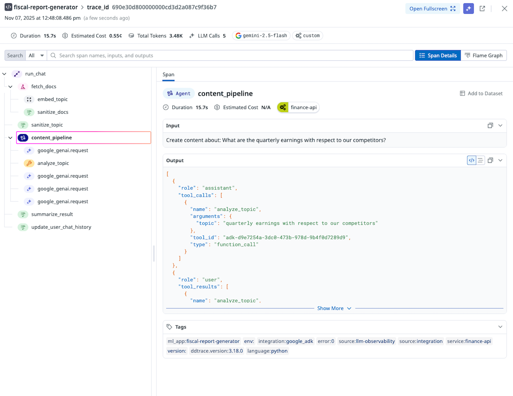

# ADK용 Datadog 관측 가능성

<div class="language-support-tag">
    <span class="lst-supported">ADK에서 지원</span><span class="lst-python">Python</span>
</div>

[Datadog LLM
Observability](https://www.datadoghq.com/product/llm-observability/)는 AI 엔지니어, 데이터 과학자, 애플리케이션 개발자가 LLM 애플리케이션을 빠르게 개발, 평가, 모니터링할 수 있도록 지원합니다. 구조화된 실험, AI 에이전트 전반의 엔드투엔드 트레이싱, 평가를 통해 출력 품질, 성능, 비용, 전반적인 리스크를 확실하게 개선할 수 있습니다.

## 개요

Datadog LLM Observability는 [Google ADK로 구축한 에이전트를 자동으로 계측하고 트레이싱](https://docs.datadoghq.com/llm_observability/instrumentation/auto_instrumentation?tab=python#google-adk)할 수 있으며, 다음 기능을 제공합니다:

- **에이전트 실행 및 상호작용 관찰** - 에이전트 내부의 모든 에이전트 실행, 도구 호출, 코드 실행을 자동으로 캡처합니다.
- **LLM 호출 및 응답 캡처** - 하위의 Google GenAI SDK를 통해 수행된 LLM 호출과 응답을 기록합니다.
- **문제 디버깅** - 오류율, 토큰 사용량과 비용, LLM 호출 및 도구 사용에 대한 별도 설정 없이 기본 제공되는 평가를 통해 문제를 디버깅합니다.

## 사전 요구사항

[Datadog 계정](https://www.datadoghq.com/)이 없다면 먼저 가입하고 [API 키를 발급](https://docs.datadoghq.com/account_management/api-app-keys/#api-keys)받으세요.

## 설치

필수 패키지를 설치합니다:

```bash
pip install ddtrace
```

## 설정

### ADK를 사용하여 애플리케이션 만들기

Google ADK를 사용하는 애플리케이션이 없다면 [ADK Getting Started Guide](https://google.github.io/adk-docs/get-started/)의 안내에 따라 샘플 ADK 에이전트를 생성하세요.

### 환경 변수 구성

다음 환경 변수에 ML 애플리케이션 이름을 지정해야 합니다. ML 애플리케이션은 특정 LLM 기반 애플리케이션과 연결된 LLM Observability 트레이스들의 그룹입니다. ML 애플리케이션 이름 지정 제한 사항에 대한 자세한 내용은 [ML Application Naming Guidelines](https://docs.datadoghq.com/llm_observability/instrumentation/sdk?tab=python#application-naming-guidelines)를 참고하세요.

```shell
export DD_API_KEY=<YOUR_DD_API_KEY>
export DD_SITE=<YOUR_DD_SITE>
export DD_LLMOBS_ENABLED=true
export DD_LLMOBS_ML_APP=<YOUR_ML_APP_NAME>
export DD_LLMOBS_AGENTLESS_ENABLED=true
export DD_APM_TRACING_ENABLED=false  # Only set this if you are not using Datadog APM
```

다음 `ddtrace-run` 명령어가 이 변수들을 읽을 수 있도록 에이전트의 `.env` 파일에 넣는 대신 애플리케이션 실행 전에 환경 변수로 직접 내보내야(`export`) 합니다.

### 애플리케이션 실행

환경 변수를 구성한 후 애플리케이션을 실행하면 LLM 기반 애플리케이션 모니터링을 시작할 수 있습니다.

```shell
ddtrace-run adk run my_agent
```

## 모니터링 확인

[Datadog LLM Observability Traces
View](https://app.datadoghq.com/llm/traces)로 이동하여 애플리케이션에서 생성된 트레이스를 확인하세요.



## 지원 및 리소스
- [Datadog LLM Observability](https://www.datadoghq.com/product/llm-observability/)
- [Datadog Support](https://docs.datadoghq.com/help/)
