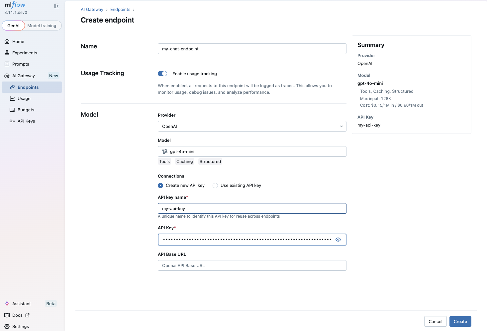

# ADK 에이전트용 MLflow AI Gateway

<div class="language-support-tag">
  <span class="lst-supported">ADK에서 지원</span><span class="lst-python">Python</span>
</div>

[MLflow AI Gateway](https://mlflow.org/docs/latest/genai/governance/ai-gateway/)는
MLflow 추적 서버에 내장된 데이터베이스 기반 LLM 프록시입니다(MLflow ≥ 3.0).
Gemini, Anthropic, Mistral, Bedrock, Ollama 등 수십 개의 공급자에 걸쳐 통합된 OpenAI 호환 API를 제공하며,
시크릿 관리, 폴백(fallback)/재시도, 트래픽 분할, 예산 추적 기능을 기본 지원하고
이 모든 기능을 MLflow UI에서 구성할 수 있습니다.

MLflow AI Gateway는 OpenAI 호환 엔드포인트를 외부에 공개하므로,
[LiteLLM](/agents/models/litellm/) 모델 커넥터를 사용하여 ADK 에이전트를 연결할 수 있습니다.

## 사용 사례

- **다중 공급자 라우팅**: 에이전트 코드 변경 없이 LLM 공급자 전환
- **시크릿 관리**: 공급자 API 키는 서버에 암호화되어 저장되며, 애플리케이션에서 공급자 키를 직접 전송하지 않음
- **폴백 및 재시도**: 장애 발생 시 백업 모델로 자동 장애 조치(failover)
- **예산 추적**: 엔드포인트별 또는 사용자별 토큰 예산 관리
- **트래픽 분할**: A/B 테스트를 위해 요청의 일정 비율을 서로 다른 모델로 라우팅
- **사용량 추적**: 모든 호출을 MLflow 트레이스로 자동 기록

## 사전 요구사항

- MLflow 버전 3.0 이상
- 실행 환경에 설치된 Google ADK 및 LiteLLM

## 설정

종속성을 설치합니다:

```bash
pip install mlflow[genai] google-adk litellm
```

MLflow 서버를 시작합니다:

```bash
mlflow server --host 127.0.0.1 --port 5000
```

MLflow UI는 `http://localhost:5000`에서 사용할 수 있습니다.

`http://localhost:5000`의 MLflow UI로 이동한 뒤 **AI Gateway → Create Endpoint**를 선택하여 게이트웨이 엔드포인트를 생성합니다.
공급자(예: Google Gemini)와 모델(예: `gemini-flash-latest`)을 선택하고
공급자 API 키를 입력하면 서버에 암호화되어 저장됩니다.



엔드포인트 구성에 대한 자세한 내용은 [MLflow AI Gateway 문서](https://mlflow.org/docs/latest/genai/governance/ai-gateway/endpoints/)를 참고하세요.

## 에이전트와 함께 사용

`api_base`가 MLflow Gateway 엔드포인트를 가리키도록 `LiteLlm` 래퍼를 사용합니다.
`model` 매개변수에는 `openai/` 접두사 뒤에 생성한 게이트웨이 엔드포인트 이름을 지정해야 합니다.

```python
from google.adk.agents import LlmAgent
from google.adk.models.lite_llm import LiteLlm

# Point to MLflow AI Gateway endpoint.
# "my-chat-endpoint" is the endpoint name you created in the MLflow UI.
agent = LlmAgent(
    model=LiteLlm(
        model="openai/my-chat-endpoint",
        api_base="http://localhost:5000/gateway/openai/v1",
        api_key="unused",  # provider keys are managed by the MLflow server
    ),
    name="gateway_agent",
    instruction="You are a helpful assistant powered by MLflow AI Gateway.",
)
```

언제든지 MLflow UI에서 게이트웨이 엔드포인트를 재구성하여 기반 LLM 공급자를 교체할 수 있으며,
ADK 에이전트 코드는 전혀 수정할 필요가 없습니다.

## 팁

- `api_key` 매개변수는 LiteLLM에서 필수이지만 게이트웨이에서는 검증하지 않습니다. 비어 있지 않은 임의의 문자열로 설정하세요.
- 프록시 뒤나 원격 호스트에서 실행할 때는 `localhost:5000`을 실제 서버 주소로 바꾸세요.
- ADK 에이전트의 엔드투엔드 관측 가능성을 확보하려면 [MLflow Tracing](/integrations/mlflow-tracing/)과 함께 사용하세요.

## 리소스

- [MLflow AI Gateway 문서](https://mlflow.org/docs/latest/genai/governance/ai-gateway/):
  엔드포인트 관리, 쿼리 API, 게이트웨이 기능을 다루는 MLflow AI Gateway 공식 문서입니다.
- [ADK용 MLflow Tracing](/integrations/mlflow-tracing/):
  MLflow Tracing을 사용하여 ADK 에이전트의 관측 가능성을 설정합니다.
- [LiteLLM 모델 커넥터](/agents/models/litellm/):
  ADK 에이전트를 호환 엔드포인트에 연결하는 데 사용되는 LiteLLM 래퍼 문서입니다.
