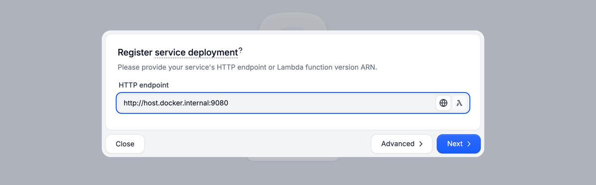
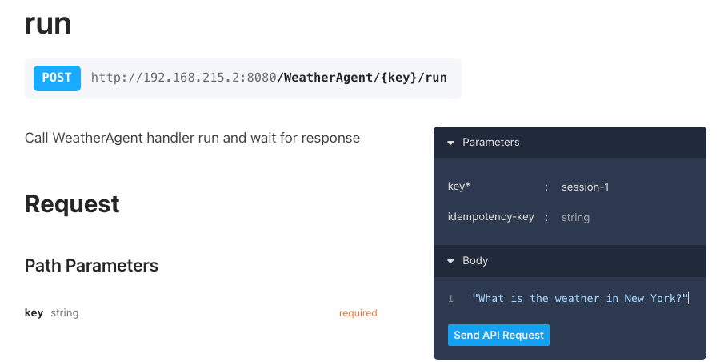
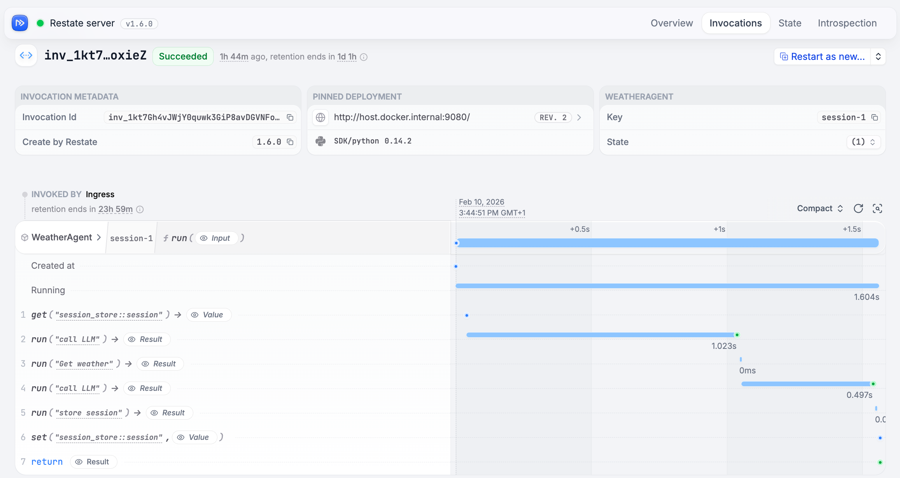

# ADK용 Restate 플러그인

<div class="language-support-tag">
  <span class="lst-supported">ADK에서 지원</span><span class="lst-python">Python</span>
</div>

[Restate](https://restate.dev)는 ADK 에이전트를 본질적으로 복원력 있고 견고한 시스템으로 만들어 주는 내구성 있는 실행(durable execution) 엔진입니다. 영구 세션, 사람의 승인을 위한 일시 중지 및 재개(pause/resume), 복원력 있는 멀티 에이전트 오케스트레이션, 안전한 버전 관리, 모든 실행에 대한 전반적인 관측성 및 제어 기능을 제공합니다. 모든 LLM 호출과 도구 실행이 저널(journal)에 기록되므로 장애가 발생하더라도 에이전트가 중단된 지점부터 정확히 복구됩니다.

## 사용 사례

Restate 플러그인은 에이전트에 다음 기능을 제공합니다:

- **내구성 있는 실행(Durable execution)**: 진행 상태를 잃지 않습니다. 에이전트가 비정상 종료되더라도 자동 재시도 및 복구를 통해 중단된 지점부터 정확히 이어서 실행됩니다.
- **휴먼인더루프(Human-in-the-loop) 일시 중지 및 재개**: 사람의 승인이 완료될 때까지 며칠 또는 몇 주 동안 실행을 일시 중지했다가 중단된 지점부터 다시 재개할 수 있습니다.
- **내구성 있는 상태(Durable state)**: 내장된 세션 관리 기능으로 재시작 후에도 에이전트 메모리와 대화 기록이 유지됩니다.
- **관측성 및 작업 제어**: 에이전트가 수행한 작업을 정확히 확인하고, 언제든 에이전트 실행을 강제 종료(kill), 일시 중지 또는 재개할 수 있습니다.
- **복원력 있는 멀티 에이전트 오케스트레이션**: 병렬 실행을 통해 여러 에이전트에 걸친 워크플로를 복원력 있게 운영할 수 있습니다.
- **안전한 버전 관리**: 불변 배포(immutable deployment)를 통해 진행 중인 실행을 중단시키지 않고 새 버전을 배포할 수 있습니다.

## 사전 준비 사항

- Python 3.12+
- [Gemini API 키](https://aistudio.google.com/app/api-keys)

아래 예제를 실행하려면 다음 도구도 필요합니다:

- [uv](https://docs.astral.sh/uv/) (Python 패키지 관리자)
- [Docker](https://docs.docker.com/get-docker/) (또는 Restate 서버용 [Brew/npm/바이너리](https://docs.restate.dev/develop/local_dev#running-restate-server--cli-locally))

## 설치

Python용 Restate SDK를 설치합니다:

```bash
pip install "restate-sdk[serde]"
```

## 에이전트와 함께 사용

다음 단계에 따라 내구성 있는 에이전트를 실행하고 Restate UI에서 실행 저널을 확인하세요:

1. **[restate-google-adk-example 저장소](https://github.com/restatedev/restate-google-adk-example)를 클론하고 예제 디렉터리로 이동**

    ```bash
    git clone https://github.com/restatedev/restate-google-adk-example.git
    cd restate-google-adk-example/examples/hello-world
    ```

2. **Gemini API 키 내보내기(export)**

    ```bash
    export GOOGLE_API_KEY=your-api-key
    ```

3. **날씨 에이전트 시작**

    ```bash
    uv run .
    ```

4. **다른 터미널에서 Restate 시작**

    ```bash
    docker run --name restate --rm -p 8080:8080 -p 9070:9070 -d \
      --add-host host.docker.internal:host-gateway \
      docker.restate.dev/restatedev/restate:latest
    ```

    다른 설치 방법: [Brew, npm, 바이너리 다운로드](https://docs.restate.dev/develop/local_dev#running-restate-server--cli-locally)

5. **에이전트 등록**

    `localhost:9070`에서 Restate UI를 열고 에이전트 배포(deployment)를 등록합니다(예: `http://host.docker.internal:9080`):

    

    !!! tip "안전한 버전 관리"

        Restate는 각 배포를 불변 스냅샷(immutable snapshot)으로 등록합니다. 새 버전을 배포하면 진행 중인 실행은 기존 배포에서 완료되고, 새 요청은 최신 버전으로 라우팅됩니다. 자세한 내용은 [버전 인식 라우팅(version-aware routing)](https://docs.restate.dev/services/versioning)을 참고하세요.

6. **에이전트에 요청 전송**

    Restate UI에서 **WeatherAgent**를 선택하고 **Playground**를 열어 요청을 전송합니다:

    

    !!! tip "내구성 있는 세션과 재시도"

        이 요청은 Restate를 거치며 에이전트로 전달되기 전에 영구 저장됩니다. 각 세션(여기서는 `session-1`)은 격리되며 상태를 유지하고 내구성이 보장됩니다. 실행 도중 에이전트가 비정상 종료되면 Restate가 자동으로 재시도하여 진행 상태를 잃지 않고 마지막으로 저널에 기록된 단계부터 재개합니다.

7. **실행 저널 점검**

    **Invocations** 탭을 클릭한 뒤 호출(invocation)을 선택하면 실행 저널을 볼 수 있습니다:

    

    !!! tip "에이전트 실행 전체 제어"

        모든 LLM 호출과 도구 실행이 저널에 기록됩니다. UI에서 실행을 일시 중지하거나 재개하고, 임의의 중간 단계부터 다시 시작하거나 강제 종료할 수 있습니다. **State** 탭에서 에이전트의 현재 세션 데이터를 확인하세요.

## 기능

Restate 플러그인은 ADK 에이전트에 다음 기능을 제공합니다:

| 기능 | 설명 |
| --- | --- |
| 내구성 있는 도구 실행 | `restate_object_context().run_typed()`로 도구 로직을 감싸 자동 재시도 및 복구 지원 |
| 휴먼인더루프(Human-in-the-loop) | 외부 신호(예: 사람의 승인)가 올 때까지 `restate_object_context().awakeable()`로 실행 일시 중지 |
| 영구 세션 | `RestateSessionService()`가 에이전트 메모리와 대화 상태를 영구적으로 안전하게 저장 |
| 내구성 있는 LLM 호출 | `RestatePlugin()`이 LLM 호출을 저널에 기록하고 자동 재시도 수행 |
| 멀티 에이전트 통신 | `restate_object_context().service_call()`로 내구성이 보장되는 에이전트 간 HTTP 호출 지원 |
| 병렬 실행 | 결정론적 복구를 위해 `restate.gather()`로 도구와 에이전트를 동시에 실행 |

## 추가 리소스

- [Restate ADK 예제 저장소](https://github.com/restatedev/restate-google-adk-example) - 사람의 승인이 포함된 청구 처리(claims processing) 등 실행 가능한 예제
- [Restate ADK 튜토리얼](https://docs.restate.dev/tour/google-adk) - Restate와 ADK를 활용한 에이전트 개발 실습 가이드
- [Restate AI 공식 문서](https://docs.restate.dev/ai) - 내구성 있는 AI 에이전트 패턴 전체 레퍼런스
- [PyPI의 Restate SDK](https://pypi.org/project/restate-sdk/) - Python 패키지
