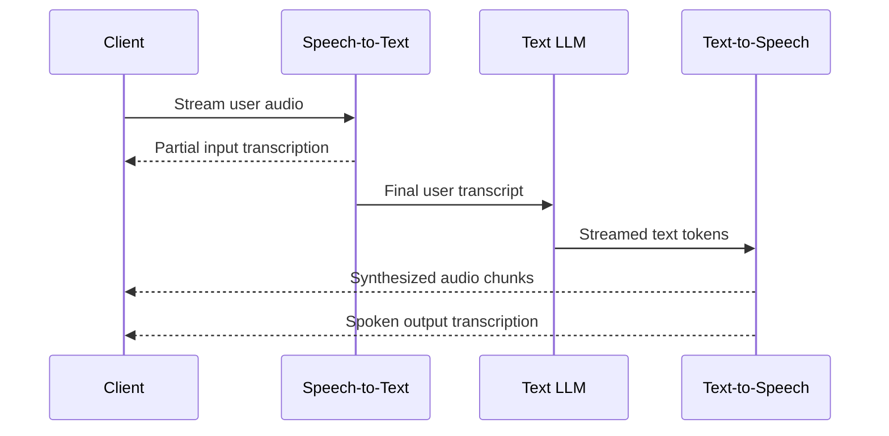

# 캐스케이드(Cascaded) 아키텍처

<div class="language-support-tag">
    <span class="lst-supported">ADK에서 지원</span><span class="lst-python">Python v2.13.0</span><span class="lst-preview">실험적 기능</span>
</div>

캐스케이드 아키텍처에서 `CascadeLive`는 스트리밍 음성-텍스트 변환(STT), 텍스트 추론 LLM, 스트리밍 텍스트-음성 변환(TTS)을 순차적으로 연결합니다. 오디오는 세 단계를 차례로 거칩니다: 음성 인식이 사용자 오디오를 텍스트로 전사하고, LLM이 텍스트를 기반으로 추론하여 도구를 호출하며, 음성 합성이 스트리밍된 텍스트 응답을 오디오로 변환합니다.

에이전트의 `model` 매개변수에 `CascadeLive`를 구성하므로, 기존의 [`Runner.run_live()`](../sessions.md#the-run_live-loop) 루프, 요청 큐, 도구, 콜백 및 워크플로우는 변경 없이 그대로 유지됩니다. 또한 동일한 에이전트를 텍스트 전용 요청을 위한 `Runner.run_async()`에서도 사용할 수 있으며, 이 경우 음성 단계를 건너뛰고 내부 텍스트 모델을 직접 호출합니다.

네이티브 음성 대 음성(speech-to-speech) 모델과의 비교는 [음성 아키텍처 선택](index.md)을 참조하세요.

## 캐스케이드 에이전트 구성 { #configure-a-cascaded-agent }

텍스트 LLM, 음성-텍스트 변환(STT) 제공업체, 텍스트-음성 변환(TTS) 제공업체와 함께 `CascadeLive` 인스턴스를 `Agent`에 전달합니다:

=== "Gemini"

    `google.adk.live`의 `GeminiSTT` 및 `GeminiTTS`는 기존 Google 사용자 인증 정보를 사용하며 추가 패키지가 필요하지 않습니다.

    ```python
    from google.adk.agents import Agent
    from google.adk.live import CascadeLive, GeminiSTT, GeminiTTS
    from google.genai import types

    root_agent = Agent(
        name="voice_assistant",
        model=CascadeLive(
            model="gemini-3.8-flash",
            stt=GeminiSTT(),
            tts=GeminiTTS(speech_config="Kore"),
        ),
        instruction=(
            "You are a voice assistant. Keep answers to one or two short "
            "sentences and end every sentence with punctuation. Write numbers, "
            "symbols, and abbreviations as spoken words."
        ),
        tools=[...],
        generate_content_config=types.GenerateContentConfig(
            thinking_config=types.ThinkingConfig(
                thinking_level=types.ThinkingLevel.LOW
            ),
        ),
    )
    ```

=== "ElevenLabs"

    ElevenLabs 추가 패키지(`pip install "google-adk[elevenlabs]"`)를 설치하고 환경에 `ELEVENLABS_API_KEY`를 설정합니다.

    ```python
    from google.adk.agents import Agent
    from google.adk.integrations.eleven_labs import ElevenLabsSTT, ElevenLabsTTS
    from google.adk.live import CascadeLive
    from google.genai import types

    root_agent = Agent(
        name="voice_assistant",
        model=CascadeLive(
            model="gemini-3.8-flash",
            stt=ElevenLabsSTT(),
            tts=ElevenLabsTTS(),
        ),
        instruction=(
            "You are a voice assistant. Keep answers to one or two short "
            "sentences and end every sentence with punctuation. Write numbers, "
            "symbols, and abbreviations as spoken words."
        ),
        tools=[...],
        generate_content_config=types.GenerateContentConfig(
            thinking_config=types.ThinkingConfig(
                thinking_level=types.ThinkingLevel.LOW
            ),
        ),
    )
    ```

에이전트의 두 가지 설정이 음성 지연 시간과 합성 품질에 직접적인 영향을 미칩니다:

- **모델 사고(Thinking) 최소화**: 모델 사고는 첫 번째 응답 토큰이 방출되기 전에 실행되므로 첫 오디오 출력까지의 시간(time-to-first-audio)에 직접 더해집니다. `generate_content_config`에서 낮은 사고 수준(또는 토큰 예산을 사용하는 모델의 경우 사고 예산 0)을 설정하세요.
- **문장 부호 사용 및 약어 금지 프롬프트 작성**: 내장 TTS 제공업체는 LLM이 전체 응답을 마칠 때까지 기다리지 않고 첫 번째 문장부터 바로 재생할 수 있도록 문장 경계에서 텍스트를 분할합니다. 첫 문장에 `Dr. Smith`와 같은 약어가 있으면 조기 분할이 발생할 수 있으며, 문장 부호가 없는 출력은 재생이 시작되기 전까지 더 오래 버퍼링됩니다.

`adk web`으로 에이전트를 실행하거나 [`Runner.run_live()`](../sessions.md#the-run_live-loop)로 구동하세요. Gemini와 ElevenLabs 음성 제공업체를 모두 사용하는 실행 가능한 전체 예제는 [`cascade` 샘플](https://github.com/google/adk-python/tree/main/contributing/samples/live/cascade)에서 확인할 수 있습니다.

## 작동 방식



### 캡션 및 턴 감지

- **실시간 캡션은 추가(append)가 아닌 교체(replace) 방식으로 동작**: 사용자가 말하는 동안 중간 전사 결과가 `event.input_transcription`으로 도착합니다. 증분 단어 조각을 스트리밍하는 네이티브 오디오 모델과 달리, 캐스케이드 모드의 각 중간 업데이트에는 현재까지의 전체 발화 가설이 담겨 있으므로 클라이언트는 표시된 캡션에 텍스트를 이어 붙이는 대신 교체해야 합니다.
- **커스텀 어휘 및 클라이언트 제어 VAD**: 서버 음성 활동 감지(VAD)가 기본적으로 활성화되어 있습니다. `GeminiSTT`에서 도메인 어휘를 제공하거나 클라이언트에서 턴 경계를 제어(예: 푸시투톡)하려면 `audio_transcription_config`를 전달하거나 자동 활동 감지를 비활성화하고 [`send_activity_start()` 및 `send_activity_end()`](../sessions.md#liverequestqueue)를 호출하세요:

```python
from google.adk.live import GeminiSTT
from google.genai import types

stt = GeminiSTT(
    audio_transcription_config=types.AudioTranscriptionConfig(
        language_codes=["en-US"],
        custom_vocabulary=["Cymbal Direct", "Altostrat"],
    ),
    activity_detection=types.AutomaticActivityDetection(disabled=True),
)
```

### 끼어들기(Barge-in) 시 사용자가 실제로 들은 내용까지만 기록 유지

TTS 제공업체는 실시간 재생보다 빠르게 다음 문장을 합성하므로, 사용자가 응답 도중에 끼어들면 클라이언트 버퍼에는 사용자가 아직 듣지 못한 오디오가 남아 있는 경우가 많습니다.

인터럽션(끼어들기)이 발생하면 `CascadeLive`는 합성과 LLM 생성을 중단하고, 클라이언트가 재생을 멈추도록 인터럽트 이벤트를 방출하며, 클라이언트에서 실제로 재생된 오디오의 양을 추정합니다. 사용자가 실제로 들은 단어만 세션 기록과 최종 `output_transcription`에 저장되므로, 이후 턴에서 아직 말하지 않은 텍스트를 참조하는 일이 발생하지 않습니다.

## 커스텀 음성 변환 { #custom-speech-transforms }

다른 음성 제공업체를 통합하거나 단계 사이에서 텍스트를 검사하려면 `google.adk.live`의 `LiveIngress`(음성-텍스트 변환용) 또는 `LiveEgress`(텍스트-음성 변환용)를 서브클래싱하세요:

- `LiveIngress`는 들어오는 오디오 스트림을 읽고 발화 시작, 부분 전사, 턴 완료 이벤트(`UserSpeechStarted`, `PartialTranscript`, `UserTurnFinished`)를 생성(yield)합니다.
- `LiveEgress`는 스트리밍된 LLM 텍스트 델타를 읽고 완료되거나 취소될 때까지 합성된 오디오 청크와 발화된 출력 트랜스크립트 이벤트(`AudioChunk`, `AgentSpokenOutput`)를 생성(yield)합니다.

합성 전의 LLM 출력은 일반 텍스트이므로, 임의의 `LiveEgress`를 래핑하여 단 하나의 오디오 프레임이 생성되기 전에 텍스트를 마스킹(redact)하거나 변환할 수 있습니다:

```python
import asyncio
from typing import AsyncGenerator, AsyncIterator
from google.adk.live import EgressEvent, LiveEgress


class RedactingTTS(LiveEgress):
    """Redacts sensitive patterns from streamed LLM text before synthesis."""

    def __init__(self, inner_tts: LiveEgress, redact_fn):
        self._tts = inner_tts
        self._redact = redact_fn

    async def __call__(
        self, text: AsyncIterator[str], *, cancel: asyncio.Event
    ) -> AsyncGenerator[EgressEvent, None]:
        async def sanitized_text() -> AsyncGenerator[str, None]:
            async for delta in text:
                yield self._redact(delta)

        async for event in self._tts(sanitized_text(), cancel=cancel):
            yield event
```

## 고려 사항 및 제한 사항

- **침묵 기반 턴 감지**: 서버 VAD는 일정 임계값 이상의 침묵이 지속되면 사용자 턴을 종료하므로, 문장 중간에 긴 멈춤이 있으면 하나의 발화가 두 개의 턴으로 나뉠 수 있습니다. STT 제공업체에서 침묵 임계값을 조정하거나 클라이언트 제어 활동 신호를 사용하세요.
- **동기식 도구 실행 중 발화 자제**: 동기식 도구 호출이 아직 실행 중일 때 사용자가 발화를 마치면 새로운 사용자 턴이 도구 호출과 그 응답 사이에 위치하게 되어, 해당 세션의 후속 모델 요청이 실패할 수 있습니다.
- **클라이언트 에코 제거**: 스피커 출력이 마이크로 다시 들어가 잘못된 사용자 끼어들기(interruption)로 인식되지 않도록 브라우저 또는 하드웨어 음향 에코 제거(AEC)나 헤드폰을 사용하세요.
