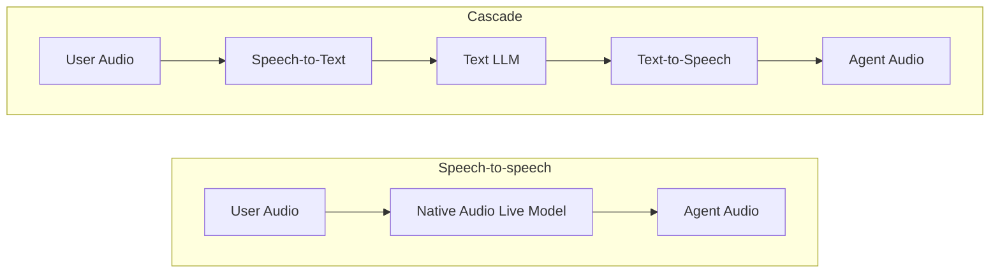

# 음성 아키텍처 선택

<div class="language-support-tag">
    <span class="lst-supported">ADK에서 지원</span><span class="lst-python">Python v2.13.0</span><span class="lst-java">Java v0.2.0</span>
</div>

ADK는 `Runner.run_live()` 아래에서 두 가지 음성 아키텍처를 지원합니다:

- **[음성 대 음성 (Speech-to-speech)](speech-to-speech.md)**: 단일 네이티브 오디오 모델이 Gemini Live API를 통해 음성 입력, 추론, 음성 출력을 엔드투엔드로 처리합니다. 가장 짧은 지연 시간, 음성의 감정 표현, 또는 실시간 비디오 입력이 가장 중요할 때 적합합니다.
- **[캐스케이드 (Cascade)](cascade.md)**: 음성-텍스트 변환(STT), 임의의 텍스트 추론 LLM, 텍스트-음성 변환(TTS)을 순차적으로 연결합니다. 최첨단 텍스트 추론, 모듈식 음성 제공업체, 또는 음성 합성 전 텍스트 가드레일이 가장 중요할 때 적합합니다.

두 아키텍처 모두 동일한 ADK 런타임을 사용합니다. 세션 루프, 요청 큐, 이벤트 스트림, 도구, 콜백, 워크플로우는 동일하게 유지되며, 아키텍처를 전환할 때 에이전트의 `model`만 변경하면 됩니다:

=== "Speech-to-speech"

    ```python
    from google.adk.agents import Agent

    root_agent = Agent(
        name="voice_assistant",
        model="gemini-live-2.5-flash-native-audio",
        instruction="You are a helpful voice assistant.",
        tools=[...],
    )
    ```

=== "Cascade"

    ```python
    from google.adk.agents import Agent
    from google.adk.live import CascadeLive, GeminiSTT, GeminiTTS

    root_agent = Agent(
        name="voice_assistant",
        model=CascadeLive(
            model="gemini-3.8-flash",
            stt=GeminiSTT(),
            tts=GeminiTTS(speech_config="Kore"),
        ),
        instruction="You are a helpful voice assistant.",
        tools=[...],
    )
    ```

## 아키텍처 비교



| 항목 | Speech-to-speech | Cascade |
| :--- | :--- | :--- |
| **엔드투엔드 지연 시간** | 가장 낮음 (단일 모델 패스) | 보통 (스트리밍 및 문장 프리페칭을 통해 직렬 단계가 중첩됨) |
| **추론 모델** | 네이티브 오디오 Live 모델만 가능 ([지원되는 모델](../models.md)) | 모든 텍스트 LLM (Gemini Flash, Gemini Pro 또는 서드파티 모델) |
| **음성 제공업체** | 내장 Gemini Live 음성 | 모듈식 (Gemini, ElevenLabs 또는 커스텀 STT/TTS 제공업체) |
| **음성 뉘앙스** | 어조와 감정을 직접 인식; 네이티브 운율(prosody) | STT가 음성을 텍스트로 변환; TTS가 문장 단위로 합성 |
| **비디오 입력** | 지원됨 (실시간 카메라 및 화면 프레임) | 지원되지 않음 (오디오 및 텍스트만 가능) |
| **텍스트 가드레일** | 오디오 생성과 함께 트랜스크립션을 검사 | 단계 간 완전한 텍스트 경계; 합성 전에 텍스트를 검사하거나 수정 가능 |
| **텍스트 전용 실행 (`run_async`)** | 지원되지 않음 | 지원됨 (내부 텍스트 LLM을 직접 사용) |
| **SDK 지원** | Python, Java | Python (실험적 기능) |
